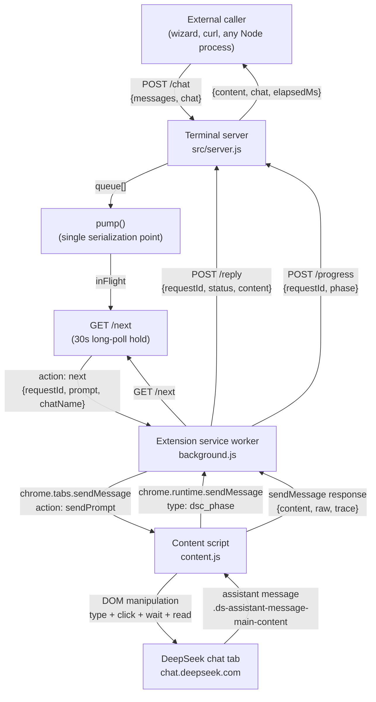
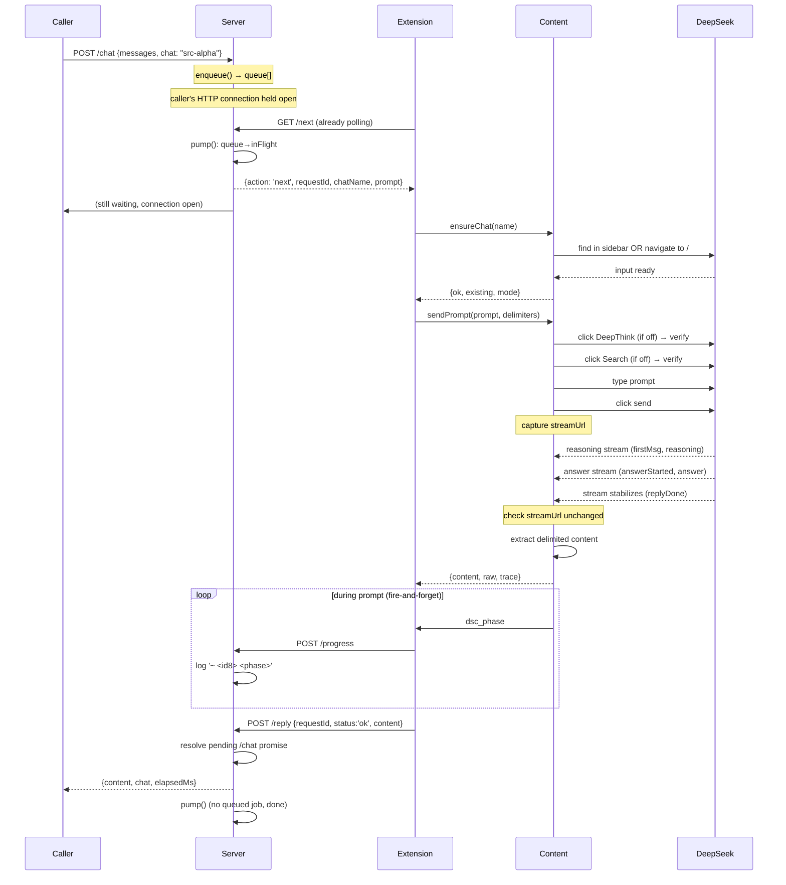

# Architecture

How the pieces fit together and why. Read this before touching code — the module boundaries and the constraints below are load-bearing, not stylistic. If you find yourself thinking "this looks over-complicated, let me simplify it," the section that explains why it's not is probably below.

Companion docs: [protocol.md](protocol.md) specifies the wire contract that follows from these decisions; [selector-maintenance.md](selector-maintenance.md) is the recovery playbook when the DeepSeek DOM changes; the [ADR folder](adr/) records each decision atomically. This doc is the cohesive narrative that ties them together.

**Contents**
- [System overview](#system-overview)
- [Lifecycle of one prompt](#lifecycle-of-one-prompt)
- [Module boundaries](#module-boundaries)
- [The seven load-bearing decisions](#the-seven-load-bearing-decisions)
  - [1. Long-poll over WebSockets](#1-long-poll-over-websockets)
  - [2. Real Chrome over Puppeteer](#2-real-chrome-over-puppeteer)
  - [3. One chat per source](#3-one-chat-per-source)
  - [4. Sticky work tab over targetTabId](#4-sticky-work-tab-over-targettabid)
  - [5. URL navigation over new-chat button](#5-url-navigation-over-new-chat-button)
  - [6. Answer-block extraction over whole-message](#6-answer-block-extraction-over-whole-message)
  - [7. Structural sidebar walk over class names](#7-structural-sidebar-walk-over-class-names)
- [The two streaming guards](#the-two-streaming-guards)
- [What the extension does not do](#what-the-extension-does-not-do)
- [Data flow between modules](#data-flow-between-modules)

---

## System overview

Four participants, three transport boundaries, one job: turn a prompt into a DeepSeek reply that the caller can consume as JSON.



Three properties the diagram makes obvious:

**1. Every prompt follows the same path.** There is no "fast path," no "reuse the last prompt," no per-source shortcut. Every `/chat` becomes a queue entry, every queue entry dispatches to `/next` exactly once, every content script round-trip ends with a `/reply`. This is what makes the queue serialization guarantee (`inFlight.size <= 1`) structural rather than cooperative — there's nowhere else to go.

**2. The extension is a client, not a server.** The extension never accepts HTTP connections. It polls. This is not a limitation — it's the only way to make Manifest V3 work at all, since a service worker can't bind a listening socket. Everything follows from that constraint: long-poll not WebSocket (see [decision 1](#1-long-poll-over-websockets)), stateless routing not session state, and the whole reason the wizard *runs* the server instead of the extension.

**3. The caller blocks on the whole round-trip.** A `POST /chat` call doesn't return "queued, poll for status" — it returns the content or the error. This is deliberate: batch wizards are per-source iterative, so the caller has nothing to do while waiting for source N's reply except wait for source N's reply. A two-round-trip API would add stateful polling for no benefit.

## Lifecycle of one prompt

The sequence view of the same flow, with timing annotations. Everything below the caller is inside the "one `POST /chat` call" bracket.



Six things worth naming from the sequence:

**`ensureChat` runs per source, before `sendPrompt`.** This is the retry-reuse mechanism. On the first attempt for `src-alpha`, `ensureChat` navigates to `/` for a fresh chat and DeepSeek auto-names it from the first message. On retry, `ensureChat` finds the existing chat via sidebar fuzzy match and clicks it. The LLM sees its own prior attempt in context. See [decision 3](#3-one-chat-per-source).

**DeepThink and Search are verified before the prompt is typed, not after.** If they can't be enabled, the request fails with `deepthink_enable_failed` or `search_enable_failed` — the prompt is never sent with them off. This is the only hard requirement that's enforced structurally rather than by convention. See [the aggregator's spec](../README.md#what-this-is) for why these must be on.

**`streamUrl` is captured at `firstMsg`, checked at `replyDone`.** The tab can navigate mid-stream — the user clicking around, DeepSeek auto-redirecting, the wizard's own nav. If the URL changed, the read is discarded as `user_navigated`. Without this guard, the completion detector locks onto whatever assistant message is on whatever page happens to be showing. See [the two streaming guards](#the-two-streaming-guards).

**Progress fires in the background, in parallel with the main loop.** `dsc_phase` messages don't block `sendPrompt`. They're forwarded by a separate `chrome.runtime.onMessage` listener in background.js. If the server is slow or the `/progress` endpoint is missing, the prompt still completes normally — the progress stream is entirely best-effort. See [decision 6's corollary](#the-two-streaming-guards) for why this matters.

**`/reply` resolves the caller's promise; `pump()` advances the queue.** These are two separate operations inside the same HTTP handler. Resolve happens first, so the caller gets its content even if the next `pump()` throws. This is deliberate — a caller whose `/chat` succeeded shouldn't see a 500 because the *next* job's enqueue went wrong.

**The caller's connection stays open the entire time.** No heartbeats, no keep-alive trickery, no chunked encoding. It's a plain HTTP request that doesn't return for 4-12 seconds (typical) or 90 seconds (timeout). Node's `http.createServer` handles this fine, but a reverse proxy in front of it wouldn't. That's why [protocol.md#constraints](protocol.md#constraints) says "loopback only" — the architecture assumes no intermediary.

## Module boundaries

Six files in the extension, two in the server package, one shared. Every module has a rule about what it can import and what it owns. Bypassing a rule breaks a guarantee.

```
deepseek-connect/
├── shared.js           constants, DSC.ERR, DSC.MSG, DSC.VERSION
├── selectors.js        tiered selector resolution, DSC_SELECTORS global
├── content.js          DOM manipulation (the only file with querySelector)
├── background.js       poll loop, message router, sticky tab (the only file with chrome.tabs)
├── popup.html          status UI
├── popup.js            config + status (reads chrome.storage.local)
├── manifest.json       permissions, content_scripts, service_worker
└── src/
    ├── server.js       HTTP server (the only file with require('node:http'))
    ├── client.js       HTTP client (the only file callers require)
    └── errors.js       taxonomy (the only file both server and client import)
```

### `shared.js` — the constant surface

Loaded by `background.js` via `importScripts('shared.js')` and by `content.js` as a content-script dependency. Both contexts get `globalThis.DSC`.

The rule: **no logic, no DOM, no chrome APIs.** It's a constants file with a self-executing wrapper (`(function () { ... })()`) so it doesn't pollute the global scope with anything except `DSC`. Every constant that both background and content need lives here. Every constant that only one side needs lives in that side's file.

**`DSC.ERR` is a mirror of `src/errors.js`'s `CODES`**, not the source of truth. The duplication is a Manifest V3 consequence — `shared.js` is a classic script (no `import`), and content scripts can't `require()` the Node module. The duplication is checked by a test that asserts the two maps agree (see [error-codes.md#adding-a-new-code](error-codes.md#adding-a-new-code)). There's one stale entry today (`DEEPTHINK_OFF`) that isn't in `CODES` — tracked as a cleanup, not a bug.

### `selectors.js` — the DOM contract

Loaded after `shared.js` and before `content.js`. Exposes `globalThis.DSC_SELECTORS` with `resolve(name)` and `probeDom()`.

The rule: **the only file with selector strings.** Every `querySelector` in `content.js` for a stable DeepSeek element goes through `DSC_SELECTORS.resolve(name)`, which tries a tiered fallback list. If `content.js` has a raw selector string, it's a bug — that string belongs in `selectors.js` where the next DOM change can update it in one place.

The tiers are ordered by fragility: text-content match first (most stable), structural walk second (stable but slower), `aria-` attributes third (usually stable), build-hashed class names never. See [decision 7](#7-structural-sidebar-walk-over-class-names) for the reasoning, and [selector-maintenance.md](selector-maintenance.md) for the per-selector table.

### `content.js` — the DOM owner

The meat. ~900 lines. Everything that touches the DeepSeek page lives here.

The rule: **content.js owns the DOM; nothing else does.** Background doesn't query the DOM (no `chrome.scripting.executeScript` for reads — only for re-injection on crash). Server doesn't know DOM exists. Selectors.js defines what to look for; content.js is the only file that looks.

The five phases inside `sendPrompt` are the load-bearing structure:

1. **probe** — resolve every required selector; fail `dom_drift` if any missing
2. **ensureChat** (called by background, not sendPrompt) — sidebar match or fresh nav
3. **toggle checks** — DeepThink and Search verified on; fail `deepthink_enable_failed` / `search_enable_failed` if not
4. **type and send** — set input value, click send
5. **stream and extract** — wait loop, capture `streamUrl`, extract on completion

A sixth concern — `dsc_phase` progress messages — runs concurrently via `chrome.runtime.sendMessage`. Content emits; background forwards to `/progress`; the main sendPrompt loop doesn't care.

### `background.js` — the router

~400 lines. The service worker. Everything that talks to `chrome.tabs`, `chrome.storage`, and `fetch` lives here.

The rule: **background owns tab lifecycle, not tab content.** It picks the work tab (and pins it), navigates it, re-injects content scripts when they crash, and forwards messages to and from the content script. It never reads the DOM directly. If it needs to know something about the page, it asks `content.js` via `sendToTab` and gets a structured response.

The `getWorkTab()` function is the load-bearing piece. It reads `chrome.storage.local.workTabId` first (sticky), falls back to picking a fresh tab if the stored ID is stale (tab closed, URL changed to non-DeepSeek, browser restarted), and hard-fails if a caller-supplied `targetTabId` doesn't exist (no silent fallback to a different tab — see [decision 4](#4-sticky-work-tab-over-targettabid)).

The `dsc_phase` listener is the second load-bearing piece. It's a separate `chrome.runtime.onMessage.addListener` that fires `fetch(/progress)` on every phase message from content. It runs in parallel with the main `handleNext` loop and doesn't block. This is what makes the live progress stream work without slowing the prompt down.

### `src/server.js` — the queue

~500 lines. The HTTP server. Everything that binds a socket, reads a request, writes a response lives here.

The rule: **server.js owns the queue, not the request semantics.** It doesn't know what a "prompt" is (it has a `prompt` field but treats it as opaque text). It doesn't know what "delimiters" are (again, opaque). It knows how to enqueue an entry, how to dispatch it via `/next`, how to resolve it via `/reply`, how to hold a long-poll for 30s, and how to fail cleanly on shutdown. The semantics of the fields belong to `content.js` and `background.js`.

The three collections — `queue[]`, `waiting[]`, `inFlight` Map — are the entire state. `pump()` is the only place jobs move between them. `enqueue()` is the only place jobs enter `queue[]`. `/reply` is the only place jobs exit `inFlight`. See [protocol.md#queue-state-machine](protocol.md#queue-state-machine) for the state diagram and the "extension dies mid-flight" hole (which is real and documented as a v0.1 limitation).

### `src/client.js` — the caller's interface

~150 lines. Zero-dependency HTTP client.

The rule: **client.js doesn't retry.** Every method throws `DSCError` on non-2xx and returns the parsed body on 2xx. The caller's retry policy (see [integration-guide.md#sendwithretry](integration-guide.md#sendwithretry)) lives in the caller, not here. A client that retried silently would hide rate-limit conditions and make the caller's attempt-counting wrong.

### `src/errors.js` — the shared taxonomy

~180 lines. `CODES`, `META`, `DSCError` class, four helpers. Imported by both `src/server.js` and `src/client.js`, and mirrored (not imported) in `shared.js`.

The rule: **errors.js is the single source of truth for codes.** A code that isn't in `CODES` isn't a code. A code that's in `CODES` has metadata in `META` (verified at module load). The `DSCError` class is what `client.js` throws and what `server.js` serializes to HTTP. See [error-codes.md](error-codes.md) for the full table.

## The seven load-bearing decisions

Each decision below shapes multiple modules. Reversing any of them requires understanding the failure mode it prevents, and the ADR that pins it. If you're about to propose "let's simplify this by doing X instead," find the decision X would violate and read its rationale first.

### 1. Long-poll over WebSockets

**Decision:** The extension polls `GET /next` with a 30-second hold, re-polling immediately on `idle`. No WebSocket.

**Context:** The extension needs to learn "there's a job for you" the moment the server has one. Two options: (a) the server pushes over a persistent connection (WebSocket or SSE), (b) the extension polls with a hold.

**Alternative considered:** WebSocket. Rejected for four reasons:

1. **Service worker lifecycle.** MV3 service workers can be killed at any moment after ~30 seconds of inactivity. A WebSocket connection's `close` event fires when the worker dies, but reopening requires re-establishing the handshake, re-authenticating, and re-registering with the server. That's ~50 lines of reconnect logic to write and test.
2. **Debug surface.** A long-poll failure produces a `curl` command. A WebSocket failure produces a browser DevTools network tab entry with a binary protocol frame that's hard to inspect. When the batch wizard hangs at 2 AM, you want `curl`.
3. **Strict alternation.** The flow is `/next` → extension works → `/reply` → `/next` → extension works → `/reply`. There's never a moment where the server needs to push a second message before the first completes. A polling model with a hold is functionally identical to a push model for this workflow.
4. **No libraries.** Node's `http` module and the browser's `fetch` API both handle long-poll natively. WebSockets need `ws` on the Node side (a dependency) and careful frame parsing on both sides.

**Consequence:** The `waiting[]` array in `src/server.js` and the `LONG_POLL_MS = 30000` constant. The extension's `pollLoop` calls `GET /next`, handles the `next` action or the `idle` timeout, and immediately re-polls. The 30s hold is the compromise between "too chatty" (10s hold → 3x the requests) and "too slow to first job" (60s hold → a fresh job waits up to a minute for the poll to return). See [ADR 0001](adr/0001-use-long-poll-over-websocket.md).

### 2. Real Chrome over Puppeteer

**Decision:** Drive the user's already-logged-in Chrome/Brave tab via a load-unpacked extension. No Puppeteer, no headless browser, no scripted login.

**Context:** The goal is to use DeepSeek as a free LLM endpoint from a batch wizard. The two ways to automate a web page are: (a) drive a fresh browser instance from a script (Puppeteer / Playwright), (b) inject into an existing browser tab (extension).

**Alternative considered:** Puppeteer with `puppeteer-extra-plugin-stealth`. This is what the aggregator currently uses for its *scrapers* — but DeepSeek's anti-automation is more aggressive than typical sites. Three failure modes pushed us off Puppeteer:

1. **Headless fingerprinting.** DeepSeek rate-limits headless sessions aggressively. Even with stealth plugins, the fingerprint — canvas, WebGL renderer, audio context, plugin list — is detectable on a fresh profile. The rate limits go from "one prompt per 5 seconds" to "one prompt per 10 minutes" or "account banned."
2. **Credential handling.** A Puppeteer-driven session starts with an empty profile. To use the user's actual DeepSeek account, we'd need to script the login flow — email, password, possibly 2FA — which means storing credentials somewhere the extension doesn't. That's a security regression with no compensating benefit.
3. **Session continuity.** Cookies from the extension-driven tab persist across runs because they're the same Chrome profile. A Puppeteer session that closes loses them (unless you persist the profile directory, which is another complication).

**Consequence:** The whole architecture. The wizard *runs* the server; the user *loads* the extension; the extension *talks* to the server. Credentials never leave the user's Chrome profile. DeepSeek sees a real browser with real cookies making real requests. The cost is that the user must install the extension (one-time) and keep a DeepSeek tab open (per-batch). That cost is small compared to Puppeteer's rate-limit ceiling and login fragility. See [ADR 0002](adr/0002-real-chrome-over-puppeteer.md).

### 3. One chat per source

**Decision:** Each source gets its own DeepSeek chat. The chat name matches the source name. On retry, the same chat is reopened so the LLM sees its prior attempt in context.

**Context:** DeepSeek's chat is stateful — the LLM sees every prior turn in the current conversation. For a batch wizard, this matters: if source A's extractor fails verification and the wizard refines the prompt, the refined prompt should land in the *same* chat so the LLM can see "here's what I tried last time, here's why it failed, now fix it."

**Alternative considered:** One chat for the whole batch, prepend every prompt with a "the previous source was X, the current source is Y" disambiguation header. Rejected for two reasons:

1. **Context window fills up.** A 76-source batch would need 76 rounds of exchange in one chat. DeepSeek's context window is large but not infinite, and even if it fits, the LLM's attention degrades on long contexts. The 60th source's prompt gets worse quality than the 1st's.
2. **Cross-contamination.** The LLM sees the previous source's extractor code and, when asked for the new source's extractor, sometimes copies patterns from the previous site's DOM structure. This produces extractors that reference selectors that don't exist on the new site — silent bugs that pass verification by coincidence.

**Consequence:** The `ensureChat` phase, the `/open` route, the sticky `chatName` field threaded through `/chat`, `/next`, `/reply`. The naming convention: `chatName` = source name. DeepSeek auto-names the chat from the first message, and the batch prompt's first line embeds the source name, so the auto-generated title contains it. On retry, the sidebar fuzzy match (`findChatInSidebar`) finds the chat by name. See [decision 7](#7-structural-sidebar-walk-over-class-names) for how the sidebar match actually works, and [ADR 0003](adr/0003-one-chat-per-source.md) for the alternatives considered (renaming via three-dot menu, URL-based lookup).

**Sub-consequence: rename is deferred.** DeepSeek's three-dot menu rename flow is fragile (menu trigger, rename menu item, rename input, submit — four selectors, each breakable). For v0.1 we rely on auto-naming instead. The auto-name is deterministic (first line of the first message), so it contains the source name by construction. If the batch prompt changes such that the first line isn't the source name, fuzzy match could miss — that's a prompt-construction bug, not a chat-lifecycle bug, and the fix is to keep the source name in the first line.

### 4. Sticky work tab over targetTabId

**Decision:** The extension pins exactly one DeepSeek tab in `chrome.storage.local.workTabId` on first use and reuses it for the entire session. Callers do not supply tab IDs. If a stale `targetTabId` is passed (deprecated), it's hard-failed rather than silently falling back.

**Context:** With multiple DeepSeek tabs open (which happens — the user might be chatting in one while the batch runs in another), the extension needs to pick one for automation. It must be consistent across requests, or different requests would land in different tabs.

**Alternative considered:** Caller supplies `targetTabId` on every `/chat`. Rejected because tab IDs are not stable across `chrome.tabs` interactions — they change on tab close, on browser restart, on some reload paths. A caller that captured a `targetTabId` once and reused it would eventually point at a different tab (or no tab), and either type into the wrong chat or fail with `input_not_found`. Either way the caller has to capture a fresh `targetTabId` before every request, which means querying `/tabs` before every `/chat`, which is one extra round-trip per prompt — ~76 extra round-trips per batch. And even then, the caller and the extension could disagree on which tab is "the work tab" if the caller cached.

**Consequence:** The `getWorkTab()` function in background.js:

1. Try `chrome.storage.local.workTabId`. If the tab exists and has a `chat.deepseek.com` URL, use it.
2. If the stored ID is stale, clear it and pick a fresh one.
3. Pick from `chrome.tabs.query({ url: 'https://chat.deepseek.com/*' })` — prefer the non-active tab (the one the user isn't reading), fall back to the first.
4. Store the picked ID. Every subsequent request in this session reuses it.

The stale-tab case (user closed the work tab) produces `input_not_found` rather than silent fallback. This is deliberate: silent fallback to a *different* DeepSeek tab would type into a chat the user is actively reading, which is exactly the "wait, why did this text appear in my chat" bug that decision 4 exists to prevent. Failing loudly is better.

The deprecated `targetTabId` path remains for backward compatibility but hard-fails if the tab doesn't exist. See [ADR 0004](adr/0004-sticky-work-tab-over-target-tab-id.md) for the failure cases considered.

### 5. URL navigation over new-chat button

**Decision:** When `ensureChat` needs a fresh chat, background navigates the work tab to `https://chat.deepseek.com/` via `chrome.tabs.update({ url: '...' })`, not by clicking the "New chat" button.

**Context:** DeepSeek has a "New chat" button in the sidebar. Clicking it produces a fresh chat page. Navigating to `/` produces the same result.

**Alternative considered:** Clicking the button. Rejected because the button is fragile:

1. **Text-based match.** `findByText(document, 'button, a, [role="button"]', /new\s*chat/i)` depends on the button's text content being literally "New chat" (case-insensitive). A rename, a translation, an icon-only redesign, or a "New" prefix all break it.
2. **Build-hashed classes.** The actual button element on current DeepSeek has classes like `_7b40dad dc1f7bee _4bcc731` — build artifacts, no semantic name. Any selector that relies on the class name breaks on every deploy.
3. **Sidebar-collapsed state.** When the sidebar is collapsed (narrow window, user preference), the "New chat" button might be hidden inside a hamburger menu or unmounted entirely. This was observed during development — the sidebar is `display:none` with `querySelectorAll` returning zero elements.
4. **Navigation is atomic.** `chrome.tabs.update({ url: '/' })` either navigates or throws. No state to wait for, no element to find, no "did the click register" ambiguity. The wait for `chrome.tabs.onUpdated` with `status: 'complete'` is the only synchronization point, and it's a browser-level event, not a DOM-level one.

**Consequence:** `background.js` `handleNext` has a branch:

```js
if (ensured && ensured.needNewChat) {
  await chrome.tabs.update(tab.id, { url: 'https://chat.deepseek.com/' });
  // wait for status: complete, wait 800ms for React to mount
  // retry ensureChat once
}
```

The content script's `ensureChat` returns `{ ok: false, needNewChat: true }` when it can't find a sidebar match and isn't already on `/`. Background does the navigation, then asks content again. Content is the one that knows the DOM; background is the one that knows the tab. The division is clean: content never touches `chrome.tabs`, background never touches the DOM.

See [ADR 0005](adr/0005-url-navigation-over-new-chat-button.md) for the "New chat" button failure modes observed during development.

### 6. Answer-block extraction over whole-message

**Decision:** When extracting the assistant's reply, target `.ds-assistant-message-main-content` specifically — the element that contains only the final answer, not the "Thought for N seconds" reasoning block above it.

**Context:** DeepSeek with DeepThink enabled produces a message with two parts: a collapsible "Thought for X seconds" section that contains the reasoning trace, and a final answer below it. Both are visible; only the answer is the "reply" the caller wants.

**Alternative considered:** Extract the entire `.ds-message` element's text. Rejected because it includes the reasoning, and the reasoning frequently contains fragments that look like the answer — "The user wants me to reply with exactly that content. Just output it verbatim." That's the model's planning, not its output. A caller that got the reasoning as content would see a batch full of broken extractors and blame the LLM.

**Alternative considered (second):** Extract the last `.ds-markdown` block. Rejected because on real DeepSeek, `.ds-markdown` is *both* the reasoning block *and* the answer block — same class, different parents. A `last.querySelector('.ds-markdown')` returns the first one (reasoning), because `querySelector` returns the first match in document order, and the reasoning appears before the answer.

**The actual fix:** `.ds-assistant-message-main-content` is a dedicated class for the answer element. It's still a `.ds-markdown` inside, but the wrapper is distinguishable. `last.querySelector('.ds-assistant-message-main-content')` returns the answer; if that's not present (mock page, older DeepSeek), fall back to "the last `.ds-markdown` that is *not* inside a `[class*="think"]` parent."

**Consequence:** `lastAssistantText()` in content.js has two branches, both non-trivial. The `answerStarted` phase in the stream loop is gated on `.ds-assistant-message-main-content` appearing. The whole "wait through reasoning, then wait for answer, then wait for answer to stabilize" loop is a direct consequence of this decision — without it, the completion detector locks onto the reasoning stream (which finishes first, before the answer starts), and the extracted content is "The user wants me to..." instead of `console.log(42);`. See [ADR 0006](adr/0006-answer-block-extraction-over-whole-message.md) for the false-positive traces that led to this decision.

### 7. Structural sidebar walk over class names

**Decision:** The sidebar chat list is found by walking from the "New chat" button text up to a narrow-tall container, then enumerating leaf elements with text content. No `[class*="chat-list"]`, no `aside`, no `nav`.

**Context:** To find an existing chat by name (for `/open`'s fuzzy match), the extension needs to enumerate chat titles in the sidebar. On current DeepSeek, the sidebar has no semantic classes — every element has a build-hashed class like `dc04ec1d`, `c08e6e93`, `_7b40dad`. The only stable anchors are text content.

**Alternative considered:** `querySelectorAll('a[href*="/a/chat/s/"]')`. This is the "obvious" approach — chat entries are links, right? Rejected because on current DeepSeek, they aren't links. They're `<div>` elements with click handlers. The href-based selector returns 0 on real DeepSeek. It works on older DeepSeek versions and on the mock page; it's kept as tier 1 for backward compat but never fires on the version we're actually driving.

**Alternative considered (second):** `querySelector('aside')` or `querySelector('[class*="sidebar"]')`. Rejected because on current DeepSeek, the sidebar container is a plain `<div class="dc04ec1d">`. No `<aside>`, no `nav`, no class containing "sidebar". This tier is also kept as a fallback but doesn't match.

**The actual fix:** Structural walk. Find the "New chat" button by text, walk up its parent chain until you hit a container with `height > 400 && 100 < width < 500`. That's the sidebar container. Then enumerate its leaf elements (`el.children.length === 0`) with text content 2-200 characters, height 10-60 pixels, positioned above the profile section at the bottom. Those are the chat titles.

**Consequence:** Three new functions in content.js — `findSidebarContainer`, `listChatLeafItems`, `clickableAncestor` — plus the rewrite of `findChatInSidebar`. The `debug` field on `/open`'s response exists entirely because this walk is opaque — when it fails, the `leafPreview` array shows exactly what the walk saw, so you don't have to F12 the tab. The `debug` field was originally intended as a temporary diagnostic; it's now a permanent part of the contract because every DeepSeek redesign will make it useful again. See [ADR 0007](adr/0007-structural-sidebar-walk.md), and [selector-maintenance.md](selector-maintenance.md) for the recovery playbook when the walk breaks.

**The trade-off accepted:** The walk is O(n) over the sidebar's elements and re-runs on every `findChatInSidebar` call. For a sidebar with 50 chat entries and 500 nested divs, that's ~500 `getBoundingClientRect()` calls per lookup, at maybe 1-2ms total. Fast enough that caching isn't worth the staleness risk. If the sidebar grows to 500 entries or the walk becomes perceptibly slow, a targeted cache (invalidated on URL change) would be the fix — not a selector-based shortcut.

## The two streaming guards

Two guards in the stream loop that exist for two different reasons. Both are easy to delete accidentally.

### `streamUrl` — mid-stream navigation

**What:** `streamUrl` is captured at `firstMsg` (the moment the first assistant message of this response appears). On every subsequent poll iteration, `location.href` is compared against `streamUrl`. If they differ, the response is discarded as `user_navigated`.

**Why:** Between `firstMsg` and `replyDone` (typically 3-8 seconds), the work tab is fully interactive. The user can click a different chat in the sidebar. The user can hit browser back. DeepSeek can auto-redirect. Any of these changes `location.href` to a different chat's URL — and the content script, which is polling "the last assistant message on this page", will suddenly start reading a *different* chat's assistant message. The reply that comes back would be from the wrong conversation.

**The specific bug that motivated this:** During development, a "Say hello" prompt on `chat.deepseek.com/` returned the string "state.cfg was my invention; real config is loadConfig()..." — which was a prior assistant message from a completely different chat that the user had navigated to mid-stream. The `completedBy: 'stable'` detector locked onto the wrong page's message and read it as the answer. `streamUrl` was added the same day.

**What deleting it costs:** Silent cross-chat contamination. Every source that happens to have a mid-stream navigation would produce content from the wrong chat, which would pass identity checks (the LLM did mention the source name — it mentioned it in the *wrong* chat), would pass JS syntax checks (it's real code from the wrong source), and would land in `generated/` as a silently wrong extractor. The batch would "succeed" with extractors that reference the wrong site's DOM. This is exactly the class of bug that takes a day to trace once it's in production.

### `reasoning` phase gating — stream stabilization on the wrong text

**What:** The completion detector tracks `lastAssistantText()` — the *answer block's* text — not the whole message's text. The `answerStarted` flag gates the stabilization check on the answer block appearing. Before `answerStarted`, the loop logs `reasoning` length periodically and continues without touching `stableLen`.

**Why:** DeepSeek with DeepThink streams the reasoning first, then the answer. The reasoning stabilizes (stops growing) 1-2 seconds before the answer starts. If the completion detector tracked "the whole message's text content", it would see the reasoning stabilize and declare `replyDone` — before the answer had begun streaming. The extracted content would be the reasoning, which is what happened in the initial build (see decision 6).

**What deleting it costs:** Every prompt with DeepThink enabled returns reasoning text as content. `extract` shows `source: 'raw'` because no delimiters appear in reasoning (the LLM hasn't produced the answer yet). The batch would complete with 76 sources of reasoning text — which happens to look plausible (it's prose mentioning the source name and the LLM's intent) and would pass identity checks. `source: 'delimiter'` only appears on the *good* runs, so the operator might not notice until they try to deploy an extractor and find it's a paragraph of English.

## What the extension does not do

Five things that are out of scope by design, each for a specific reason.

**1. It does not solve DeepSeek captchas.** If DeepSeek decides a request is automated and serves a captcha, the extension can't click through. That's `input_not_found` or `response_timeout`, not a solvable automation problem. The mitigation is using a real Chrome profile that DeepSeek trusts — which is what decision 2 is about.

**2. It does not rotate accounts.** One extension, one Chrome profile, one DeepSeek account. Multi-account is a different product with different security implications.

**3. It does not scan the whole DOM.** Every selector is a targeted lookup — the input, the send button, the two toggles, the answer block, the sidebar container. No `document.querySelectorAll('*')` for anything. The one place that enumerates a container's contents is `listChatLeafItems`, and that's scoped to the sidebar.

**4. It does not interpret the reply.** Delimiter extraction, fence extraction, raw fallback — those are three text-manipulation passes, not a parser. The content script doesn't validate that the extracted text is valid JavaScript, doesn't check that it references the source name, doesn't know whether it's a code block or a prose reply. Those are the caller's concern (the batch wizard's identity check). The extension's contract is "here's what the assistant said between the delimiters (or the fences, or the whole thing)" — the caller decides what to do with it.

**5. It does not retry.** A single `sendPrompt` call is a single attempt. If the content script reports `send_failed`, the extension does not internally retry. It returns the error to the background, which posts `/reply { status: 'error' }`, which the caller sees as a `DSCError`. Retry policy lives in the caller (see [integration-guide.md#sendwithretry](integration-guide.md#sendwithretry)). Putting retry inside `sendPrompt` would make the trace opaque ("why did it take 30 seconds to fail?") and would conflate "the extension tried and gave up" with "the caller will try again." The extension's job is one attempt, faithfully reported.

## Data flow between modules

One line per boundary. Useful when tracing "which module is responsible for X".

- **`src/errors.js` → `src/server.js`, `src/client.js`** — the code table and `DSCError` class are shared by both. If you add a code, both sides get it.
- **`shared.js` → `background.js`, `content.js`** — `DSC.ERR`, `DSC.MSG`, `DSC.VERSION`, timing constants. Neither background nor content hardcodes a code string.
- **`selectors.js` → `content.js`** — `DSC_SELECTORS.resolve(name)` and `DSC_SELECTORS.probeDom()`. Content never queries the DOM by raw selector string.
- **`background.js` → `content.js`** via `chrome.tabs.sendMessage` — `ensureChat`, `sendPrompt`, `checkState`, `resetChat`. Four actions, all structured, no DOM assumptions.
- **`content.js` → `background.js`** via `chrome.runtime.sendMessage` — `dsc_phase` (progress), `state` (popup UI). Two types, both fire-and-forget.
- **`background.js` → `src/server.js`** via `fetch` — `/hello`, `/next`, `/reply`, `/progress`. HTTP, authenticated with `EXTENSION_TOKEN`.
- **`src/server.js` → `src/client.js`** (via the caller) — the HTTP response body is what the caller's `dc.chat()` resolves to. `DSCError` on non-2xx, parsed body on 2xx.
- **`src/client.js` → caller's batch loop** — `chat()`, `open()`, `reset()`, `tabs()`. `DSCError` on failure with `{ code, retryable, userFixable, retryAfter, details }`.

When a bug appears at one of these boundaries, the fix belongs on the side that owns the contract. A prompt that lands in the wrong chat is a `background.getWorkTab` bug or a `content.ensureChat` bug, not a `server` bug. A reply that doesn't contain the answer is a `content.lastAssistantText` bug (decision 6) or a `content` extraction bug, not a `background` bug. A `/chat` that hangs is a `server` queue bug (see the "extension dies mid-flight" note in [protocol.md#queue-state-machine](protocol.md#queue-state-machine)), not a `content` bug.

The single hardest boundary to debug is `content.js` → `background.js` → `server.js` → `client.js` for the same failure. When a prompt "fails silently," the failure could be: content threw an uncaught exception (background gets `Receiving end does not exist`, retries, fails, reports `input_not_found`); content returned `{error: 'dom_drift'}` (background reports `dom_drift` cleanly); or background's `sendToTab` timed out (background reports `input_not_found` after two attempts). Three different root causes, one visible symptom. The `trace` array on the `/reply` payload is the way to tell them apart — it carries the content-side phases, so a trace that ends at `probe` means content got that far and stopped; a trace that's empty means content never ran. Check the trace first when a source fails for a non-obvious reason.