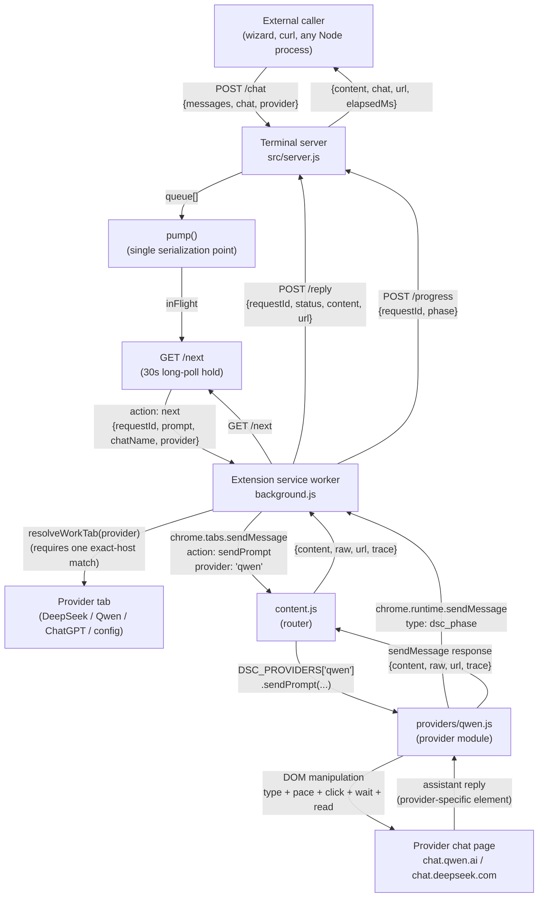
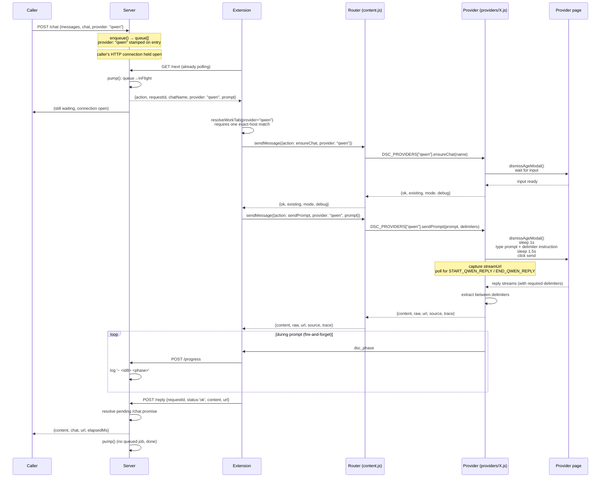

# Architecture

How the pieces fit together and why. Read this before touching code — the module boundaries and the constraints below are load-bearing, not stylistic. If you find yourself thinking "this looks over-complicated, let me simplify it," the section that explains why it's not is probably below.

Companion docs: [protocol.md](protocol.md) specifies the wire contract that follows from these decisions; [providers.md](providers.md) is the how-to for adding a provider; [selector-maintenance.md](selector-maintenance.md) is the recovery playbook when a provider's DOM changes; the [ADR folder](adr/) records each decision atomically. This doc is the cohesive narrative that ties them together.

> **Current routing contract:** Every work request must name a built-in (`deepseek`, `qwen`, `chatgpt`) or enabled config provider. Background routing requires exactly one tab with that provider's exact hostname; it does not pin a sticky work tab or fall back to another provider. Older sticky-tab descriptions and diagrams below are historical context; see [protocol.md](protocol.md) and [background.js](../background.js) for current behavior.

**Contents**
- [System overview](#system-overview)
- [Lifecycle of one prompt](#lifecycle-of-one-prompt)
- [Module boundaries](#module-boundaries)
- [The eight load-bearing decisions](#the-eight-load-bearing-decisions)
  - [1. Long-poll over WebSockets](#1-long-poll-over-websockets)
  - [2. Real Chrome over Puppeteer](#2-real-chrome-over-puppeteer)
  - [3. One chat per source, URL-primary identity](#3-one-chat-per-source-url-primary-identity)
  - [4. Exact provider-tab routing](#4-exact-provider-tab-routing)
  - [5. URL navigation over new-chat button](#5-url-navigation-over-new-chat-button)
  - [6. Answer-block extraction over whole-message](#6-answer-block-extraction-over-whole-message)
  - [7. Structural sidebar walk as fallback](#7-structural-sidebar-walk-as-fallback)
  - [8. Plugin registry over feature flags](#8-plugin-registry-over-feature-flags)
- [The two streaming guards](#the-two-streaming-guards)
- [What the extension does not do](#what-the-extension-does-not-do)
- [Data flow between modules](#data-flow-between-modules)

---

## System overview

Four participants, three transport boundaries, one job: turn a prompt plus a provider name into a provider-specific reply that the caller can consume as JSON.



Four properties the diagram makes obvious:

**1. Every prompt follows the same path, regardless of provider.** There is no "DeepSeek fast path" and "Qwen slow path." Both go through `/chat` → queue → `/next` → `sendToTab` → `content.js` → `providers/<name>.js` → `/reply`. The provider name is a data field on every message from the caller down to the provider module, but the routing above the provider module is identical.

**2. The extension is a client, not a server.** The extension never accepts HTTP connections. It polls. This is not a limitation — it's the only way to make Manifest V3 work at all, since a service worker can't bind a listening socket. Everything follows from that constraint: long-poll not WebSocket (see [decision 1](#1-long-poll-over-websockets)), stateless routing not session state, and the whole reason the wizard *runs* the server instead of the extension.

**3. The router is deliberately blind.** `content.js` looks up `DSC_PROVIDERS[msg.provider]` and calls one of four methods on it. It has zero knowledge of what a "DeepSeek" or a "Qwen" is. All provider-specific logic lives inside `providers/<name>.js`. This is what makes adding a third provider a single-file change (see [decision 8](#8-plugin-registry-over-feature-flags)).

**4. The caller blocks on the whole round-trip.** A `POST /chat` call doesn't return "queued, poll for status" — it returns the content or the error. This is deliberate: batch wizards are per-source iterative, so the caller has nothing to do while waiting for source N's reply except wait for source N's reply. A two-round-trip API would add stateful polling for no benefit.

## Lifecycle of one prompt

The sequence view of the same flow, with provider routing highlighted and timing annotations. Everything below the caller is inside the "one `POST /chat` call" bracket.



Seven things worth naming from the sequence:

**`resolveWorkTab(provider)` runs before any message dispatch.** It requires exactly one tab on the requested provider's exact hostname. Zero or multiple matches fail with `ambiguous_provider_tab`; there is no sticky-tab fallback. See [decision 4](#4-exact-provider-tab-routing).

**`ensureChat` runs per source, before `sendPrompt`, on the provider's own terms.** For DeepSeek, this means "find in sidebar, else navigate to `/`." For Qwen, this means "dismiss age modal, wait for input, return fresh." Each provider decides what "ensure the chat is ready" means — the router doesn't impose a shared meaning. See [decision 3](#3-one-chat-per-source-url-primary-identity).

**`sendPrompt` is provider-owned, start to finish.** The provider decides: whether to append a delimiter instruction to the caller's prompt (Qwen does, DeepSeek doesn't), how long to pause between actions (Qwen 1000-1500ms, DeepSeek near-instant), what constitutes "done" (DeepSeek waits for `.ds-assistant-message-main-content` to stabilize, Qwen waits for both delimiters to appear), and what to extract (DeepSeek uses `.ds-assistant-message-main-content`, Qwen uses the strict-delimiter slice). The router doesn't know any of these details.

**`streamUrl` is captured by the provider at "first assistant message" time, checked at "reply done" time.** Each provider implements this independently. For DeepSeek it's captured when the first assistant message block appears; for Qwen it's captured when the first assistant message fires. If the URL changed by the time the reply finished, the read is discarded as `user_navigated`. Without this, the completion detector locks onto whatever assistant message is on whatever page happens to be showing. See [the two streaming guards](#the-two-streaming-guards).

**Progress fires in the background, in parallel with the main loop.** `dsc_phase` messages don't block `sendPrompt`. Each provider emits phase messages (DeepSeek's are `probe`/`waitInput`/`toggleDeepthink`/etc.; Qwen's are `step_1_dismiss_modal`/`step_2_find_input`/etc.), background forwards them to `/progress`, and the main sendPrompt loop doesn't care. Phase names are provider-specific; the `/progress` endpoint accepts any string.

**`/reply` resolves the caller's promise; `pump()` advances the queue.** These are two separate operations inside the same HTTP handler. Resolve happens first, so the caller gets its content even if the next `pump()` throws.

**The caller's connection stays open the entire time.** The server handles the request/reply round trip as a plain HTTP request. Queue deadline defaults to 120 seconds; dispatched-request and Node client deadlines default to 960 seconds. A caller may use a shorter timeout, which does not cancel provider work. If dispatch may have occurred, the terminal error is `outcome_unknown`.

### Request correlation and recovery

The client creates or preserves one `requestId` across caller, queue, `/next`, provider progress, and `/reply`. The server deduplicates identical submissions in a bounded in-memory cache; conflicting payloads for the same ID return 409. A request is terminally `completed`, definitely `not_dispatched`, or `outcome_unknown`. After dispatch, timeout does not free the queue slot: the server quarantines it until a late reply or shutdown, so another request cannot be mistaken for it. Repeating the exact same request ID after a late reply retrieves the cached terminal result without redispatch. The cache is lost on server restart, so inspect the provider tab before recovery after a restart.

## Module boundaries

Nine files in the extension, two providers, three server-side modules. Every module has a rule about what it can import and what it owns. Bypassing a rule breaks a guarantee.

```
deepseek-connect/
├── shared.js               constants, DSC.PROVIDER_DOMAINS, DSC.providerForUrl
├── selectors.js            DeepSeek-specific selector registry (not provider-neutral)
├── content.js              router — the ONLY file that dispatches by provider name
├── providers/
│   ├── deepseek.js         DeepSeek DOM manipulation
│   └── qwen.js             Qwen DOM manipulation
├── background.js           poll loop, provider-aware tab routing, message router
├── popup.html              status UI
├── popup.js                config + status (reads chrome.storage.local)
├── manifest.json           permissions, content_scripts, service_worker
└── src/
    ├── server.js           HTTP server (the only file with require('node:http'))
    ├── client.js           HTTP client (the only file callers require)
    └── errors.js           taxonomy (the only file both server and client import)
```

### `shared.js` — the constant surface

Loaded by `background.js` via `importScripts('shared.js')` and by `content.js` as a content-script dependency. Both contexts get `globalThis.DSC`.

The rule: **no logic beyond `providerForUrl`, no DOM, no chrome APIs.** It's a constants file with three small exceptions that earn their keep:

1. **`DSC.PROVIDER_DOMAINS`** — the single source of truth for URL → provider mapping. `background.js` reads it twice (in `getWorkTab` and in `register`), and `DSC.providerForUrl(url)` uses it. Adding a provider means adding one line here, plus the manifest and the provider file itself. There is no other place to update.

2. **`DSC.providerForUrl(url)`** — provider name from a URL, or null if unsupported. Three lines of logic, used by both callers in `background.js`. This is the only place URL string parsing for provider detection exists.

3. **The `PROVIDER CONTRACT` comment block** — a docstring, not code. Documents the four-method interface and the three registration points. `content.js`'s router references this block from the top of its IIFE. If you're adding a provider, this comment is the first thing to read.

Every other constant that both background and content need lives here. Every constant that only one side needs lives in that side's file.

**`DSC.ERR` is a mirror of `src/errors.js`'s `CODES`**, not the source of truth. The duplication is a Manifest V3 consequence — `shared.js` is a classic script (no `import`), and content scripts can't `require()` the Node module. The duplication is checked by a test that asserts the two maps agree (see [error-codes.md#registered-codes](error-codes.md#registered-codes)).

### `selectors.js` — DeepSeek's DOM contract

Loaded after `shared.js` and before the provider modules. Exposes `globalThis.DSC_SELECTORS` with `resolve(name)` and `probeDom()`.

The rule: **DeepSeek-specific. Not shared infrastructure.** Despite living at the repo root, this file is DeepSeek's, not a neutral registry. The header comment says so explicitly. Qwen declares its own selectors inline and ignores this file entirely.

The reason is historical and pragmatic: DeepSeek was the first provider, and when it was the only provider, `selectors.js` was the obvious place for selectors. When Qwen was added, copying the tier-list structure into `providers/qwen.js` was faster than abstracting the tier-list concept — and the abstraction (a `selector-tiers.js` shared module with per-provider config) hasn't been justified yet because two providers don't justify it. If a third provider arrives and needs the same tier-list pattern, that's the moment to extract the genuinely shared part.

For now: DeepSeek uses `DSC_SELECTORS`, Qwen doesn't. When a provider has selectors, they live in `providers/<name>.js`.

### `content.js` — the router

~40 lines. The only file that dispatches by provider name.

The rule: **the router is deliberately blind.** It reads `msg.provider || 'deepseek'`, looks up `globalThis.DSC_PROVIDERS[providerName]`, and calls one of four methods. It does not check whether the provider is a class or an object, doesn't have any fallback logic, doesn't know what `sendPrompt` returns.

```js
const providerName = msg.provider || 'deepseek';
const provider = (globalThis.DSC_PROVIDERS && globalThis.DSC_PROVIDERS[providerName]);
if (!provider) {
  return sendResponse({ error: 'no_provider_loaded', provider: providerName, hostname: location.hostname });
}
if (msg.action === DSC.MSG.SEND_PROMPT) {
  return sendResponse(await provider.sendPrompt(msg.prompt, msg.delimiters));
}
// ...
```

`content.js` reports the internal `no_provider_loaded` condition when a module is missing. It is not a registered public `DSCError`; the server/client may expose it as `internal_error`. For config providers, verify that the provider is enabled and registered; for built-in changes, reload the extension and the provider tab.

The router also emits a `[dsc:router:diag]` console.debug at load time, reporting the URL, hostname, frame context, and registered providers. That diagnostic is what F12 shows when someone asks "is the provider loaded on this tab?"

### `providers/deepseek.js` — DeepSeek's DOM logic

~600 lines wrapped in an IIFE. The pre-refactor `content.js` logic, unchanged in behavior. Registers itself into `globalThis.DSC_PROVIDERS['deepseek']` at the end of the IIFE.

The rule: **self-contained.** No imports from other files. Uses `globalThis.DSC_SELECTORS` (which it can, because `selectors.js` loads before it) but declares its own helpers for everything else (`visible`, `waitFor`, `findByText`, `findInput`, `findSendButton`, etc.).

Implements the four-method contract with DeepSeek-specific concerns:

- **`ensureChat`** — sidebar walk from "New chat" anchor, or navigate to `/` for fresh. Returns `{ok, existing, mode, debug}` on success, or `{ok: false, needNewChat: true}` to signal "background should navigate."
- **`sendPrompt`** — probes required selectors, enables DeepThink + Search, types prompt, clicks send, watches `.ds-assistant-message-main-content` until stable, extracts (delimiter → fence → raw fallback), returns `{content, raw, url, source, trace}`.
- **`checkState`** — returns input/DeepThink/Search state.
- **`resetChat`** — delegates to `ensureChat`.

### `providers/qwen.js` — Qwen's DOM logic

~230 lines, no IIFE wrapper (registers directly). Self-contained to the point of bundling its own helpers rather than sharing any with DeepSeek.

The rule: **self-contained, even more strictly than DeepSeek.** The Qwen provider doesn't use `globalThis.DSC_SELECTORS` — it has inline `selectors: { input, sendButton, assistantMessages }` functions. This is deliberate: sharing selectors between providers is a coupling that breaks when one provider redesigns. Two providers, two selector strategies, zero shared assumptions.

Three Qwen-specific concerns that don't exist in DeepSeek:

- **`dismissAgeModal()`** runs at the top of every action (`ensureChat`, `sendPrompt`, `checkState`). Qwen shows a "confirm your age" modal on first use per session; the modal blocks the input, so failing to dismiss it produces `input_not_found` even though the input is technically present.
- **Anti-bot pacing** — 1000-1500ms `sleep()` between every action. Qwen's React app drops fast send clicks and can trigger bot defense.
- **Strict delimiter enforcement** — Qwen's completion detector **only** breaks when both `START_QWEN_REPLY` and `END_QWEN_REPLY` appear in the DOM. The provider appends a delimiter instruction to every prompt and fails with `invalid_response_format` if the delimiters are missing at the end. This eliminates the "Thinking..." false positive that a DeepSeek-style stability detector would produce on Qwen.

See [providers.md#case-study-qwen](providers.md#case-study-qwen) for the full reasoning behind each.

### `background.js` — the router and the tab manager

~450 lines. The service worker. Everything that talks to `chrome.tabs`, `chrome.storage`, and `fetch` lives here.

The rule: **background owns tab lifecycle and provider routing, not tab content.** It resolves a provider-matching tab (see [decision 4](#4-exact-provider-tab-routing)), navigates it, re-injects content scripts when needed, and forwards messages to and from the content script. It never reads the DOM directly.

Two load-bearing pieces for the multi-provider behavior:

**`resolveWorkTab(targetTabId, provider)`** — resolves the provider tab in `background.js`. It requires an explicit routable provider and exactly one tab with the matching exact hostname; when `targetTabId` is supplied it must match that provider. There is no pinned-tab selection or first-match fallback.

**`register()`** — the `/hello` body includes a per-tab `provider` field so callers can see which provider each tab belongs to without parsing URLs. The `provider` field comes from `DSC.providerForUrl(t.url)`. This is what makes `/tabs` usable for debugging multi-provider state.

The `dsc_phase` listener is a separate `chrome.runtime.onMessage.addListener` that fires `fetch(/progress)` on every phase message from any provider. It runs in parallel with the main `handleNext` loop and doesn't block. This is what makes the live progress stream work without slowing the prompt down.

### `src/server.js` — the queue

~450 lines. The HTTP server. Everything that binds a socket, reads a request, writes a response lives here.

The rule: **server.js owns the queue, not the request semantics.** It doesn't know what a "prompt" is, what "delimiters" are, or what "provider" means — all three are opaque fields that get threaded from the HTTP request through `enqueue()` → `pump()` → `/next` → `/reply` → the caller's response. The semantics belong to the provider.

The main runtime collections are `queue[]`, `waiting[]`, and the `inFlight` Map, with request identity and a bounded completed-request cache. `pump()` is the dispatch point; `enqueue()` adds jobs; `/reply` removes active work. Queue expiry removes definitely undispatched work. A dispatched timeout reports uncertain outcome but keeps the slot quarantined until reply or shutdown. See [protocol.md#queue-state-machine](protocol.md#queue-state-machine).

**Provider threading** is a one-line addition to `enqueue`'s entry object (`provider: req.provider || 'deepseek'`) and a one-line addition to `pump`'s `/next` payload. That's the entire server-side multi-provider surface — ~4 lines of code total. If server.js ever grows provider-specific logic beyond those 4 lines, that's a design bug — provider details should not reach the queue layer.

### `src/client.js` — the caller's interface

~180 lines. Zero-dependency HTTP client.

The rule: **client.js doesn't retry, and it threads `provider` through.** Every method throws `DSCError` on non-2xx and returns the parsed body on 2xx. `chat()`, `open()`, and `reset()` accept a provider, and the server rejects missing or unknown names. A client that retried silently would hide rate-limit conditions and make the caller's attempt-counting wrong.

### `src/errors.js` — the shared taxonomy

~200 lines. `CODES`, `META`, `DSCError` class, four helpers. Imported by both `src/server.js` and `src/client.js`, and mirrored (not imported) in `shared.js`.

The rule: **errors.js is the source of registered codes and default metadata.** Errors can add request identity and execution state; server-side `retryable` is overridden to false when dispatch may have occurred. Unknown extension codes are surfaced as `internal_error` with diagnostic context. See [error-codes.md](error-codes.md).

## The eight load-bearing decisions

Each decision below shapes multiple modules. Reversing any of them requires understanding the failure mode it prevents, and the ADR that pins it.

### 1. Long-poll over WebSockets

**Decision:** The extension polls `GET /next` with a 30-second hold, re-polling immediately on `idle`. No WebSocket.

**Context:** The extension needs to learn "there's a job for you" the moment the server has one. Two options: (a) the server pushes over a persistent connection (WebSocket or SSE), (b) the extension polls with a hold.

**Alternative considered:** WebSocket. Rejected for four reasons:

1. **Service worker lifecycle.** MV3 service workers can be killed at any moment after ~30 seconds of inactivity. A WebSocket connection's `close` event fires when the worker dies, but reopening requires re-establishing the handshake, re-authenticating, and re-registering with the server. That's ~50 lines of reconnect logic to write and test.
2. **Debug surface.** A long-poll failure produces a `curl` command. A WebSocket failure produces a browser DevTools network tab entry with a binary protocol frame that's hard to inspect. When the batch wizard hangs at 2 AM, you want `curl`.
3. **Strict alternation.** The flow is `/next` → extension works → `/reply` → `/next` → extension works → `/reply`. There's never a moment where the server needs to push a second message before the first completes.
4. **No libraries.** Node's `http` module and the browser's `fetch` API both handle long-poll natively. WebSockets need `ws` on the Node side.

**Consequence:** The `waiting[]` array in `src/server.js` and the `LONG_POLL_MS = 30000` constant. The extension's `pollLoop` calls `GET /next`, handles the `next` action or the `idle` timeout, and immediately re-polls. See [ADR 0001](adr/0001-use-long-poll-over-websocket.md).

### 2. Real Chrome over Puppeteer

**Decision:** Drive the user's already-logged-in Chrome/Brave tab via a load-unpacked extension. No Puppeteer, no headless browser, no scripted login.

**Context:** The goal is to use a free LLM endpoint from a batch wizard. The two ways to automate a web page are: (a) drive a fresh browser instance from a script (Puppeteer / Playwright), (b) inject into an existing browser tab (extension).

**Alternative considered:** Puppeteer with `puppeteer-extra-plugin-stealth`. DeepSeek and Qwen both rate-limit headless sessions aggressively, detect headless fingerprints even with stealth plugins, and require real auth cookies that a fresh profile doesn't have. Three failure modes pushed off Puppeteer:

1. **Headless fingerprinting.** DeepSeek and Qwen both fingerprint canvas, WebGL renderer, audio context, plugin list. Even with stealth, a fresh profile is detectable. Rate limits go from "one prompt per 5 seconds" to "one prompt per 10 minutes" or "account banned."
2. **Credential handling.** A Puppeteer-driven session starts with an empty profile. To use the user's actual account, we'd script the login — email, password, possibly 2FA — which means storing credentials somewhere the extension doesn't. Security regression with no compensating benefit.
3. **Session continuity.** Cookies from the extension-driven tab persist across runs because it's the same Chrome profile. A Puppeteer session that closes loses them.

**Consequence:** The whole architecture. The wizard *runs* the server; the user *loads* the extension; the extension *talks* to the server. Credentials never leave the user's Chrome profile. See [ADR 0002](adr/0002-real-chrome-over-puppeteer.md).

### 3. One chat per source, URL-primary identity

**Decision:** Each source gets its own chat. On retry, the same chat is reopened so the LLM sees its prior attempt in context. The primary identity mechanism is the **chat URL** (the `/a/chat/s/<uuid>` for DeepSeek, `/c/<uuid>` for Qwen), persisted by the caller and passed back via `/open { chatName, url }`. The sidebar fuzzy-match walk is a **fallback**, used only when the URL isn't available (first send per source, or a fresh run directory).

**Context:** DeepSeek's chat is stateful — the LLM sees every prior turn in the current conversation. For a batch wizard, if source A's extractor fails verification and the wizard refines the prompt, the refined prompt should land in the same chat so the LLM can see "here's what I tried last time, here's why it failed, now fix it."

**The original design used sidebar fuzzy-match as the primary identity.** The chat name was embedded in the prompt's first line, DeepSeek auto-named the chat from that, and `findChatInSidebar(name)` found it via title substring match. **This broke in testing.** DeepSeek *paraphrases* the first message into a title. A prompt starting with `reuse-test-1754824017022 — reply with just: alpha` became a chat titled "Alpha reply." The `reuse-test-175...` prefix was completely dropped. No sidebar fuzzy match could find it. Every retry opened a fresh chat, and the LLM never saw its prior turn.

Qwen has the same behavior — its titles are paraphrases too.

**The URL-based fix:** Every provider's `sendPrompt` returns the actual chat URL in its response. The caller persists this URL and supplies it to `/chat` to navigate directly before sending a retry, or to `/open` when it needs to navigate without sending. This skips the sidebar walk and keeps the prior conversation context.

**Consequence:** The `url` field on `/chat` success responses and the `targetUrl` threading through enqueue → `/next` → extension dispatch. The sidebar walk remains a fallback when a URL is not supplied. See [ADR 0003](adr/0003-one-chat-per-source.md) and its amendment by [ADR 0008](adr/0008-multi-provider-plugin.architecture.md).

### 4. Exact provider-tab routing

**Current decision:** The request must specify a provider, and the extension requires exactly one open tab whose hostname matches that provider. A caller-supplied `targetTabId` is accepted only if it matches the same provider. There is no pinned-tab routing or implicit provider fallback.

**Context:** With multiple provider tabs open — which happens, the user might be chatting in a DeepSeek tab while the batch runs against Qwen — the extension needs to route each request to the right tab.

**Why exact-one routing:** Selecting an arbitrary tab when several match could send a prompt to the wrong conversation. Refusing ambiguous matches is safer and gives the caller an actionable error.

**Consequence:** `resolveWorkTab(targetTabId, provider)` in `background.js` refuses missing or unroutable providers with `bad_request`, and returns `ambiguous_provider_tab` for an invalid target tab or anything other than one exact-host match. See [ADR 0004](adr/0004-sticky-work-tab-over-target-tab-id.md) for the superseded sticky-tab design and [ADR 0008](adr/0008-multi-provider-plugin.architecture.md) for later routing changes.

### 5. URL navigation over new-chat button

**Decision:** When `ensureChat` needs a fresh chat, background navigates the work tab to the provider's origin (`https://chat.deepseek.com/` or `https://chat.qwen.ai/`) via `chrome.tabs.update({ url: ... })`, not by clicking the provider's "New chat" button.

**Context:** Every provider has a "New chat" button in its sidebar. Clicking it produces a fresh chat page. Navigating to `/` produces the same result.

**Alternative considered:** Clicking the button. Rejected because the button is fragile across providers and across redesigns:

1. **Text-based match.** `findByText(document, 'button, a, [role="button"]', /new\s*chat/i)` depends on the button's text content being literally "New chat". A rename, a translation, an icon-only redesign, or a "New" prefix all break it.
2. **Build-hashed classes.** Both DeepSeek's and Qwen's buttons have build-artifact classes with no semantic name. Any selector that relies on the class name breaks on every deploy.
3. **Sidebar-collapsed state.** When the sidebar is collapsed, the "New chat" button might be hidden inside a hamburger menu or unmounted entirely.
4. **Navigation is atomic.** `chrome.tabs.update({ url: '/' })` either navigates or throws. No element to find, no ambiguity about whether the click registered.

**Consequence:** `background.js` `handleNext` has a branch that navigates based on the current tab's origin (not a hardcoded provider URL) — `new URL(tab.url).origin + '/'`. This works for any provider whose fresh chat is at the domain root. If a future provider's fresh-chat URL is not at the root, the provider's `ensureChat` needs to return a `freshChatUrl` field, and background will use that. For DeepSeek and Qwen, the origin is correct. See [ADR 0005](adr/0005-url-navigation-over-new-chat-button.md).

### 6. Answer-block extraction over whole-message

**Decision:** When extracting the assistant's reply, each provider targets its own "answer element" — DeepSeek uses `.ds-assistant-message-main-content`, Qwen uses a strict-delimiter slice of `.qwen-chat-message`. The provider does **not** extract the whole message; the whole message includes reasoning/thinking text that isn't the reply.

**Context:** DeepSeek with DeepThink enabled produces a message with two parts: a collapsible "Thought for N seconds" section and a final answer below it. Qwen produces a "Thinking..." preamble streamed before the actual answer. Both are visible; only the answer is the reply the caller wants.

**Alternative considered:** Extract the whole `.ds-message` element's text. Rejected because reasoning text frequently contains fragments that look like the answer. The specific bug that motivated this: a "Reply with exactly: console.log(42);" prompt returned 78 characters of "The user wants me to reply with exactly that content. Just output it verbatim." — the model's plan, not its output. Every DeepThink prompt was returning reasoning text as content.

**Alternative considered (second):** Extract the last `.ds-markdown` block. Rejected because on real DeepSeek, `.ds-markdown` is both the reasoning block *and* the answer block — same class, different parents. A `last.querySelector('.ds-markdown')` returns the first one (reasoning).

**Provider-specific solutions:**

DeepSeek uses `.ds-assistant-message-main-content` as the answer wrapper. If it's not present, the fallback is "the last `.ds-markdown` that is not inside a `[class*="think"]` parent." The completion detector gates on the answer block appearing — before that point, `lastAssistantText` returns null and the loop continues.

Qwen is stricter: it requires both `START_QWEN_REPLY` and `END_QWEN_REPLY` to appear in the DOM. If both don't appear within the timeout, the provider fails with `invalid_response_format` rather than returning whatever text happened to be present. This eliminates the "Thinking..." false positive entirely — if the delimiters aren't there, the answer isn't done yet.

**Consequence:** Each provider implements its own completion detector and extraction. There is no shared "extract the answer" function. This is deliberate — the failure modes are provider-specific and a shared abstraction would either be too loose (return preamble) or too strict (fail on legitimate replies). The `extract` phase in `/progress` shows `source: 'delimiter'`, `'fence'`, or `'raw'`, so the caller can see what happened. See [ADR 0006](adr/0006-answer-block-extraction-over-whole-message.md).

### 7. Structural sidebar walk as fallback

**Decision:** DeepSeek's sidebar chat list is found by walking from the "New chat" button text up to a narrow-tall container, then enumerating leaf elements with text content. This is a **fallback**, used only when the URL-based retry path isn't available. Qwen doesn't implement the sidebar walk at all — it returns `existing: false, mode: 'fresh'` and relies entirely on the URL-based mechanism.

**Context:** When the caller doesn't have a persisted URL (first send per source, or a fresh run directory), the extension needs to establish a chat. The mechanism the original DeepSeek provider chose was sidebar fuzzy-match: enumerate chat titles, find one whose text contains the source name, click it.

**The sidebar walk is now secondary** because of [decision 3's URL-primary fix](#3-one-chat-per-source-url-primary-identity). It was always going to be fragile — DeepSeek's sidebar has no semantic class names (every class is build-hashed like `dc04ec1d`), chat entries aren't anchors, and the titles are paraphrased. The structural walk (find "New chat" text, walk up to a tall-narrow container, enumerate leaves) works but breaks every time DeepSeek changes sidebar dimensions or the "New chat" text.

**Consequence:** Qwen doesn't have a sidebar walk at all. Its `ensureChat` returns `{existing: false, mode: 'fresh'}` unconditionally — the provider assumes the caller is on a fresh page or will navigate. If a Qwen retry needs to find a chat by name, it can't; it must use the URL. This is documented as a known limitation, mitigated by `chat-map.json` in the aggregator layer. DeepSeek's walk remains for the "no URL yet" case, but its failure no longer blocks the wizard — a missed match just opens a fresh chat, and the retry-from-URL path handles subsequent turns.

See [ADR 0007](adr/0007-structural-sidebar-walk.md) and its amendment by [ADR 0008](adr/0008-multi-provider-plugin.architecture.md), and [selector-maintenance.md](selector-maintenance.md) for the DeepSeek walk's recovery playbook.

### 8. Plugin registry over feature flags

**Decision:** Multi-provider support is a **registry-based plugin system**: `content.js` is a thin router, each provider registers itself into `globalThis.DSC_PROVIDERS[name]`, and dispatch happens by name lookup. Providers are self-contained modules with a four-method contract.

**Context:** When Qwen was added as a second provider, the codebase had to support both. Three architecture options were considered.

**Alternative considered (1): Feature flags inside a monolithic `content.js`.** Every function checks `if (provider === 'deepseek') { ... } else if (provider === 'qwen') { ... }`. Rejected because:

- `content.js` would grow to ~800 lines with both providers' logic, and every function would need dual branches.
- A third provider would add a third branch to every function — linear blowup.
- The provider-specific code would be interleaved with the shared router code, making it hard to see what's shared vs provider-specific.

**Alternative considered (2): Class inheritance.** A base `Provider` class with `ensureChat`/`sendPrompt`/`checkState`/`resetChat`, with `DeepSeekProvider extends Provider` and `QwenProvider extends Provider`. Rejected because:

- Manifest V3 content scripts are classic scripts, not modules. `import`/`export` don't work in content scripts without a bundler, and adding a bundler is against the project's hard constraint.
- The class approach creates an implicit interface (the base class's abstract methods) that has to be maintained in two places (the base and each subclass). The registry approach has one place: the `PROVIDER CONTRACT` comment in `shared.js`.
- Two providers don't justify the abstraction. A registry is 10 lines of code; a class hierarchy is 200 lines of scaffolding for 30 lines of shared behavior.

**Alternative considered (3): Separate content script per provider, with background dispatching to the right tab.** Rejected because background would need to know which content script is injected where, which is exactly the coordination problem that `manifest.json`'s `content_scripts` already solves at load time. And the router pattern (one content script, dispatched by provider) is more flexible: the same tab can handle multiple providers if needed (e.g., a future cross-provider orchestration mode).

**The chosen design** — registry-based dispatch — wins on three axes:

1. **Adding a provider is one new file plus three registrations.** `providers/claude.js` + one line in `shared.js` `PROVIDER_DOMAINS` + two places in `manifest.json` + one place in `background.js` `sendToTab`. Nothing in `content.js`, `src/server.js`, or `src/client.js` changes.
2. **The provider contract is documented in code.** `shared.js`'s `PROVIDER CONTRACT` comment block is the spec — the interface is four methods, the registration is three places, and both are visible from the router's top. A contributor reading `content.js` sees the reference to the contract block, reads it, and knows what to implement.
3. **Provider internals are truly isolated.** `providers/qwen.js` doesn't import anything from `providers/deepseek.js`. `providers/deepseek.js` doesn't know Qwen exists. When a provider redesigns, its file is the only file that changes for that provider's DOM. When a provider is added, its file is the only new file for that provider's DOM.

**Consequence:** The `globalThis.DSC_PROVIDERS` registry and `content.js` router. Missing registrations may surface as an internal error; config providers are registered dynamically, while built-in modules are loaded by the extension. See [ADR 0008](adr/0008-multi-provider-plugin.architecture.md) for the original design rationale.

## The two streaming guards

Two guards that exist in every provider's `sendPrompt`, for two different reasons. Both are easy to delete accidentally when refactoring a provider.

### `streamUrl` — mid-stream navigation

**What:** `streamUrl` is captured when the first assistant message of the response appears. On every subsequent poll iteration, `location.href` is compared against `streamUrl`. If they differ, the response is discarded as `user_navigated`.

**Why:** Between the first assistant message and the reply done (typically 3-8 seconds), the work tab is fully interactive. The user can click a different chat in the sidebar. The user can hit browser back. The provider can auto-redirect. Any of these changes `location.href` to a different chat's URL — and the provider's polling loop, which is watching "the last assistant message on this page," will suddenly start reading a *different* chat's assistant message. The reply that comes back would be from the wrong conversation.

**The specific bug that motivated this:** During development, a "Say hello" prompt on DeepSeek returned the string "state.cfg was my invention; real config is loadConfig()..." — a prior assistant message from a completely different chat that the user had navigated to mid-stream. The completion detector locked onto the wrong page's message and read it as the answer.

**What deleting it costs:** Silent cross-chat contamination. Every source that happens to have a mid-stream navigation would produce content from the wrong chat, which would pass identity checks (the LLM did mention the source name — in the *wrong* chat), would pass JS syntax checks (it's real code from the wrong source), and would land in `generated/` as a silently wrong extractor.

**Implemented per-provider.** DeepSeek checks `if (streamUrl && location.href !== streamUrl)` inside its poll loop. Qwen captures `streamUrl = location.href` at first message and checks it the same way. Each provider implements the guard; the pattern is shared, the code is not.

### `answerStarted` gating — stream stabilization on the wrong text

**What (DeepSeek):** The completion detector tracks the answer block's text (`.ds-assistant-message-main-content`), not the whole message's text. The `answerStarted` flag gates the stabilization check on the answer block appearing. Before `answerStarted`, the loop logs reasoning length periodically and continues without touching `stableLen`.

**What (Qwen):** The completion detector requires both `START_QWEN_REPLY` and `END_QWEN_REPLY` to appear in the DOM. The delimiter enforcement is stricter than DeepSeek's — Qwen fails with `invalid_response_format` rather than returning whatever text happens to be present.

**Why:** Both providers stream reasoning/thinking before the answer. DeepSeek streams "Thought for N seconds" into `.ds-think-content`. Qwen streams "Thinking..." into a preamble element. Each stabilization (stopping growth) fires 1-2 seconds before the answer starts streaming. If the completion detector tracked "the whole message's text content," it would see the reasoning stabilize and declare `replyDone` — before the answer had begun.

**What deleting it costs:** Every prompt with the provider's reasoning mode enabled returns reasoning text as content. `extract` shows `source: 'raw'` because no delimiters appear in reasoning. The batch completes with 76 sources of reasoning text — which happens to look plausible (it mentions the source name and the LLM's intent) and would pass identity checks. `source: 'delimiter'` only appears on the *good* runs, so the operator might not notice until they try to deploy an extractor and find it's a paragraph of English.

**The two providers chose different implementations.** DeepSeek gated on a DOM signal (`.ds-assistant-message-main-content` appearing). Qwen gated on content signal (both delimiters appearing). Both are correct; the choice depends on which signal the provider's DOM provides reliably.

## What the extension does not do

Six things that are out of scope by design, each for a specific reason.

**1. It does not solve captchas.** If a provider decides a request is automated and serves a captcha, the extension can't click through. That's `input_not_found` or `response_timeout`, not a solvable automation problem. The mitigation is using a real Chrome profile that providers trust — which is what decision 2 is about. Qwen's age modal is a mild case of this; the provider dismisses it, but a harder bot check (Cloudflare challenge, "are you human" CAPTCHA) would still fail.

**2. It does not rotate accounts.** One extension, one Chrome profile, one provider account per provider. Multi-account is a different product.

**3. It does not auto-pivot between providers on rate limit.** When a DeepSeek request fails with `rate_limited`, the extension returns the error to the caller. The caller (or the wizard layer above it) decides whether to retry on Qwen. The extension does not have a "pivot to Qwen automatically" mode, because "pivot" implies the extension knows about both providers and has a policy for when to switch — that's the caller's policy, not the extension's.

**4. It does not scan the whole DOM.** Every selector is a targeted lookup — the input, the send button, the toggles (DeepSeek only), the answer block, the sidebar container. No `document.querySelectorAll('*')` for anything, in any provider.

**5. It does not interpret the reply.** Delimiter extraction, fence extraction, raw fallback — those are three text-manipulation passes, not a parser. The provider doesn't validate that the extracted text is valid JavaScript, doesn't check that it references the source name, doesn't know whether it's a code block or a prose reply. Those are the caller's concern (the batch wizard's identity check). The provider's contract is "here's what the assistant said between the delimiters (or the fences, or the whole thing)" — the caller decides what to do with it.

**6. It does not retry.** A single `sendPrompt` call is a single attempt. The caller may retry only when the error says `retryable: true` and `executionState: "not_dispatched"`; it must not replay an uncertain request under a new ID. See [integration-guide.md#safe-retry-and-recovery](integration-guide.md#safe-retry-and-recovery).

## Data flow between modules

One line per boundary. Useful when tracing "which module is responsible for X".

- **`src/errors.js` → `src/server.js`, `src/client.js`** — the code table and `DSCError` class are shared by both. If you add a code, both sides get it.
- **`shared.js` → `background.js`, `content.js`, all providers** — `DSC.ERR`, `DSC.MSG`, `DSC.VERSION`, `DSC.PROVIDER_DOMAINS`, `DSC.providerForUrl`, timing constants. Neither background, content, nor any provider hardcodes a code string or a provider domain.
- **`selectors.js` → `providers/deepseek.js`** — `DSC_SELECTORS.resolve(name)` and `DSC_SELECTORS.probeDom()`. DeepSeek uses this file; Qwen doesn't. DeepSeek-specific.
- **`content.js` → `providers/*.js`** — the router dispatches by `msg.provider` name. It calls `provider.ensureChat`, `provider.sendPrompt`, `provider.checkState`, `provider.resetChat`, and does nothing else. Four methods, one direction.
- **`providers/*.js` → `content.js`** — return values from the four methods. Structured objects; no side effects beyond DOM manipulation and `chrome.runtime.sendMessage({type: 'dsc_phase'})`.
- **`background.js` → `content.js`** via `chrome.tabs.sendMessage` — `ensureChat`, `sendPrompt`, `checkState`, `resetChat`, each with `provider` field. Four actions, all structured, no DOM assumptions in background.
- **`background.js` → `resolveWorkTab(targetTabId, provider)`** — tab selection requires an explicit provider and one exact-host match.
- **`content.js` → `background.js`** via `chrome.runtime.sendMessage` — `dsc_phase` (progress), `state` (popup UI). Two types, both fire-and-forget.
- **`background.js` → `src/server.js`** via `fetch` — `/hello`, `/next`, `/reply`, `/progress`. HTTP, authenticated with `EXTENSION_TOKEN`.
- **`src/server.js` → `src/client.js`** (via the caller) — the HTTP response body is what the caller's `dc.chat()` resolves to. `DSCError` on non-2xx, parsed body on 2xx.
- **`src/client.js` → caller's batch loop** — `chat()`, `open()`, `reset()`, `tabs()`, `status()`. `DSCError` on failure with `{ code, retryable, userFixable, retryAfter, details, trace, requestId, executionState }` where available.
- **`src/server.js` `enqueue` → `pump` → `/next` → `background.handleNext` → `sendToTab`** — the `provider` string threads through every hop, unchanged. Four hops, four assignments, no transformation.

When a bug appears at one of these boundaries, the fix belongs on the side that owns the contract:

- A prompt that lands in the wrong provider's tab is a `background.getWorkTab` bug (or a caller that didn't pass `provider`).
- A provider that isn't dispatched is a `manifest.json` or `background.sendToTab` registration bug (see [providers.md#the-registration-checklist](providers.md#the-registration-checklist)).
- A reply that doesn't contain the answer is a provider's `sendPrompt` extraction bug (see [decision 6](#6-answer-block-extraction-over-whole-message)).
- A `/chat` that hangs is a `server` queue bug (see [protocol.md#queue-state-machine](protocol.md#queue-state-machine)).

The single hardest boundary to debug is `providers/*.js` → `content.js` → `background.js` → `server.js` → `client.js` for the same failure. When a prompt "fails silently," the failure could be: provider threw an uncaught exception (background gets `Receiving end does not exist`, retries, fails, reports `input_not_found`); provider returned `{error: 'dom_drift'}` (background reports `dom_drift` cleanly); or background's `sendToTab` timed out (background reports `input_not_found` after two attempts). Three different root causes, one visible symptom. The `trace` array on the `/reply` payload is the way to tell them apart — it carries the provider-side phases, so a trace that ends at `probe` means the provider got that far and stopped; a trace that's empty means the provider never ran (registration bug). Check the trace first when a source fails for a non-obvious reason.

For provider-specific failures, the trace phase names are the diagnostic: `probe` / `waitInput` / `toggleDeepthink` / `toggleSearch` indicate DeepSeek; `step_1_dismiss_modal` / `step_2_find_input` / `step_3_type_prompt` indicate Qwen. If a trace mixes both, something is wrong with the routing — the provider that ran doesn't match the provider that was requested.


## Config providers (addendum)

Providers can also be data-driven files: `providers/<name>.js` calling `DSC.makeConfigProvider({...})`
(factory in `shared.js`, same four-method interface as the code modules). The server exposes
`GET/POST/PUT/DELETE /providers`, derives its provider whitelist from `providers/*.js`, and renders
files from a fixed template. `background.js` reconciles the files on disk against
`chrome.scripting` registered content scripts (`dsc-provider-<name>`) and keeps the per-machine
`enabled` flag in `dsc_registered`. The router lookup is still only `globalThis.DSC_PROVIDERS[name]`.
Completion detection for config providers is `whichever` of stop-selector-gone or text-stable, so a
marker parse is never the sole gate.
