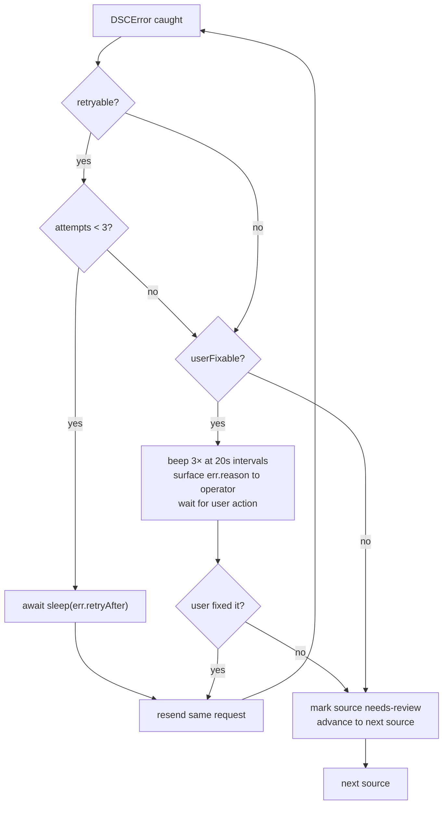

# Error codes

The `DSCError` taxonomy. Twenty-three codes, every failure mode the extension or server can report, and — the part that matters for integrators — the decision rule for what to do about each one. Read this before writing a `try/catch` around any `deepseek-connect` call.

Multi-provider changes the taxonomy in two ways. First, one code is new: `invalid_response_format`, raised only by Qwen. Second, several codes are now **provider-specific** — `deepthink_enable_failed` and `search_enable_failed` only apply to DeepSeek; `invalid_response_format` only applies to Qwen. A wizard that switches on `err.code` needs to know which codes can appear from which providers.

Companion to [protocol.md](protocol.md), which defines the error *shape*; this doc defines the error *meanings* and the wizard's response to each. If the two disagree on a code's metadata, [src/errors.js](../src/errors.js) is authoritative — this doc tracks it, not the other way around.

**Contents**
- [Three metadata flags](#three-metadata-flags)
- [Decision tree](#decision-tree)
- [Five decision buckets](#five-decision-buckets)
- [Provider attribution](#provider-attribution)
- [Full code table](#full-code-table)
- [Per-code reference](#per-code-reference)
- [Common try/catch patterns](#common-trycatch-patterns)
- [Adding a new code](#adding-a-new-code)

---

## Three metadata flags

Every `DSCError` carries three booleans (plus an optional `retryAfter`) that answer three separate questions. Understanding the difference between them is the entire reason this taxonomy exists — a `catch` block that only reads `code` and hardcodes per-code logic will drift from the metadata within a month.

### `retryable`

> Can the caller safely resend the exact same request?

`true` means yes — no state has changed on the server that would make the retry produce a different outcome than the original would have if it had succeeded. The retry is *safe*; it may still fail with the same code again, but if it succeeds the result is indistinguishable from a first-attempt success.

`false` means no — the same request will fail again with the same code. Either something external must change first (user logs in, tab opens, provider DOM updates), or the request itself is wrong (bad shape, unknown requestId). Retrying wastes time and, for `rate_limited` specifically, can make the rate limit worse.

**Does not imply `userFixable`.** `dom_drift` is `retryable: false, userFixable: false` — the code is broken, not the user. `auth_failed` is `retryable: false, userFixable: true` — the user has to fix the token.

### `userFixable`

> Is there something a human must do before this can succeed?

`true` means yes — the failure is a state the operator can change. The token in `.env` is wrong, the tab closed, the provider logged the user out, the DeepThink toggle got stuck. Beeping and surfacing the message is the right response; silently retrying is not, because the retry will fail until the human acts.

`false` means no — either the code is at fault (`dom_drift`), the caller is at fault (`bad_request`), or the failure is transient and clears on its own (`internal_error`, `extension_timeout`, `invalid_response_format`). Retrying or skipping is the right response; beeping at the user is not, because there's nothing they can do.

`userFixable: true` does not mean "don't retry." Two codes — `extension_disconnected` and `response_timeout` — are both `retryable` and `userFixable`. The pattern for those is: retry a small number of times (2–3), then beep. The first retry usually succeeds; the beep is for the cases where it doesn't.

### `retryAfter`

> Milliseconds to wait before the retry, if `retryable`.

Only `rate_limited` sets a non-zero value (30000ms). Every other retryable code defaults to 0 — retry immediately. The field is present on every `DSCError` as `0` when irrelevant, so a caller can unconditionally `await sleep(err.retryAfter)` and it does the right thing.

### HTTP status

The `http` field is what the caller's HTTP client sees, derived from the code via `httpStatusFor(code)`. It exists so that a proxy, load balancer, or monitoring dashboard sees a sensible status (401 for auth, 429 for rate limit, 504 for timeout, 502 for provider errors) rather than a uniform 500 for every application error. It is **not** the primary decision signal — the code is. A wizard that switches on `res.status` instead of `err.code` is reading the wrong field.

---

## Decision tree

For any `DSCError`, the recommended response is:



Three things the diagram encodes:

1. **Retry before beep.** A `retryable && userFixable` code goes through the retry loop first. Only after 3 failed attempts does it escalate to a beep. `extension_disconnected` during a brief server restart is the canonical case — the retry succeeds, the user never sees a beep.
2. **Beep before skip.** A `!retryable && userFixable` code beeps. It does not auto-skip. The wizard's `needs-review` marker is set only after the beep sequence completes without the user acting.
3. **Skip without beep.** A `!retryable && !userFixable` code skips silently. `dom_drift` is the canonical case — the selector changed, the user can't fix it from the CLI, beeping would just be noise.

The `attempts < 3` cap is a wizard-side policy, not a `DSCError` guarantee. See [integration-guide.md#sendwithretry](integration-guide.md#sendwithretry) for the wizard's actual retry loop.

**Multi-provider extension.** A wizard that knows which provider each source was routed to can make better decisions — specifically, a `rate_limited` from DeepSeek can be pivoted to Qwen (retry the same request with `provider: 'qwen'`) before the wizard gives up. That's a policy on top of the decision tree, not a modification of it. See [integration-guide.md#provider-pivot](integration-guide.md#provider-pivot) for the recommended pattern.

---

## Five decision buckets

Twenty-three codes, grouped by their response. Every code falls into exactly one bucket.

### Bucket A — Retry, no beep (5 codes)

`retryable: true, userFixable: false`. Transient failures. Retry up to 3 times with no beep, no user surface, no `needs-review` marker. If all 3 fail, fall through to bucket E (skip).

| Code | What causes it | Typical fix |
|---|---|---|
| `send_failed` | The send click didn't register — the provider's React app dropped the event, or the input cleared before send | Retry; usually succeeds on attempt 2 |
| `internal_error` | Unexpected server error, an unregistered code collapsed to this | Retry; if consistent, check server logs |
| `extension_stale` | Extension hasn't polled `/next` in over 60s — usually a service worker restart | Retry; extension reconnects within a few seconds |
| `extension_timeout` | Server didn't get a `/reply` within the expected window — usually a slow provider stream | Retry; if consistent, check that the work tab is still responsive |
| **`invalid_response_format`** | **Qwen only.** The model reply didn't include the required `START_QWEN_REPLY` / `END_QWEN_REPLY` delimiters. The completion detector refuses to extract without them. | Retry; the model usually cooperates on attempt 2. If it repeats 3×, the prompt enforcement needs strengthening (a prompt issue, not a code issue). |

**Do not beep for these.** A user seeing a beep for `invalid_response_format` on retry 1 of 3 will waste 40 seconds staring at a terminal for something that resolves itself on the next attempt. The strict-delimiter enforcement is *supposed* to occasionally fire — the model doesn't always follow instructions perfectly, and the retry gives it a second chance.

### Bucket B — Retry after delay, no beep (1 code)

`retryable: true, retryAfter: 30000, userFixable: false`. Rate limited. Retry once after the delay, then fall through to bucket E (skip).

| Code | What causes it | retryAfter |
|---|---|---|
| `rate_limited` | The provider returned a rate-limit response — too many prompts in a short window, or DeepThink active on a low-quota DeepSeek account, or Qwen's free-tier burst limit | 30000ms |

**One retry, not three.** The `attempts < 3` cap doesn't apply here — a caller who hits `rate_limited` twice in 60 seconds is being told by the provider to back off, and a third retry will just produce `rate_limited` again with a longer window. After one delayed retry, skip the source and move on.

**Pivot option.** A wizard that supports multi-provider can pivot here: instead of skipping the source, retry it with `provider: 'qwen'` (if the original was DeepSeek, or vice versa). The `rate_limited` error carries the same shape regardless of which provider raised it; the wizard's pivot policy handles the provider switch. See [integration-guide.md#provider-pivot](integration-guide.md#provider-pivot).

### Bucket C — Retry, then beep (2 codes)

`retryable: true, userFixable: true`. Dual-flag — retry first, but if retries exhaust, escalate to beep. The retry handles transient cases (brief extension restart, slow stream); the beep handles the case where the transient condition has become permanent.

| Code | What causes it | When to beep |
|---|---|---|
| `response_timeout` | No answer within the timeout window — the provider's stream stalled, the model is stuck in a long reasoning loop, or the tab is backgrounded and Chrome throttled it | After 2 retries with the same code; the third beep is the user's signal to check the tab |
| `extension_disconnected` | Extension hasn't polled `/next` in over 60s — service worker crashed, or `.env` token was changed without reloading the extension | After 2 retries with the same code; the third beep is the user's signal to reload the extension |

**The beep message must be specific.** `extension_disconnected` says "reload the extension in `brave://extensions`"; `response_timeout` says "check the work tab — the provider might be stuck streaming". The reason field carries this through; beep renderers should not collapse it to the code name.

### Bucket D — Beep, no auto-retry (9 codes)

`retryable: false, userFixable: true`. The operator must act. Beep 3 times at 20-second intervals, surface `err.reason` to the terminal, wait. If the user doesn't act by the third beep, mark `needs-review` and advance to the next source.

| Code | What causes it | User action | Provider |
|---|---|---|---|
| `ambiguous_provider_tab` | The request names a provider and the number of open tabs on that provider's exact hostname is not exactly one — none, or several | Open one tab for that provider, or close the extras | both |
| `auth_failed` | Bearer token mismatch — `.env` and popup disagree on `EXTENSION_TOKEN` | Set the same token in `.env` and the popup | both |
| `deepthink_enable_failed` | Could not verify DeepThink is on after clicking the toggle | Manually toggle DeepThink on, confirm it stays on | **deepseek only** |
| `input_not_found` | The chat input box isn't where it should be — tab closed, wrong page, or the DOM changed | Open the work tab, confirm it's on the provider's URL, refresh | both |
| `logged_out` | The work tab shows the provider's login screen — session expired | Log in to the provider in the work tab | both |
| `protocol_version_mismatch` | Server and extension disagree on the protocol version — **not raised in v0.2.0**, see [protocol.md#version-negotiation](protocol.md#version-negotiation) | Reload the extension, restart the server | both |
| `search_enable_failed` | Could not verify Search is on after clicking the toggle | Manually toggle Search on, confirm it stays on | **deepseek only** |
| `user_navigated` | The work tab URL changed mid-stream — user clicked into a different chat while a reply was streaming | Don't touch the work tab while a prompt is running | both |
| `version_mismatch` | Extension `BUILD_HASH` differs from the server's, checked on `/hello` — the extension is refused and never registers | The extension reloads itself once; if it persists, reload it in `brave://extensions`, hard-reload provider tabs, restart the server | server |

`input_not_found` and `logged_out` are the two most common beeps across both providers. `deepthink_enable_failed` and `search_enable_failed` are DeepSeek-only and rarer but harder to debug — the beep message names the specific toggle.

### Bucket E — Skip without beep (6 codes)

`!retryable, !userFixable`. The request will never succeed with the same inputs. Log the code, mark the source `needs-review`, advance. No beep, no waiting, no user surface beyond the log line.

| Code | What causes it | What happened | Provider |
|---|---|---|---|
| `bad_request` | Malformed request — missing `messages`, missing `chatName`, wrong types | Caller bug — check the request shape against [protocol.md](protocol.md) | both |
| `cancelled` | `/cancel` was called on this requestId — **route not shipped in v0.2.0**, see [protocol.md#extending-the-protocol](protocol.md#extending-the-protocol) | Caller aborted the request | both |
| `chat_not_found` | Could not find or create the requested chat | Sidebar and navigation both failed | both |
| `dom_drift` | Required selectors missing from the provider's DOM — a page redesign | The provider is out of date; see [selector-maintenance.md](selector-maintenance.md) | both |
| `unknown_request` | `/reply` carried a `requestId` that isn't in `inFlight` | Internal inconsistency — usually a double-reply after a server restart | both |
| `user_skipped` | The user clicked "Skip site" in the popup — **button not shipped in v0.2.0** | User explicitly skipped the source | both |

`dom_drift` is the one to watch. It's the natural consequence of a provider redesigning its UI. Everything else in this bucket is either a caller bug or a planned-but-unshipped feature. The `probe` field on the error carries the specific missing selector names; that's the handoff to [selector-maintenance.md](selector-maintenance.md).

`user_skipped` sits in bucket E by behavior but is flagged `userFixable: true` in `src/errors.js` — the user is the one who chose to skip. A wizard that follows bucket-D beep rules blindly for `user_skipped` would beep at the user who just clicked "Skip". The metadata is correct; the wizard's per-code policy must override the generic flag rule for this one.

---

## Provider attribution

Which codes can be raised by which providers. A wizard that switches on `err.code` needs to know this — a beep for `deepthink_enable_failed` makes sense if the source was routed to DeepSeek, but wouldn't make sense if it went to Qwen (Qwen has no such toggle).

| Code | deepseek | qwen | Server/router |
|---|---|---|---|
| `dom_drift` | ✓ | ✓ | — |
| `input_not_found` | ✓ | ✓ | — |
| `ambiguous_provider_tab` | ✓ | ✓ | — |
| `deepthink_enable_failed` | ✓ | — | — |
| `search_enable_failed` | ✓ | — | — |
| `invalid_response_format` | — | ✓ | — |
| `chat_not_found` | ✓ | ✓ | — |
| `rate_limited` | ✓ | ✓ | — |
| `logged_out` | ✓ | ✓ | — |
| `response_timeout` | ✓ | ✓ | — |
| `send_failed` | ✓ | ✓ | — |
| `user_navigated` | ✓ | ✓ | — |
| `extension_disconnected` | — | — | ✓ |
| `extension_stale` | — | — | ✓ |
| `extension_timeout` | — | — | ✓ |
| `protocol_version_mismatch` | — | — | ✓ |
| `version_mismatch` | — | — | ✓ |
| `bad_request` | — | — | ✓ |
| `auth_failed` | — | — | ✓ |
| `unknown_request` | — | — | ✓ |
| `internal_error` | — | — | ✓ |
| `cancelled` | — | — | ✓ |
| `user_skipped` | ✓ | ✓ | — |

**Two reasons that appear on `input_not_found` but aren't codes.** These deserve special attention because they masquerade as one code but mean different things.

**`no_work_tab`** — raised by `background.js#handleNext` when `getWorkTab(provider)` returns `null`. Meaning: no tab with the requested provider is open. For `provider: 'qwen'`, this means "the user hasn't opened a Qwen tab." That's user-fixable (`input_not_found` is correctly bucket D). For `provider: 'tongyi'`, this could also mean the provider is registered in `PROVIDER_DOMAINS` but no one has opened a tongyi tab — same user-fixable. **The `reason` field carries `no_work_tab`; the code is `input_not_found`.** A wizard that wants to distinguish "no tab open for this provider" from "tab open but input not found" can check `err.reason === 'no_work_tab'`.

**`no_provider_loaded`** — raised by `content.js` when `DSC_PROVIDERS[msg.provider]` is missing. Meaning: the router received a request for a provider that isn't registered. This is **not** a user-fixable error — it's a **developer registration bug**. The fix is to add the provider to `manifest.json`'s `content_scripts.js` array and reload the extension. The `reason` field carries `no_provider_loaded` plus the `hostname`, and the router's error object includes `provider` for context. **This surfaces as `input_not_found` at the code level** (background.js doesn't recognize `no_provider_loaded`, so it falls through to `input_not_found`), but its bucket should be E (skip, mark needs-review, don't beep) not D (beep). A wizard that special-cases `err.reason === 'no_provider_loaded'` avoids wasting the user's time on a beep that can't fix the problem.

Both are documented in [providers.md#the-registration-checklist](providers.md#the-registration-checklist) with the specific registration that's missing for each.

---

## Full code table

Sorted by bucket, then alphabetically within bucket. Use this for reference lookups — the prose sections above are for understanding.

| Bucket | Code | `retryable` | `retryAfter` | `userFixable` | HTTP | Provider | One-line reason |
|---|---|---|---|---|---|---|---|
| **A** | `extension_stale` | ✓ | 0 | ✗ | 409 | server | Extension stopped polling |
| **A** | `extension_timeout` | ✓ | 0 | ✗ | 504 | server | Extension didn't respond in time |
| **A** | `internal_error` | ✓ | 0 | ✗ | 500 | server | Unexpected server error |
| **A** | `invalid_response_format` | ✓ | 0 | ✗ | 502 | **qwen** | Delimiters missing in model reply |
| **A** | `send_failed` | ✓ | 0 | ✗ | 502 | both | Send click didn't register |
| **B** | `rate_limited` | ✓ | 30000 | ✗ | 429 | both | Provider rate limit hit |
| **C** | `extension_disconnected` | ✓ | 0 | ✓ | 409 | server | Extension not connected |
| **C** | `response_timeout` | ✓ | 0 | ✓ | 504 | both | No answer within timeout |
| **D** | `ambiguous_provider_tab` | ✗ | 0 | ✓ | 409 | both | Zero or several tabs match the provider |
| **D** | `auth_failed` | ✗ | 0 | ✓ | 401 | server | Bearer token mismatch |
| **D** | `deepthink_enable_failed` | ✗ | 0 | ✓ | 502 | **deepseek** | DeepThink couldn't be verified on |
| **D** | `input_not_found` | ✗ | 0 | ✓ | 502 | both | Chat input not found |
| **D** | `logged_out` | ✗ | 0 | ✓ | 401 | both | Not logged in to provider |
| **D** | `protocol_version_mismatch` | ✗ | 0 | ✓ | 500 | server | Protocol versions differ |
| **D** | `search_enable_failed` | ✗ | 0 | ✓ | 502 | **deepseek** | Search couldn't be verified on |
| **D** | `user_navigated` | ✗ | 0 | ✓ | 409 | both | Work tab URL changed mid-stream |
| **D** | `version_mismatch` | ✗ | 0 | ✓ | 409 | server | Build hash differs from the server's |
| **E** | `bad_request` | ✗ | 0 | ✗ | 400 | server | Malformed request |
| **E** | `cancelled` | ✗ | 0 | ✗ | 499 | server | Request cancelled by caller |
| **E** | `chat_not_found` | ✗ | 0 | ✗ | 404 | both | Chat not found and not creatable |
| **E** | `dom_drift` | ✗ | 0 | ✗ | 500 | both | Provider DOM changed |
| **E** | `unknown_request` | ✗ | 0 | ✗ | 404 | server | Unknown requestId |
| **E** | `user_skipped` | ✗ | 0 | ✓ | 499 | both | Skipped by user via popup |

**Sanity check:** 5 (A) + 1 (B) + 2 (C) + 9 (D) + 6 (E) = 23. Matches `Object.keys(CODES).length` in `src/errors.js` and the bucket-count assertion in `tests/errors.test.js`.

---

## Per-code reference

The one-liner in the full table is what fits on a log line. This section is what fits in a beep message or a `needs-review` terminal row.

### Bucket A

#### `extension_stale`

**Raises in:** `src/server.js`, when the extension hasn't polled `/next` in over 60 seconds. **Not raised in v0.2.0** — the heartbeat check is designed but not shipped. The code exists in `errors.js` for the future implementation.

**Means:** the extension's service worker was killed by Chrome (happens after ~30s of inactivity on MV3) and hasn't woken up yet. On the next tab event, the service worker restarts and re-polls.

**Retry:** yes, up to 3 attempts. In practice, attempt 2 succeeds because the content-script message that triggers the service worker wake-up has fired by then.

**Beep:** no. Self-resolves on retry.

**Details:** when shipped, the field will carry `{ lastPollAt, sinceMs }` so the retry policy can be adaptive.

#### `extension_timeout`

**Raises in:** `src/server.js`, when a per-request deadline fires with no `/reply` received. **Not raised in v0.2.0** — the per-request deadline is designed but not shipped; the caller's HTTP client timeout is the current mechanism (which the caller sees as a network error, not a `DSCError`).

**Means:** the extension picked up the job but never finished. Either the send never clicked, the stream never completed, or the content script crashed silently.

**Retry:** yes, up to 3 attempts with increasing wait — first retry immediately, second after 5s, third after 15s.

**Beep:** no. Retry usually resolves.

**Details:** when shipped, carries `{ requestId, elapsedMs, lastPhase }` so the wizard knows whether the job got as far as `sendClick` or stalled at `firstMsg`.

#### `internal_error`

**Raises in:** `src/server.js`, `src/errors.js`, or anywhere a code propagates that isn't in `CODES`. The client-side `fromReply` helper collapses unknown codes to this.

**Means:** something failed that doesn't fit the taxonomy. Either a new error path was added without registering a code, or the server hit an edge case in its own logic.

**Retry:** yes, up to 3 attempts. Most `internal_error` cases are transient — a timing issue in the queue, a socket that closed unexpectedly, a JSON parse that hit a partial body.

**Beep:** no on first attempts. If all 3 retries fail with `internal_error`, check the server log — the specific failure should be visible as an uncaught exception or a `! handler error` line.

**Details:** usually `null`. If the server was able to attach a `reason`, it's a free-form string from the underlying exception.

#### `invalid_response_format`

**Raises in:** `providers/qwen.js`, `sendPrompt` phase, when the completion detector times out without seeing both `START_QWEN_REPLY` and `END_QWEN_REPLY` in the DOM.

**Means:** the model produced a reply but didn't wrap it in the required delimiters. Qwen streams a "Thinking..." preamble before the answer; without the strict delimiter requirement, a stability-based detector would return the preamble as content. The provider refuses to extract anything that isn't properly delimited — better to fail cleanly than to return "Thinking..." as the reply.

**Retry:** yes, up to 3 attempts. The model usually cooperates on attempt 2 — the delimiter instruction is appended to every prompt, and the model's instruction-following is probabilistic.

**Beep:** no. This is a model behavior issue, not a user-fixable state. A user who sees a beep for `invalid_response_format` on retry 1 has nothing to do about it — the retry loop handles the transient case, and if it exhausts, the source lands in `needs-review` for the operator to investigate.

**Details:** `{ rawPreview: string }` — the first 200 characters of the raw reply, so the operator can see what the model produced. Useful for distinguishing "model output prose without delimiters" (prompt issue) from "model output extractor code without delimiters" (also a prompt issue, but a different one).

**Provider-specific.** Only Qwen raises this. DeepSeek uses a different completion detector (`.ds-assistant-message-main-content` appearing) and doesn't require delimiters — DeepSeek falls back to fence or raw extraction if delimiters are missing. A wizard that sees `invalid_response_format` knows the source was routed to Qwen, even if it doesn't track that explicitly.

#### `send_failed`

**Raises in:** provider's `sendPrompt`, after `clickSend()` returns false or after the input clears but no assistant message appears within 3 seconds.

**Means:** the send button click was dispatched but the provider's React app didn't process it. The most common cause is that the input value was set via `execCommand('insertText')` which React's synthetic event system sometimes misses — the input shows the text visually, but the internal state is empty, so the send button is disabled or no-ops.

**Retry:** yes, up to 3 attempts. Attempt 2 almost always succeeds because the provider falls back to a different input-setting method (native setter + `input` event) when attempt 1 fails. For Qwen specifically, the anti-bot pacing (1-1.5s between actions) mostly eliminates this — Qwen's send click has a 99% success rate on the first attempt because the pacing gives React time to process.

**Beep:** no. Transient. A user seeing a beep for `send_failed` on attempt 1 would escalate something that self-resolves.

**Details:** the `probe` field carries the selector probe at send-click time. Rarely useful — this code is a timing issue, not a selector issue.

### Bucket B

#### `rate_limited`

**Raises in:** provider's `sendPrompt`, when the assistant's reply contains text matching `/too many requests|rate limit|try again later/i`, or when the provider's UI shows a rate-limit indicator.

**Means:** the provider is throttling the account. On DeepSeek, most common when DeepThink is enabled (each prompt is a "reasoning" quota hit) and the batch runs many sources back to back. On Qwen, most common when the free-tier burst limit is hit — Qwen's free tier has a generous per-minute limit but a stricter per-hour limit.

**Retry:** yes, once, after `retryAfter` (30000ms). Not 3 attempts — a third prompt inside the rate window makes the next window longer.

**Beep:** no. Beeping doesn't un-rate-limit; the delay does.

**Pivot option:** if the wizard has multi-provider support and the source wasn't already on a fallback provider, retry with the other provider instead of skipping. The rate limit is per-account-per-provider, so a DeepSeek rate limit doesn't affect Qwen's ability to serve the same prompt. See [integration-guide.md#provider-pivot](integration-guide.md#provider-pivot).

**Details:** `retryAfter` is the primary payload. The wizard's retry loop should `await sleep(err.retryAfter)` before resending.

### Bucket C

#### `extension_disconnected`

**Raises in:** `src/server.js`, any caller route, when the extension has never registered (`POST /hello` never received) or when the last `/hello` is older than a configured threshold.

**Means:** the server is up but no extension is talking to it. Either the extension isn't loaded, the token in the popup doesn't match `.env`, or the extension's service worker is in a crashed state.

**Retry:** yes, up to 2 attempts, with a 1-second wait between. If the extension was mid-restart, attempt 2 succeeds; if the extension was never loaded, all attempts fail and escalate to beep.

**Beep:** yes, after the second failed retry. Message: "extension not connected — load it in `brave://extensions` or check `EXTENSION_TOKEN`".

**Details:** `{ lastHelloAt, sessionId, expectedToken }` — the last two fields are what to compare against the popup's current values.

#### `response_timeout`

**Raises in:** provider's `sendPrompt`, when the response wait loop hits `RESPONSE_TIMEOUT_MS` (90s default) without a completion signal.

**Means:** the provider started generating but never finished, or the completion detector didn't recognize the finished stream. DeepSeek: the last trace phase is `reasoning` with a large `len` (model stuck in a reasoning loop) or `answer` with a small `len` (completion detector missed the end). Qwen: the last trace phase is `step_7b_streaming` with a growing `len` (model producing a very long reply) or `step_7a_first_msg` (model produced a message but never completed — rare).

**Retry:** yes, up to 2 attempts. Attempt 2 may succeed if the first was a transient stall.

**Beep:** yes, after the second failed retry. The user needs to check the work tab — the provider may be showing a manual "stop generating" button that needs clicking, or the tab may be suspended.

**Details:** `trace` is the primary payload. The last 2-3 entries tell the wizard where the stream stalled, and the phase names indicate which provider was running.

### Bucket D

#### `ambiguous_provider_tab`

**Raises in:** `background.js#resolveWorkTab`, when a request names a provider and the open tabs on that provider's exact hostname number zero or more than one; and `content.js`, as `reason: 'provider_mismatch'`, when a tab receives a request for a provider it doesn't belong to. The aggregator's `ProviderRouter.checkTabs` raises the same code in its preflight against `/tabs`.

**Means:** the extension cannot pick a single tab for the requested provider, and it will not fall back to another provider's tab. `reason` is one of `no_work_tab`, `multiple_work_tabs`, `target_tab_mismatch`, `target_tab_not_found`, or `provider_mismatch`.

**Retry:** no. The tab set is the state.

**Beep:** yes, immediately. Message: "expected exactly one <provider> tab — open one or close the extras".

**Details:** `{ provider, count, tabs: [{ id, url }] }` for none/several; `{ provider, targetTabId, url }` for a mismatched `targetTabId`; `{ requested, actual, hostname }` for `provider_mismatch`.

#### `auth_failed`

**Raises in:** `src/server.js`, before any route dispatch, when the `Authorization` header is missing, malformed, or doesn't match the token.

**Means:** the caller's token and the server's token differ. Most common after changing `.env` without restarting the server, or changing the popup without reloading the extension.

**Retry:** no. The same token will fail again.

**Beep:** yes, immediately (not after 3 beeps — the user has to act before anything can succeed). Message: "Bearer token mismatch between `.env` and popup".

**Details:** `{ expectedSource: '.env' | 'popup' }` — the field names which side the server thinks is authoritative.

#### `deepthink_enable_failed`

**Raises in:** `providers/deepseek.js`, `sendPrompt` phase, after `ensureToggleOn('deepthink')` returns `ok: false` and 3 internal toggle attempts have failed.

**Means:** the DeepThink toggle could not be verified as on. Either the toggle element moved (DOM drift), the toggle is disabled (quota exhausted), or the click registered but the `aria-pressed` state didn't update.

**Retry:** no. Retrying the same selector will produce the same failure.

**Beep:** yes, immediately. Message: "DeepThink could not be enabled — toggle it manually and confirm it stays on". The user can do this in 5 seconds; the wizard shouldn't waste 60 seconds retrying.

**Details:** `{ toggleSelector, ariaPressedBefore, ariaPressedAfter, clickAttempts }` — everything the user needs to know which control to click and why the auto-enable missed it.

**Provider-specific.** Only DeepSeek has DeepThink. A source routed to Qwen will never raise this. A wizard that sees this code knows the source was on DeepSeek, and that the failure is about the DeepThink toggle specifically (not a general "toggle failed" class of issue).

#### `input_not_found`

**Raises in:** provider's `ensureChat` or `waitForInputReady` phase, after 5 seconds of polling for the input box with no match.

**Means:** the work tab is not on a provider page that has an active input box. Either the tab was closed, the URL changed to something that isn't a chat, the page is stuck on a loading state, or the DOM changed such that the input selector no longer matches.

**Two common reason strings that are not codes:**

- `reason: 'no_work_tab'` — raised by `background.js` when `getWorkTab(provider)` returns null. The provider tab isn't open. For `provider: 'qwen'`, this means the user hasn't opened a Qwen tab. The fix is "open a Qwen tab." The `input_not_found` code is technically accurate but the `reason` is what the user sees and acts on.
- `reason: 'no_provider_loaded'` — raised by `content.js` when the router can't find the provider module. This is a **registration bug**, not a runtime failure — the fix is "add the provider to `manifest.json` and reload the extension." A wizard that catches this can distinguish it from the user-fixable cases and mark the source `needs-review` without beeping (the beep wouldn't help; the user can't fix a manifest registration from the CLI).

**Retry:** no. The tab state is the state (for the runtime cases) or the registration state is the state (for `no_provider_loaded`).

**Beep:** yes, immediately, for the user-fixable cases (`no_work_tab`, or input not found after a successful tab selection). The message should name the provider: "Chat input not found on Qwen tab — confirm the work tab is on `chat.qwen.ai` and refresh". For `no_provider_loaded`, beep is a category error — mark `needs-review` without beeping.

**Details:** `probe` is the primary payload for DeepSeek (it carries every selector tier's resolution result). Qwen's `input_not_found` carries less detail — just the reason string and the current path. A wizard that needs to distinguish "input not found because the tab is on the wrong page" from "input not found because the provider DOM changed" can check whether `probe.healthy` is empty (wrong page) or `probe.requiredMissing` is non-empty (DOM changed).

#### `logged_out`

**Raises in:** provider's `sendPrompt` phase, before the first send, when the provider's login screen is detected.

**Means:** the provider session in the work tab has expired. Cookies gone, or account logged out on another tab. Both DeepSeek and Qwen have session timeouts (a few days of inactivity) after which the login screen appears.

**Retry:** no.

**Beep:** yes, immediately. Message: "Not logged in to DeepSeek (or Qwen) — log in in the work tab and confirm you see the chat input".

**Details:** `{ loginFormDetected: true, lastKnownUrl }` — the `lastKnownUrl` is what the tab showed before the redirect to login, which is sometimes useful for debugging.

#### `protocol_version_mismatch`

**Raises in:** `src/server.js`, on `/hello`, when the version in the body doesn't match the server's supported major version. **Not raised in v0.2.0** — version negotiation is designed but not shipped.

**Means:** the extension and server are different versions and the protocol has changed incompatibly between them. Should never happen with both installed from the same commit, but possible after a partial upgrade.

**Retry:** no.

**Beep:** yes. Message: "extension and server versions differ — reload the extension and restart the server".

**Details:** when shipped, `{ serverVersion, extensionVersion, breakingChange }` — the `breakingChange` field names the specific incompatible field or route.

#### `search_enable_failed`

**Raises in:** `providers/deepseek.js`, `sendPrompt` phase, after `ensureToggleOn('search')` returns `ok: false` and 3 internal toggle attempts have failed.

**Means:** the Search toggle could not be verified as on. Same root causes as `deepthink_enable_failed`.

**Retry:** no.

**Beep:** yes, immediately. Message: "Search could not be enabled — toggle it manually".

**Details:** `{ toggleSelector, ariaPressedBefore, ariaPressedAfter, clickAttempts }`, same shape as `deepthink_enable_failed`.

**Provider-specific.** Only DeepSeek has Search.

#### `user_navigated`

**Raises in:** provider's `sendPrompt` phase, when `location.href` changes away from the URL captured at first-assistant-message time, before the reply is done.

**Means:** the work tab's URL changed mid-stream. The most common cause is the user clicking into a different chat while a reply was streaming — they see the reply coming in, get impatient, click elsewhere, and the provider's polling loop reads from the wrong page.

**Retry:** no. The user has to stop touching the tab.

**Beep:** yes, after the second occurrence within the same batch. The first `user_navigated` is treated as an accident; the second means the user is genuinely interfering and needs to be told.

**Details:** `{ expected: '<captured URL>', actual: '<current URL>' }` — the two URLs that differ.

#### `version_mismatch`

**Raises in:** `src/server.js`, `/hello`, when the extension's `buildHash` differs from the server's. The server reads its hash from `BUILD_HASH` in `shared.js` when it starts and also serves it on `GET /version`. HTTP 409, logged as `! version_mismatch`.

**Means:** the loaded extension and the running server come from different builds — usually the extension was not reloaded after a code change, or the server was not restarted after the stamp was bumped. The refusal goes to the extension, not to `dc.chat()` callers: the extension never registers, so it never polls `/next`.

**Retry:** no. The extension calls `chrome.runtime.reload()` once when its own hash differs from the server's, with a 60-second cooldown kept in `chrome.storage.local` (`dsc_last_reload`), and skips a second reload for the same pair of hashes because the build on disk would be unchanged.

**Beep:** yes, if the automatic reload does not clear it. Message: "extension and server builds differ — reload the extension in `brave://extensions`, hard-reload provider tabs, restart the server".

**Details:** `{ server, extension }` — the two build hashes.

### Bucket E

#### `bad_request`

**Raises in:** `src/server.js`, route-level validation, when a required field is missing or a type is wrong.

**Means:** the caller's request doesn't match the documented shape. Missing `messages`, missing `chatName`, `messages` isn't an array, etc.

**Retry:** no. The same request will produce the same 400.

**Beep:** no. This is a caller bug, not a user-fixable state.

**Details:** the `reason` field names the specific missing or malformed field. `{ field: 'messages', expected: 'array', received: 'undefined' }` is the shape a well-built server attaches.

#### `cancelled`

**Raises in:** `src/server.js`, `pump()`, when an entry with `cancelled: true` reaches the front of the queue. **Not raised in v0.2.0** — `/cancel` is designed but not shipped.

**Means:** the caller explicitly aborted the request via `/cancel/:requestId` after it was queued but before it dispatched.

**Retry:** no. The caller chose not to run it.

**Beep:** no. Cancellation is intentional.

**Details:** `{ cancelledBy: 'caller' }`. When `/cancel` ships, a future variant will be `{ cancelledBy: 'server', reason: 'deadline_exceeded' }` for the per-request timeout, and that one is retryable. Distinct codes may be needed then.

#### `chat_not_found`

**Raises in:** provider's `ensureChat` phase, when `needNewChat: true` was returned, the background navigated to the provider's origin, and the retry `ensureChat` also failed to find or create the chat.

**Means:** both paths failed — the find path (sidebar match for DeepSeek, URL for Qwen) returned null AND the fresh-page path couldn't establish an input. This is essentially "input_not_found on a fresh page", which usually means the fresh-chat flow itself is broken.

**Retry:** no. The DOM is the DOM.

**Beep:** no, per bucket E. The user can see the `needs-review` marker and investigate manually. See [selector-maintenance.md](selector-maintenance.md).

**Details:** `{ sidebarMatch: null, freshPageInput: null }` for DeepSeek. Qwen's `chat_not_found` (if it fires) carries `{ path }` — the current URL — since Qwen has no sidebar walk.

#### `dom_drift`

**Raises in:** provider's `sendPrompt` phase, at the initial probe call, when any selector marked `required: true` resolves to null.

**Means:** the provider shipped a UI change and one or more required selectors no longer match. The extension is out of date. Every send will fail with this code until the selectors are updated.

**Retry:** no. Same selectors, same DOM, same failure.

**Beep:** no. The user cannot fix this from the CLI. `needs-review` + `probe` + the selector-maintenance playbook.

**Details:** `details` is an array of missing required selector names (e.g., `['input']`). `probe` is the full selector resolution snapshot. Together they're the handoff — see [selector-maintenance.md#diagnosing-a-drift](selector-maintenance.md#diagnosing-a-drift) for the diagnostic loop.

**Provider-specific probe shape.** DeepSeek's `probe` has full tier information; Qwen's is minimal (the provider doesn't use `selectors.js`). A wizard that needs the probe shape for a specific provider should look at the provider's `fail()` calls.

#### `unknown_request`

**Raises in:** `src/server.js`, `/reply` handler, when the `requestId` isn't found in `inFlight`.

**Means:** a `/reply` arrived for a request that isn't currently being processed. Either the reply was a double-delivery (extension retried `/reply` after a network hiccup — unlikely, since `/reply` is fire-and-forget) or the server was restarted between `/next` and `/reply` (likely, since a server restart clears `inFlight`).

**Retry:** no. Retrying the same `requestId` will also 404.

**Beep:** no. The `/reply` call has already returned 404 — the caller's `/chat` promise is still hanging. In practice, the caller times out at the client level.

**Details:** `{ requestId, inFlightSize }` — the ID that was sent and how many entries were in `inFlight` at the time. If `inFlightSize` is 0, the server was almost certainly restarted.

#### `user_skipped`

**Raises in:** `background.js`, when the user clicks "Skip site" in the popup. **Not raised in v0.2.0** — the skip button is designed but not shipped.

**Means:** the user explicitly chose to abort the current request. This is bucket E (skip) but has `userFixable: true` because the user is the one who triggered it.

**Retry:** no. The user chose to skip; retrying would override their choice.

**Beep:** no. Beeping at a user who just clicked "Skip" is user-hostile. The metadata says `userFixable: true` because the user *can* un-skip; the response rule overrides that to "skip silently".

**Details:** `{ skippedAt, source }` — when the skip happened and which source it was. Used by the wizard to record which source landed in `needs-review`.

---

## Common try/catch patterns

Five shapes that cover every wizard interaction with `DSCError` in a multi-provider world. Copy-paste, adapt.

### Pattern 1 — Batch loop with retry, beep, skip

The canonical integration. See [integration-guide.md#batch-loop](integration-guide.md#batch-loop) for the full version with provider threading.

```js
async function processSource(dc, source, beeper) {
  for (let attempt = 1; attempt <= 3; attempt++) {
    try {
      return await dc.chat({
        messages: source.messages,
        chat: source.name,
        provider: source.provider || 'deepseek',
      });
    } catch (err) {
      if (!(err instanceof DSCError)) throw err;

      if (err.retryable && attempt < 3) {
        await sleep(err.retryAfter);
        continue;
      }

      if (err.userFixable && err.reason !== 'no_provider_loaded') {
        await beeper.beep3x(err.reason);
      }
      throw err;
    }
  }
}
```

The `err.reason !== 'no_provider_loaded'` guard is the one non-obvious line — see [Provider attribution](#provider-attribution) for why.

### Pattern 2 — Provider-aware pivot on rate limit

```js
async function processSourceWithPivot(dc, source, beeper, pivotProvider) {
  const providers = [source.provider || 'deepseek'];
  if (pivotProvider) providers.push(pivotProvider);

  for (const provider of providers) {
    for (let attempt = 1; attempt <= 3; attempt++) {
      try {
        return await dc.chat({
          messages: source.messages,
          chat: `${source.name}-${provider}`,
          provider,
        });
      } catch (err) {
        if (err.code === 'rate_limited') {
          // Try the pivot provider before giving up on this one
          if (provider !== pivotProvider) break; // fall through to next provider
          // Already on pivot — retry once after delay, then fail
          if (attempt >= 2) throw err;
          await sleep(err.retryAfter);
          continue;
        }
        if (!err.retryable) throw err;
        if (attempt >= 3) throw err;
        await sleep(err.retryAfter);
      }
    }
  }
}
```

Note the `chat: \`${source.name}-${provider}\`` — each provider gets its own chat, so pivoting doesn't lose the DeepSeek context when the source retries on Qwen. The `chat-map.json` in [integration-guide.md](integration-guide.md) should key on `(source.name, provider)` pairs, not just `source.name`, for this pattern to work.

### Pattern 3 — Probe server readiness before a batch

```js
async function ensureReady(dc) {
  try {
    await dc.tabs();
  } catch (err) {
    if (err.code === CODES.EXTENSION_DISCONNECTED) {
      throw new Error('extension not connected — load it or check EXTENSION_TOKEN');
    }
    throw err;
  }
}
```

Optionally extend this to check that each provider the batch needs has at least one tab open:

```js
async function ensureProviderTab(dc, provider) {
  const { tabs } = await dc.tabs();
  if (!tabs.some(t => t.provider === provider)) {
    throw new Error(`no ${provider} tab open — open one and retry`);
  }
}
```

This is what turns a mid-batch `input_not_found` (with `reason: 'no_work_tab'`) into a pre-flight error before any source runs.

### Pattern 4 — Distinguish caller errors from extension errors

```js
try {
  await dc.chat({ messages, provider });
} catch (err) {
  if (err.code === CODES.BAD_REQUEST) {
    console.error('your request is malformed:', err.reason);
    process.exit(2);
  }
  if (err.code === CODES.AUTH_FAILED) {
    console.error('token mismatch:', err.reason);
    process.exit(3);
  }
  if (err.code === CODES.EXTENSION_DISCONNECTED) {
    console.error('extension not loaded');
    process.exit(4);
  }
  // Provider-side error — retryable
  throw err;
}
```

### Pattern 5 — Inspect the trace for a failed send

```js
try {
  await dc.chat({ messages, provider });
} catch (err) {
  if (err.code === CODES.RESPONSE_TIMEOUT) {
    console.error('timed out after', err.trace.slice(-1)[0]?.t, 'ms');
    // Phase names indicate provider:
    //   'probe', 'waitInput', 'answerStarted' -> deepseek
    //   'step_N_*' -> qwen
    for (const entry of err.trace) {
      console.error(' ', entry.phase, entry.len ? `(len ${entry.len})` : '');
    }
  }
  throw err;
}
```

The phase names in the trace are the fastest way to confirm which provider actually ran, especially when a source is reported to have failed on the "wrong" provider.

---

## Adding a new code

Five steps. In this order. A route that raises an unregistered code is worse than a route that doesn't exist.

**1. Decide the metadata.** Before naming the code, answer: is this `retryable`? Is this `userFixable`? What HTTP status does the caller see? **Is this provider-specific or universal?** If the code is dual-flagged (both retryable and userFixable), it belongs in bucket C and the beep-after-retries pattern applies — be explicit about when the beep fires. If the code only appears from one provider, note that in the `META` entry's `human` string so integrators know which provider raised it.

**2. Add to `src/errors.js` first.** Both `CODES` and `META`. The file has a self-check at the bottom (`Object.keys(CODES).length === Object.keys(META).length`) — a code without metadata, or metadata without a code, fails at module load.

**3. Add a test.** `tests/errors.test.js` has a "every code has a meta entry" assertion and a bucket-count assertion. Adding a code requires updating both — the bucket-count assertion will fail until the new code is classified. If the code is provider-specific, consider adding an assertion that the code isn't in the "universal" set... though the current test file doesn't have one. Adding it as a follow-up is reasonable; the registry itself is the source of truth, and `src/errors.js` doesn't track provider attribution today.

**4. Raise it from exactly one place.** A code that's raised from `content.js` and `background.js` and `src/server.js` is a code whose cause is ambiguous. If two modules can produce the same failure, they should produce two codes. **If two providers can produce the same failure but with different meanings, they should probably produce two codes** — `invalid_response_format` is Qwen-only because DeepSeek's extraction fallback handles the missing-delimiter case differently. Don't share a code across providers unless the meaning is genuinely identical.

**5. Update this doc.** Add the code to the [full code table](#full-code-table), add a per-code entry under the right bucket heading, add the code to the [provider attribution table](#provider-attribution), and if the code opens a new decision path, update the relevant prose section too.

**Reconcile `shared.js` in the same PR.** `shared.js` has a `DSC.ERR` map that mirrors `CODES`. It's not the source of truth (that's `errors.js`) but it's what the content script references, so an out-of-sync `ERR` map means a code that fires in a provider module won't match what the server expects. The v0.2.0 commit removed the stale `DEEPTHINK_OFF` entry and added `INVALID_RESPONSE_FORMAT` — a new code addition is a chance to reconcile the two maps. If they drift, the client-side `fromReply` helper collapses the mismatch to `internal_error`, which loses the wizard's ability to switch on the original code.

**Do not invent codes in provider modules.** If `providers/qwen.js` raises a code that isn't in `errors.js`, the client-side `fromReply` helper collapses it to `internal_error` — the caller sees `internal_error` with a `reason` field that names the real code, but can't switch on it. This is by design (unknown codes are always safe to collapse) but it means a new provider-side failure mode that needs its own bucket must be registered first. Qwen's `invalid_response_format` is the reference: the code was added to `errors.js` in the same commit as the provider, not raised ad-hoc from the provider.