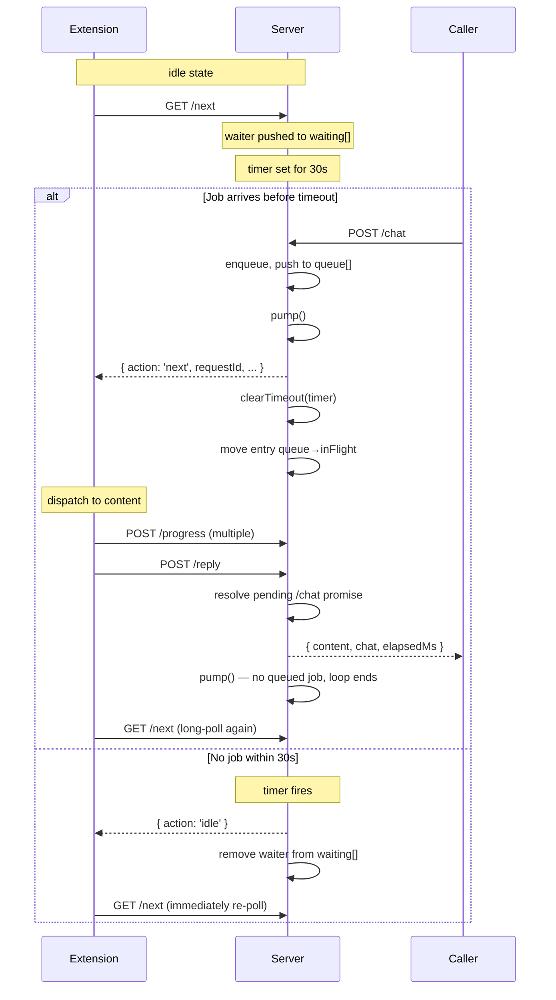
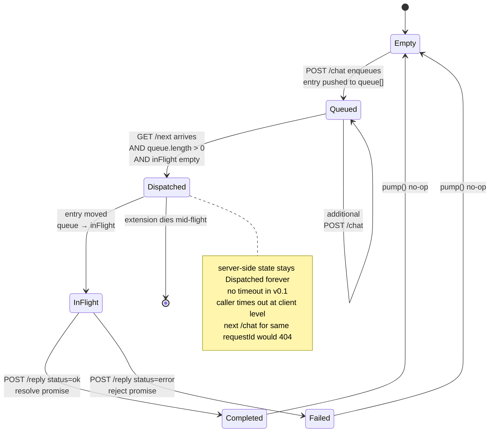

# Protocol

The complete wire contract between the four participants — external caller, server, extension service worker, content script. Every route, every request shape, every response shape, every error shape. This is the reference doc — it does not teach, it specifies.

**Contents**
- [Participants and transport](#participants-and-transport)
- [Authentication](#authentication)
- [Route index](#route-index)
- [Caller routes](#caller-routes)
  - [POST /chat](#post-chat)
  - [POST /open](#post-open)
  - [POST /reset](#post-reset)
  - [GET /tabs](#get-tabs)
- [Extension routes](#extension-routes)
  - [POST /hello](#post-hello)
  - [GET /next](#get-next)
  - [POST /reply](#post-reply)
  - [POST /progress](#post-progress)
- [Long-poll lifecycle](#long-poll-lifecycle)
- [Queue state machine](#queue-state-machine)
- [Extension to content messages](#extension-to-content-messages)
- [Content to extension messages](#content-to-extension-messages)
- [Error response shape](#error-response-shape)
- [Version negotiation](#version-negotiation)
- [Constraints](#constraints)
- [Extending the protocol](#extending-the-protocol)

---

## Participants and transport

Four participants, three transport boundaries:

```
[external caller]                    (curl, Node client, wizard)
        │
        │ HTTP/1.1 over 127.0.0.1
        │ Bearer token auth
        ▼
[terminal server]                    (src/server.js)
        │
        │ HTTP/1.1 over 127.0.0.1
        │ Bearer token auth
        │ caller routes + extension routes share the socket
        ▼
[extension service worker]           (background.js)
        │
        │ chrome.tabs.sendMessage (in-process, no HTTP)
        │ no auth — same extension context
        ▼
[content script]                     (content.js, injected in chat.deepseek.com)
        │
        │ direct DOM manipulation
        ▼
[DeepSeek page]
```

Three rules that constrain everything else:

1. **The server binds loopback only.** `host: '127.0.0.1'` is a hardcoded default in `createServer`. Binding to `0.0.0.0` is not supported by the current options — passing a different host works if you need it, but the intended deployment is loopback-only and the docs and quickstarts all assume it.
2. **The server is one end of every HTTP conversation.** External callers and the extension both connect to it. There is no direct caller-to-extension path, no reverse channel, no push. The extension is a polling client with a long-poll hold, and everything the caller sends reaches the extension only because the server has queued it and the extension has asked for it via `GET /next`.
3. **The extension is single-tab, single-server.** It pins exactly one `chat.deepseek.com` tab in `chrome.storage.local.workTabId` and registers against exactly one server URL. Two servers against one browser profile would fight over `/next` polling and produce interleaved `dispatched` lines for the same request. Not supported. See [Constraints](#constraints).

All request and response bodies are JSON. All requests carry `Content-Type: application/json` when they have a body. All responses carry `Content-Type: application/json` unconditionally. Binary bodies and multipart forms are not used anywhere in this protocol.

---

## Authentication

Every HTTP request — caller or extension — carries:

```
Authorization: Bearer <EXTENSION_TOKEN>
```

`EXTENSION_TOKEN` is a long random string shared by three parties:

1. The operator's `.env` (`EXTENSION_TOKEN=...`), read by `src/server.js` at `createServer({ token })`
2. The extension's `chrome.storage.local.dsc_token`, set once through the popup on first load
3. Any external caller's configuration, generally read from the same `.env` on the same machine

The server compares the token byte-for-byte against the value passed at construction. Mismatch, missing header, or malformed header all produce the same response:

```
HTTP/1.1 401 Unauthorized
Content-Type: application/json

{
  "ok": false,
  "error": "auth_failed",
  "reason": "unauthorized"
}
```

`auth_failed` is a `DSCError` code with `retryable: false, userFixable: true` — the caller must supply the right token; retrying with the same wrong token produces the same 401. See [error-codes.md](error-codes.md).

The token is checked before any route dispatch. A request with a bad token never reaches route logic, never appears in the queue, and never emits a `dispatched` log line — the only evidence is the server-side `! auth fail` log entry showing the method and URL. This is deliberate: unauthorized probes should be cheap to reject and easy to spot.

There is no token rotation, no expiry, no refresh flow, no signature. The token is a shared secret on a loopback socket between processes that all trust each other. Anything more elaborate would be ceremony.

---

## Route index

Nine routes, split into two groups:

**Caller routes** — invoked by external callers. Return success payloads or error responses. Wait for the extension round-trip before responding.

| Method | Path | Auth | Blocking | Returns |
|---|---|---|---|---|
| `POST` | `/chat` | ✓ | yes — waits for extension reply | `{ content, chat, elapsedMs }` |
| `POST` | `/open` | ✓ | yes — waits for extension reply | `{ ok, existing, mode, debug, chat }` |
| `POST` | `/reset` | ✓ | yes — waits for extension reply | `{ ok, chat, result }` |
| `GET` | `/tabs` | ✓ | no — reads cached tab list | `{ ok, tabs }` |

**Extension routes** — invoked by the extension service worker. Most are fire-and-forget or long-poll; none wait on the caller.

| Method | Path | Auth | Blocking | Returns |
|---|---|---|---|---|
| `POST` | `/hello` | ✓ | no | `{ ok, sessionId }` |
| `GET` | `/next` | ✓ | yes — 30s long-poll hold | `{ action: 'next', ... }` or `{ action: 'idle' }` |
| `POST` | `/reply` | ✓ | no | `{ ok }` |
| `POST` | `/progress` | ✓ | no | `{ ok }` |

Unknown routes return:

```
HTTP/1.1 404 Not Found

{ "ok": false, "error": "not_found" }
```

The distinction between caller and extension routes is not enforced — a caller could technically call `/next` and a badly-written extension could call `/chat`. The split is documentation, not security. The one rule that *is* enforced is auth, and only because a leaked token on a loopback socket is still a token leak.

---

## Caller routes

### POST /chat

The main entry point. Send messages, receive the assistant's reply.

**Request:**

```json
{
  "messages": [
    { "role": "user", "content": "Reply with just: hello" }
  ],
  "chat": "my-chat-name",
  "targetTabId": 1234567890
}
```

| Field | Type | Required | Meaning |
|---|---|---|---|
| `messages` | array | ✓ | One or more `{ role, content }` objects. Only `content` is used; `role` is preserved for future multi-turn use but not currently sent to DeepSeek as anything other than a blank-line-joined blob. |
| `chat` | string | ✗ | The DeepSeek chat name to open before sending. If omitted, the server generates `api-<uuid8>`. |
| `targetTabId` | number | ✗ | Explicit tab ID to target. **Deprecated** — the extension uses its sticky work tab instead. Passing this pins the request to that tab if it still exists, and returns `input_not_found` if it doesn't (rather than silently falling back). |

All messages are concatenated with `"\n\n"` between them and sent as a single prompt. The DeepSeek chat gets one turn per `/chat` call; multi-turn conversations are expressed by reusing the same `chat` name across calls, not by sending a `messages` array with history — the extension opens the named chat, which already has prior turns in it, and adds the new prompt as the next turn. See [architecture.md#one-chat-per-source](architecture.md#one-chat-per-source).

**Success:**

```json
{
  "content": "hello",
  "chat": "my-chat-name",
  "elapsedMs": 4300
}
```

| Field | Meaning |
|---|---|
| `content` | Extracted reply. See [Extraction](#extraction) below for how delimiters and code fences are handled. |
| `chat` | The chat name actually used. Echoed back so callers who relied on the generated `api-<uuid8>` default can reuse it for follow-up calls. |
| `elapsedMs` | Wall clock from server receipt of `/chat` to server receipt of `/reply`. Includes queue time plus extension round-trip. |

**Errors:** every `DSCError` code can appear here. The HTTP status is determined by the code's `http` metadata (see [error-codes.md](error-codes.md)). The client library (`src/client.js`) throws `DSCError` on any non-2xx with the code preserved.

**Timeout:** the caller's HTTP client times out at `DEFAULT_CHAT_TIMEOUT_MS` (180s) by default. The server holds the connection open for the full extension round-trip; there is no server-side per-request timeout in v0.1. A wedged extension produces a client timeout, not a server error — the request stays queued or in-flight on the server and its `/reply` (when it eventually arrives) resolves to a `DSCError('extension_timeout')` that nothing is listening for.

**Worked example:**

```bash
curl -s -X POST http://127.0.0.1:7331/chat \
  -H "Authorization: Bearer $EXTENSION_TOKEN" \
  -H "Content-Type: application/json" \
  -d '{
    "messages": [{"role":"user","content":"Reply with just: hello"}],
    "chat": "quickstart"
  }' | python3 -m json.tool
```

```json
{
  "content": "hello",
  "chat": "quickstart",
  "elapsedMs": 4300
}
```

### POST /open

Find or create a chat by name, without sending a prompt. Used by batch wizards to establish the chat before the prompt is ready — for example, to discover whether a chat exists from a prior retry so the LLM sees its own prior turns.

**Request:**

```json
{
  "chatName": "src-alpha"
}
```

| Field | Type | Required | Meaning |
|---|---|---|---|
| `chatName` | string | ✓ | The chat to find or create. Empty string or missing → `400 { error: 'chatName required' }`. |

**Success:**

```json
{
  "ok": true,
  "existing": true,
  "mode": "existing",
  "debug": {
    "sideFound": true,
    "leafCount": 13,
    "leafPreview": ["src-alpha", "src-beta", "..."],
    "name": "src-alpha",
    "path": "/a/chat/s/d3545c8f-b493-4ee3-a727-a554a3d44232"
  },
  "chat": "src-alpha"
}
```

| Field | Meaning |
|---|---|
| `existing` | `true` if a sidebar chat matched `chatName` (fuzzy — contains, case-insensitive); `false` if a fresh `/` chat was used. |
| `mode` | `'existing'` — clicked a sidebar item. `'fresh'` — already on `/`, no navigation needed. `'need_nav'` — content requested navigation, background did it, retried. |
| `debug` | Diagnostic snapshot from the content script: whether the sidebar was found, how many chat leaf items were listed, and the first 8 previews. Useful for debugging fuzzy-match misses without F12. |
| `chat` | Echo of `chatName`. |

**Errors:**

| Case | HTTP | Body |
|---|---|---|
| Missing `chatName` | 400 | `{ ok: false, error: 'chatName required' }` |
| Server queue rejected the enqueue | 500 | `{ ok: false, error: <message> }` |
| Extension reported a failure | 500 | `{ ok: false, error: <DSCError code> }` |

`/open` is not the same as checking if a chat exists — it *navigates* to the chat if it exists. If you want a read-only existence check without navigation, wait for a future `/exists` route (see [Extending the protocol](#extending-the-protocol)).

### POST /reset

Reset a chat. In v0.1, "reset" means re-running the `/open` flow — DeepSeek's delete UI is fragile, and forcing a delete-and-recreate would break the sidebar fuzzy match on every retry, defeating the per-source chat design.

**Request:**

```json
{
  "chatName": "src-alpha"
}
```

**Success:**

```json
{
  "ok": true,
  "chat": "src-alpha",
  "result": {
    "elapsedMs": 271,
    "chat": "src-alpha"
  }
}
```

The `result` field mirrors what `/open` would have returned, minus the `debug` payload (which is dropped by `/reset` — use `/open` directly if you need it).

**Semantics note:** calling `/reset` in v0.1 leaves the chat's history intact and opens it if it exists. A caller who needs to actually clear the history should click through DeepSeek's UI manually, or wait for a future `delete: true` flag on `/reset` (see [Extending the protocol](#extending-the-protocol)). The `/reset` route is provided so that future behavior has a stable URL to hang off — the current behavior is a placeholder.

**Errors:** identical to `/open`.

### GET /tabs

Returns the tab inventory the extension reported on its last `/hello`. Does not query the browser in real time — it's a cached snapshot.

**Request:** no body, no parameters.

**Success:**

```json
{
  "ok": true,
  "tabs": [
    {
      "id": 1695700080,
      "url": "https://chat.deepseek.com/a/chat/s/d3545c8f-b493-4ee3-a727-a554a3d44232",
      "title": "DeepSeek connect continue - DeepSeek",
      "active": true
    }
  ]
}
```

| Field | Meaning |
|---|---|
| `id` | Chrome tab ID. Stable within a browser session, invalidated on tab close. |
| `url` | Full URL. Always matches `https://chat.deepseek.com/*` — non-DeepSeek tabs are filtered out before the list is sent. |
| `title` | First 80 chars of the page title. |
| `active` | Whether the tab is the focused tab in its window at `/hello` time. |

**Staleness:** the cache updates on every `/hello` (extension registration). The extension re-registers on startup, on server reconnect, and on tab URL change. A tab that has been closed but not detected by a `/hello` still appears in `/tabs` until the next registration. Callers who need a fresh list should not rely on `/tabs` alone — they should ensure the extension is polling by checking `/status` (when available; see [Extending the protocol](#extending-the-protocol)), or they should just try `/open` and accept the inevitable `input_not_found` if the tab is gone.

---

## Extension routes

### POST /hello

The extension's registration. Sent on startup, on server reconnect (with backoff 1s/2s/5s/10s max), and on work-tab URL change.

**Request:**

```json
{
  "version": "0.1.0",
  "tabUrl": "https://chat.deepseek.com/",
  "tabs": [
    { "id": 1695700080, "url": "https://chat.deepseek.com/", "title": "DeepSeek - Into the Unknown", "active": true }
  ]
}
```

| Field | Meaning |
|---|---|
| `version` | Extension version, from `shared.js` `DSC.VERSION`. Currently `'0.1.0'`. See [Version negotiation](#version-negotiation) for what the server does with it. |
| `tabUrl` | The URL of the work tab (the one pinned in `chrome.storage.local.workTabId`, or the one just pinned if this is a first registration). Not necessarily `tabUrl` in `tabs[]` — the work tab is always in the list, but so are other DeepSeek tabs. |
| `tabs` | Snapshot of every `chat.deepseek.com/*` tab currently open. Cached by the server; served by `GET /tabs`. |

**Success:**

```json
{
  "ok": true,
  "sessionId": "9c7f8a3b-1d2e-4f6a-8b9c-0d1e2f3a4b5c"
}
```

`sessionId` is a fresh UUID on every `/hello`. The server uses it for logging correlation only — it's not checked on subsequent requests, not required by anything, and rotates on every reconnect. A caller who wants "which extension generation am I talking to" should compare `sessionId` values across `/hello` events rather than assume it's stable.

**Side effects on the server:**

1. Replaces `cachedTabs` with `body.tabs` (if `tabs` is an array)
2. Generates a new `sessionId`
3. Logs `extension connected (<version>) | <tabUrl> | <N> tab(s)`

**Not a queue entry.** `/hello` is not enqueued — it returns immediately, in parallel with any in-flight `/chat`. The extension sends `/hello` frequently (URL changes trigger it), and serializing those against the queue would deadlock the queue during navigation.

### GET /next

The extension's long-poll. Holds for 30 seconds waiting for a queued job; returns `idle` on timeout.

**Request:** no body, no parameters.

**Success (job available):**

```json
{
  "action": "next",
  "requestId": "a4ad2ed9-da51-4410-95fb-085462b5da81",
  "mode": "prompt",
  "chatName": "my-chat",
  "targetTabId": null,
  "prompt": "Reply with just: hello",
  "delimiters": { "start": "START_", "end": "END_" }
}
```

| Field | Meaning |
|---|---|
| `requestId` | UUID. The extension must echo this back in `/reply` and `/progress`. |
| `mode` | `'prompt'` — send a prompt. `'open'` — just ensure the chat exists. `'reset'` — ensure the chat exists, current behavior is identical to `'open'`. See [Modes](#modes) below. |
| `chatName` | The chat name to open before dispatching. Always non-null. |
| `targetTabId` | Deprecated passthrough of what the caller sent. The extension's `getWorkTab()` honors this only if the tab still exists *and* has a `chat.deepseek.com` URL; otherwise it hard-fails with `input_not_found` rather than silently falling back. |
| `prompt` | The prompt text. `null` when `mode !== 'prompt'`. |
| `delimiters` | `{ start, end }` boundaries for extraction. Defaults are `'START_'` / `'END_'` — the boundary tokens that the caller embeds in the prompt so the extension can extract just the code block. See [Extraction](#extraction). |

**Success (no job, timeout after 30s):**

```json
{ "action": "idle" }
```

**No error responses.** `/next` is the polling channel — a `500` here would force the extension to back off, which is exactly what we don't want during a transient server hiccup. Every outcome is either a job or `idle`. If the connection dies mid-poll (extension crashes, browser closes the tab), the server sees `req.on('close')` and removes the waiter from the waiting list.

### POST /reply

The extension's result delivery. Resolves the `/chat` or `/open` or `/reset` promise that the server is holding.

**Request — success:**

```json
{
  "requestId": "a4ad2ed9-da51-4410-95fb-085462b5da81",
  "status": "ok",
  "content": "hello",
  "raw": "hello",
  "trace": [
    { "t": 921, "phase": "reasoning", "len": 20 },
    { "t": 2123, "phase": "answerStarted" },
    { "t": 4930, "phase": "replyDone", "completedBy": "stable", "sawNew": true, "stableLen": 32 },
    { "t": 4931, "phase": "extract", "source": "raw", "contentLen": 32, "rawLen": 32 }
  ]
}
```

**Request — failure:**

```json
{
  "requestId": "a4ad2ed9-da51-4410-95fb-085462b5da81",
  "status": "error",
  "error": "input_not_found",
  "reason": "input_after_new_chat",
  "details": ["input"],
  "probe": { "healthy": [], "degraded": [], "requiredMissing": ["input"] },
  "trace": [...]
}
```

| Field | Required | Meaning |
|---|---|---|
| `requestId` | ✓ | The ID from `/next`. |
| `status` | ✓ | `'ok'` or `'error'`. |
| `content` | when ok + prompt | Extracted reply. See [Extraction](#extraction). |
| `raw` | when ok + prompt | Full assistant message text, before delimiter extraction. Preserved for debugging. |
| `existing` | when ok + open | `true` if a sidebar chat matched, `false` if a fresh `/` was used. |
| `mode` | when ok + open/reset | Same semantics as `/open`'s response. |
| `debug` | when ok + open | Same payload as `/open`'s response. |
| `chat` | when ok | The chat name actually used. |
| `error` | when error | `DSCError` code. Must be one of the 20 registered codes — unknown codes collapse to `internal_error` on the client side. |
| `reason` | when error | Free-form human-readable reason. More specific than the code's generic `human` string. |
| `retryAfter` | when error, retryable | Milliseconds. Used by the caller's retry policy. |
| `details` | when error | Structured details — for `dom_drift`, an array of missing required selector names; for `input_not_found`, the phase where the input was missed. |
| `probe` | when error | The selector-probe snapshot at failure time. Populated by the content script's `fail()` helper. Useful when the error is `dom_drift`. |
| `trace` | always | Array of `{ t, phase, ... }` timing entries from the content script. Preserved for debugging; the server truncates to the last 4 (success) or 8 (failure) lines when logging. |

**Response:**

```json
{ "ok": true }
```

**Behavior:**

1. Looks up `requestId` in `inFlight`. Not found → `404 { error: 'unknown_request' }` (double-reply, stale reply after server restart, or tampered reply).
2. Removes from `inFlight`.
3. On `status: 'ok'`: resolves the pending promise with `{ content, raw, elapsedMs, trace, existing, mode, debug, chat }`. Logs `ok done <requestId> | <N>ms` and the last 4 trace lines.
4. On `status: 'error'`: rejects the pending promise with a `DSCError`-shaped error carrying `{ code, reason, retryAfter, details, probe, trace }`. Logs `x failed <requestId> | <reason>` (or `! DOM DRIFT` for `dom_drift`) and the last 8 trace lines.
5. Calls `pump()` to dispatch the next queued job if there is one.

**`/reply` is not enqueued.** Like `/hello`, it must respond immediately — enqueueing it would deadlock the pump, since pump only advances when `inFlight.size === 0` and `inFlight.size` only drops when `/reply` is processed.

### POST /progress

The extension's live phase telemetry. Fire-and-forget, logged but not stored.

**Request:**

```json
{
  "requestId": "a4ad2ed9-da51-4410-95fb-085462b5da81",
  "phase": "reasoning",
  "extra": { "len": 20 }
}
```

**Response:**

```json
{ "ok": true }
```

**Behavior:** logs `  ~ <id8> <phase> <json(extra)>` to the server console. No storage, no state, no queue interaction, no auth failure path beyond the global 401.

The `extra` field is free-form. Known phases and their `extra` payloads:

| Phase | `extra` | Emitted when |
|---|---|---|
| `probe` | `{ healthy: [...], degraded: [...], requiredMissing: [...] }` | After selector probe at the start of `sendPrompt` |
| `waitInput` | `{ found: boolean }` | After waiting for the input box |
| `toggleDeepthink` | `{ ok: boolean, reason?: string }` | After the DeepThink auto-enable attempt |
| `toggleSearch` | `{ ok: boolean, reason?: string }` | After the Search auto-enable attempt |
| `setInput` | `{ promptLen: number, typedLen: number, msgBefore: number }` | After typing the prompt |
| `sendClick` | `{ ms: number }` | After clicking send |
| `firstMsg` | `{ msgs: number, url: string }` | First time a new assistant message is detected |
| `reasoning` | `{ len: number }` | Periodic — reasoning stream has grown |
| `answerStarted` | *(none)* | First time the answer block (`.ds-assistant-message-main-content`) appears |
| `answer` | `{ len: number }` | Periodic — answer stream has grown |
| `replyDone` | `{ completedBy: string, sawNew: boolean, stableLen: number }` | After the completion detector fires |
| `extract` | `{ source: 'delimiter'\|'fence'\|'raw', contentLen: number, rawLen: number }` | After delimiter extraction |

`/progress` is best-effort — the extension does not retry, does not block, and does not care if the server is down. A caller whose server doesn't implement `/progress` sees normal behavior; the extension's `chrome.runtime.sendMessage({ type: 'dsc_phase' })` just goes nowhere.

---

## Long-poll lifecycle

The `/next` state machine on the server. This is the one place in the protocol where timing is load-bearing — every other route is either immediate (fire-and-forget) or waits on something else.



**Three invariants:**

1. **Every waiter gets exactly one response.** Either a `next` action, or `idle` at 30s, or `idle` at socket close (if the extension hung up mid-poll, the server treats it as a no-op — the waiter is removed, the pending timeout is cleared, and the extension's next `/next` starts a new waiter). A waiter never appears twice in `waiting[]`, never gets two responses, and never leaks.

2. **`pump()` is the only place jobs leave `queue[]`.** It's called at three points: after every `enqueue`, after every `/reply`, and after every `waiting.push`. It's the single serialization point for dispatch. There is no path where a job appears in a caller's response without having passed through `pump()` and `inFlight`.

3. **`inFlight.size <= 1` always.** The `while` condition in `pump()` is `queue.length > 0 && waiting.length > 0 && inFlight.size === 0` — the third clause means only one job can be in-flight at a time. If two jobs are queued and two pollers are waiting, only one dispatches; the second dispatches when the first `/reply` calls `pump()` again. This is what makes the queue serialization work without a mutex — the invariant is structural, not cooperative.

**Why 30 seconds?** `LONG_POLL_MS = 30000` in `src/server.js`. The extension re-polls immediately on `idle`, so the effective polling rate is one request every 30 seconds when idle. Shorter (10s) would be chattier with no benefit; longer (60s) would make the first job after idle wait up to 60s for the poll to return. 30s is a compromise that keeps the queue responsive without filling the server log with idle loops.

---

## Queue state machine

The internal queue `queue[]`, `waiting[]`, `inFlight` map. Understand this if you're modifying `/next`, `/reply`, or `/chat`; skip if you're just calling the API.



**The "extension dies mid-flight" case is the one hole.** If the extension crashes after `/next` returned a job but before `/reply` posts back, the server's `inFlight` map keeps the entry forever. `pump()` never advances because `inFlight.size === 1`. Subsequent `/chat` calls queue up behind it and never dispatch. The caller's HTTP client times out at 180s; the server has no per-request timeout.

Recovery requires restarting the server. This is documented as a v0.1 limitation, not a designed behavior — see [Extending the protocol](#extending-the-protocol) for the planned fix (per-request server-side timeout that auto-cancels and pumps the next queued entry).

Until that fix lands, the mitigation is: if the extension terminal shows a crashed service worker (brave://extensions → the "service worker" link is greyed out) while `/chat` calls are hanging, restart the server. The extension will reconnect on its next startup, but the old `inFlight` entry stays — no restart, no recovery.

---

## Extension to content messages

`chrome.tabs.sendMessage` payloads, dispatched from `background.js` to `content.js` via the service worker. These never touch the HTTP protocol — they're in-process between two extension contexts — but they're documented here because the internal contract must match the external one or the queue silently stalls.

### ensureChat

Find or create a chat by name. Called before every prompt and for every `/open` and `/reset`.

**Message:**

```json
{ "action": "ensureChat", "name": "src-alpha" }
```

**Response (found):**

```json
{ "ok": true, "existing": true, "mode": "existing" }
```

**Response (fresh, already on `/`):**

```json
{ "ok": true, "existing": false, "mode": "fresh" }
```

**Response (needs navigation):**

```json
{ "ok": false, "needNewChat": true, "mode": "need_nav", "path": "/a/chat/s/d3545c8f..." }
```

When the response has `needNewChat: true`, `background.js` navigates the work tab to `https://chat.deepseek.com/` via `chrome.tabs.update`, waits for `chrome.tabs.onUpdated` with `status: 'complete'` (or 15s, whichever comes first), waits an additional 800ms, and retries the `ensureChat` once. If the retry also fails, `input_not_found` is raised.

**Response (failure):**

```json
{ "ok": false, "error": "input_not_found", "reason": "input_after_open_existing", "debug": { ... } }
```

The `debug` payload is always included on failure and on success when `mode !== 'need_nav'`. It contains `{ sideFound, leafCount, leafPreview, name, path }` — everything needed to reproduce the sidebar fuzzy match by hand.

### sendPrompt

Type a prompt into the current chat, click send, wait for completion, extract the reply.

**Message:**

```json
{
  "action": "sendPrompt",
  "prompt": "Reply with just: hello",
  "delimiters": { "start": "START_", "end": "END_" }
}
```

**Response (success):**

```json
{
  "content": "hello",
  "raw": "hello",
  "trace": [ ... ]
}
```

**Response (failure):**

```json
{
  "error": "response_timeout",
  "reason": "no_new_message",
  "details": null,
  "probe": { ... },
  "trace": [ ... ]
}
```

Any content-script-side error is a failure response — the background never sees a thrown exception from `sendToTab`, only `{ error, ... }` payloads. This is by design: the content script owns the DOM and must translate DOM failures into structured errors before they cross the `sendMessage` boundary. A thrown exception in content.js produces a `Receiving end does not exist` error in background, which is treated as "content script crashed" and retried once with `executeScript` re-injection. Two failures in a row → `input_not_found`.

### checkState

Return the current state of the work tab without changing it. Used by the popup's status display, and would be used by a future `/status` route.

**Message:**

```json
{ "action": "checkState" }
```

**Response:**

```json
{
  "inputFound": true,
  "deepThinkOn": true,
  "searchOn": true,
  "currentChatName": "src-alpha"
}
```

### resetChat

Reset the named chat. In v0.1, delegates to `ensureChat` — same semantics as `/reset` at the HTTP layer.

**Message:**

```json
{ "action": "resetChat", "name": "src-alpha" }
```

**Response:** identical to `ensureChat`.

---

## Content to extension messages

`chrome.runtime.sendMessage` payloads, dispatched from `content.js` to `background.js`. Two types:

### dsc_phase

Live phase telemetry. Forwarded to `POST /progress` if there's an active request.

**Message:**

```json
{
  "type": "dsc_phase",
  "phase": "reasoning",
  "extra": { "len": 20 }
}
```

The background tracks `activeRequestId` (set at the start of `handleNext`, cleared on both success and failure). If `activeRequestId` is null — because the content script emits a phase during `checkState` or after a reply has already posted — the message is dropped silently. The `dsc_phase` listener is the *only* `chrome.runtime.onMessage` listener in background.js; a malformed message is ignored.

### state

The popup's live state broadcast. Not part of the protocol — this is internal UI plumbing. Included here so the message type namespace is documented.

**Message:**

```json
{
  "type": "state",
  "state": {
    "connected": true,
    "serverUrl": "http://127.0.0.1:7331",
    "currentChat": "src-alpha",
    "lastError": null,
    "promptsDone": 13,
    "lastHelloAt": 1700000000000,
    "tabs": [ ... ]
  }
}
```

The popup renders from this. There is no request-response between popup and background — the popup reads `chrome.storage.local` on mount and listens for `state` broadcasts thereafter.

---

## Extraction

Between the raw assistant reply and the `content` field of `/chat`, there are three extraction passes. They run in order; the first one that produces non-empty content wins.

**Pass 1 — delimiter extraction.** The caller embeds the delimiters in the prompt. When the LLM replies, its reply contains the delimiters in the text:

```
<sourceName> START_<filename>
[code here]
<sourceName> END_<filename>
```

The content script matches with a regex anchored on line boundaries. Two passes: line-anchored first (preferred — preserves newlines in the extracted content), then whitespace-tolerant (for collapsed single-line blobs where the model or the DOM dropped the newlines).

**Pass 2 — last JS code fence.** If the delimiters are missing (LLM ignored the instruction, or replied without embedding them), the content script falls back to the last ```js or ```javascript fenced block in the reply. This is the original convention the aggregator's `extractCodeFromClipboard` uses.

**Pass 3 — raw.** If neither delimiters nor a JS fence is present (LLM replied with prose, or with a non-JS fenced block), the raw assistant message text is returned as `content`. The `extract` trace phase shows `source: 'raw'` — the caller can distinguish "the extraction fell through" from "the LLM replied with code as expected".

The `trace` array captures which pass fired in the `extract` phase: `{ source: 'delimiter' | 'fence' | 'raw', contentLen, rawLen }`.

---

## Error response shape

Every caller-route error response is `{ ok: false, error: <code>, ... }`. The full `DSCError`-shaped payload is:

```json
{
  "ok": false,
  "error": "rate_limited",
  "reason": "DeepSeek rate limit hit; retry after 30000ms.",
  "retryAfter": 30000,
  "retryable": true,
  "userFixable": false,
  "details": null,
  "trace": [ ... ]
}
```

Not every field is present on every error — `retryAfter` only appears for `rate_limited`, `details` only appears when the content script produces structured data, `trace` only appears when the error originated from the content script. The `error` field is always one of the 20 registered codes; unknown codes are collapsed to `internal_error` by the client library. See [error-codes.md](error-codes.md) for the full table.

---

## Version negotiation

`/hello` carries a `version` field from `shared.js` `DSC.VERSION`, currently `'0.1.0'`. The server logs it:

```
extension connected (0.1.0) | https://chat.deepseek.com/ | 1 tab(s)
```

The server does **not** reject mismatched versions in v0.1. A `0.0.1` extension against a `0.1.0` server gets normal service, and vice versa. The version field is informational only.

The `PROTOCOL_VERSION_MISMATCH` error code exists in `src/errors.js` and its metadata describes the intent (server rejects mismatched major versions, extension displays a reload prompt), but the check itself is deferred — see [Extending the protocol](#extending-the-protocol).

Until then: operators upgrading the server without upgrading the extension (or vice versa) should expect silent behavior changes, not errors. The mitigation is the same as for any pre-1.0 project — treat server and extension as a single versioned unit, upgrade both at the same time.

---

## Constraints

Four constraints that are not obvious from the routes alone:

**1. One work tab.** The extension pins `chrome.storage.local.workTabId` on first use and reuses it for the entire browser session. If that tab closes, `getWorkTab()` returns null and the next request fails with `input_not_found`. There is no tab-rotation, no multi-tab parallelism, no fallback to a different tab. This is a design choice — see [adr/0004-sticky-work-tab-over-target-tab-id.md](adr/0004-sticky-work-tab-over-target-tab-id.md).

**2. One server, one extension, one browser profile.** Two servers on the same profile would each receive half the `/hello` polls and race for `/next`. Not supported. The intended deployment is one server + one extension + one browser profile per machine.

**3. No per-request server-side timeout.** If the extension dies after `/next` returns a job, the server's `inFlight` map blocks the queue forever. Recovery requires restarting the server. See [Queue state machine](#queue-state-machine) for the details and [Extending the protocol](#extending-the-protocol) for the fix.

**4. Loopback only.** The server binds `127.0.0.1` by default. Passing a different `host` works if you have a reason, but the token is the only auth and it's not TLS — running this on a public interface would expose the token and the tab. Don't.

---

## Extending the protocol

Three routes and two flags are designed but not shipped in v0.1. The shape of each is documented here so that a future integrator doesn't invent an incompatible one.

**`GET /status`** — introspection, no blocking. Response: `{ connected, sessionId, currentChat, queued, processing }`. Would replace the ad-hoc `curl /tabs` check that currently serves the same purpose. Deferred because no caller has needed it yet.

**`POST /cancel/:requestId`** — abort an in-flight or queued request. Response: `{ ok, cancelled: boolean }`. Sets `entry.cancelled = true`; `pump()` skips cancelled entries; a reply for a cancelled request is discarded. Returns `{ cancelled: false }` if the request already completed. Deferred because the extension cannot actually abort mid-send — the content script would need a `chrome.runtime.onMessage` listener for an `abort` action, and DeepSeek's send button has no "undo" affordance. The route would cancel the queue slot but not the in-flight DOM operation.

**`GET /health`** — server readiness, no auth. Returns `{ ok: true, version, uptime }` if the server is listening and the extension has polled within 60s, `{ ok: false, error: 'extension_stale' }` otherwise. Intended for a supervisor (systemd `ExecStartPost`, k8s liveness probe) that needs to distinguish "server up" from "extension connected". Deferred because the current deployment model (systemd + manual restart) doesn't use a readiness check.

**Per-request server-side timeout.** Not a route, a behavior change. Every `inFlight` entry gets a `deadline` (default 180s, matching the client timeout). A background timer clears expired entries with `DSCError('extension_timeout')` and calls `pump()`. This is the fix for the "extension dies mid-flight" hole described in [Queue state machine](#queue-state-machine). Deferred because in practice the extension doesn't crash often enough for the queue-blocking bug to bite — when it does, restarting the server is a 2-second fix that doesn't require a protocol change.

**`/reset` with `delete: true`.** Current `/reset` is an alias for `/open` — it doesn't delete the chat. A future `/reset { chatName, delete: true }` would actually delete the chat via DeepSeek's three-dot menu. Deferred because the delete UI is fragile (same reason rename was deferred in stage 3) and no caller has needed a real reset yet.

**Version negotiation.** The `PROTOCOL_VERSION_MISMATCH` error exists in the taxonomy but is never raised. A future version bump to `0.2.0` would introduce a `protocol` field on `/hello`, a matching field on every response, and a rule that major-version mismatch produces `PROTOCOL_VERSION_MISMATCH` on the first request rather than silent behavior drift. Deferred until there's a breaking change to negotiate about.

**Adding a new route — checklist:**

1. Decide: caller route (blocks) or extension route (fire-and-forget or long-poll).
2. If caller: add the route to `src/server.js`, enqueue a `mode`, extend the `pump()` payload if needed, extend `/reply` to resolve the new fields, extend `src/client.js` with a method.
3. If extension: add the route to `src/server.js` and `background.js`, ensure it never calls `pump()` in a way that could re-enter (the queue serialization depends on `pump()` being the only state mover).
4. Add the response shape to this doc under the appropriate section.
5. If the route can fail in a new way, add a code to `src/errors.js` first, then update [error-codes.md](error-codes.md), then raise it from the content or background code.
6. If the change touches an invariant (long-poll, queue serialization, one-tab-per-extension), add an ADR under `docs/adr/` before touching the code.

The order matters: errors before routes, routes before docs, docs before code in a different layer. A route that raises an unregistered error is worse than a route that doesn't exist.