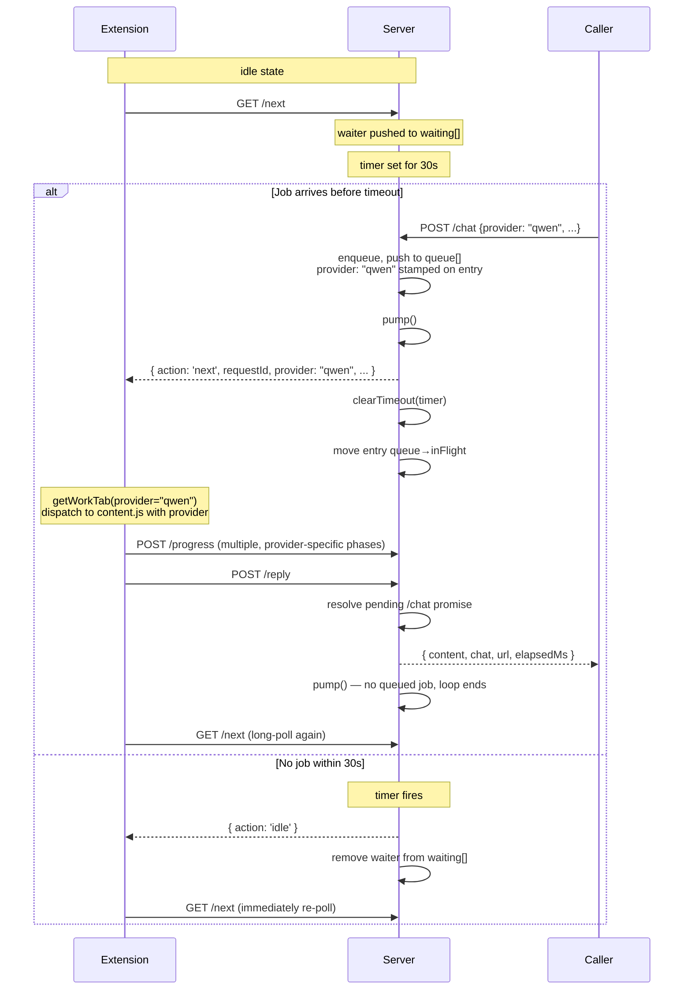
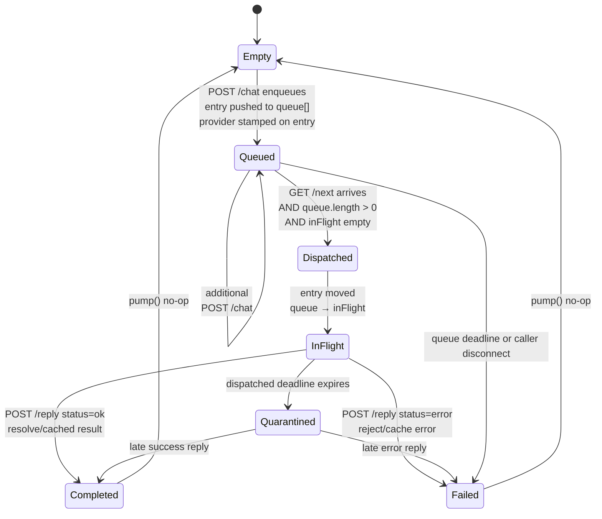

# Protocol

The complete wire contract between the four participants — external caller, server, extension service worker, content script. Every route, every request shape, every response shape, every error shape. Multi-provider is a data field threaded through every layer; the wire shapes reflect it.

**Contents**
- [Participants and transport](#participants-and-transport)
- [Authentication](#authentication)
- [Route index](#route-index)
- [Caller routes](#caller-routes)
  - [POST /chat](#post-chat)
  - [POST /open](#post-open)
  - [POST /reset](#post-reset)
  - [GET /tabs](#get-tabs)
- [Extension routes](#extension-routes)
  - [POST /hello](#post-hello)
  - [GET /next](#get-next)
  - [POST /reply](#post-reply)
  - [POST /progress](#post-progress)
- [Long-poll lifecycle](#long-poll-lifecycle)
- [Queue state machine](#queue-state-machine)
- [Extension to content messages](#extension-to-content-messages)
- [Content to extension messages](#content-to-extension-messages)
- [Provider threading](#provider-threading)
- [Error response shape](#error-response-shape)
- [Version negotiation](#version-negotiation)
- [Constraints](#constraints)
- [Extending the protocol](#extending-the-protocol)

---

## Participants and transport

Four participants, three transport boundaries, one provider-agnostic pipeline:

```
[external caller]                    (curl, Node client, wizard)
        │
        │ HTTP/1.1 over 127.0.0.1
        │ Bearer token auth
        │ body includes `provider` field
        ▼
[terminal server]                    (src/server.js)
        │
        │ HTTP/1.1 over 127.0.0.1
        │ Bearer token auth
        │ caller routes + extension routes share the socket
        │ provider threaded through queue entries
        ▼
[extension service worker]           (background.js)
        │
        │ chrome.tabs.sendMessage (in-process, no HTTP)
        │ no auth — same extension context
        │ provider field included in every message
        ▼
[content script router]              (content.js)
        │
        │ dispatches to DSC_PROVIDERS[msg.provider]
        ▼
[provider module]                    (providers/deepseek.js, providers/qwen.js, ...)
        │
        │ direct DOM manipulation
        ▼
[provider chat page]
```

Four rules that constrain everything else:

1. **The server binds loopback only.** `host: '127.0.0.1'` is a hardcoded default in `createServer`. Binding to `0.0.0.0` is not supported by the current options — passing a different host works if you need it, but the intended deployment is loopback-only.

2. **The server is one end of every HTTP conversation.** External callers and the extension both connect to it. There is no direct caller-to-extension path, no reverse channel, no push. The extension is a polling client with a long-poll hold.

3. **The provider field is validated and threaded.** The server rejects missing or unknown provider names, stores accepted names on the queue entry, and includes them in `/next`. The extension uses the name for exact-host tab routing and provider-module dispatch.

4. **The extension requires exactly one tab per requested provider.** A missing or ambiguous match fails with `ambiguous_provider_tab`; there is no pinned-tab or cross-provider fallback. Requests for all providers serialize through the same queue.

All request and response bodies are JSON. All requests carry `Content-Type: application/json` when they have a body. All responses carry `Content-Type: application/json` unconditionally.

---

## Authentication

Every HTTP request — caller or extension — carries:

```
Authorization: Bearer <EXTENSION_TOKEN>
```

`EXTENSION_TOKEN` is a long random string shared by three parties:

1. The operator's `.env` (`EXTENSION_TOKEN=...`), read by `src/server.js` at `createServer({ token })`
2. The extension's `chrome.storage.local.dsc_token`, set once through the popup on first load
3. Any external caller's configuration, generally read from the same `.env` on the same machine

The server compares the token byte-for-byte against the value passed at construction. Mismatch, missing header, or malformed header all produce the same response:

```
HTTP/1.1 401 Unauthorized
Content-Type: application/json

{
  "ok": false,
  "error": "auth_failed",
  "reason": "unauthorized"
}
```

`auth_failed` is a `DSCError` code with `retryable: false, userFixable: true` — the caller must supply the right token; retrying with the same wrong token produces the same 401. See [error-codes.md](error-codes.md).

The token is checked before any route dispatch. A request with a bad token never reaches route logic, never appears in the queue, and never emits a `dispatched` log line.

There is no token rotation, no expiry, no refresh flow, no signature. The token is a shared secret on a loopback socket between processes that all trust each other. Anything more elaborate would be ceremony.

---

## Route index

Routes are split into caller, extension, and provider-management groups:

**Caller routes** — invoked by external callers. Return success payloads or error responses. Wait for the extension round-trip before responding.

| Method | Path | Auth | Blocking | Provider field | Returns |
|---|---|---|---|---|---|
| `POST` | `/chat` | ✓ | yes — waits for extension reply | request: required `provider` | `{ content, chat, url, elapsedMs }` |
| `POST` | `/open` | ✓ | yes — waits for extension reply | request: required `provider` | `{ ok, existing, mode, url, debug, chat }` |
| `POST` | `/reset` | ✓ | yes — waits for extension reply | request: required `provider` | `{ ok, chat, result }` |
| `GET` | `/tabs` | ✓ | no — reads cached tab list | response: `provider` per tab | `{ ok, tabs }` |
| `GET` | `/status` | ✓ | no — server/extension snapshot | none | `{ ok, registered, extensionResponsive, queued, inFlight, ... }` |
| `GET` | `/version` | ✓ | no | none | `{ ok, version, buildHash }` |
| `GET` | `/providers` | ✓ | no | none | Built-in and configured provider definitions |
| `POST` | `/providers` | ✓ | no | body: `name`, `definition` | Writes a new config provider |
| `PUT` | `/providers/:name` | ✓ | no | body: `definition` | Updates a generated config provider |
| `DELETE` | `/providers/:name` | ✓ | no | none | Deletes a generated config provider |

**Extension routes** — invoked by the extension service worker. Most are fire-and-forget or long-poll; none wait on the caller.

| Method | Path | Auth | Blocking | Provider field | Returns |
|---|---|---|---|---|---|
| `POST` | `/hello` | ✓ | no | `provider` is not a request field | `{ ok, sessionId }` |
| `GET` | `/next` | ✓ | yes — 30s long-poll hold | response: `provider` (echoed from queue entry) | `{ action: 'next', provider, ... }` or `{ action: 'idle' }` |
| `POST` | `/reply` | ✓ | no | not present (reply body has `requestId`; provider implicit) | `{ ok }` |
| `POST` | `/progress` | ✓ | no | not present (phase messages don't carry provider; the phase name itself is provider-specific, see [POST /progress](#post-progress)) | `{ ok }` |

Unknown routes return:

```
HTTP/1.1 404 Not Found

{ "ok": false, "error": "not_found" }
```

---

## Caller routes

### POST /chat

The main entry point. Send messages with a required provider; receive the assistant's reply plus the stable chat URL.

**Request:**

```json
{
  "messages": [
    { "role": "user", "content": "Reply with just: hello" }
  ],
  "chat": "my-chat-name",
  "provider": "qwen",
  "targetTabId": 1234567890,
  "url": "https://chat.qwen.ai/c/..."
}
```

| Field | Type | Required | Meaning |
|---|---|---|---|
| `messages` | array | ✓ | One or more `{ role, content }` objects. Only `content` is used; `role` is preserved for future multi-turn use but not currently sent to providers as anything other than a blank-line-joined blob. |
| `chat` | string | ✗ | The chat name to open before sending. If omitted, the server generates `api-<uuid8>`. |
| `provider` | string | ✓ | Provider name. Built-ins are `deepseek`, `qwen`, and `chatgpt`; configured providers must be enabled in the extension. Missing or unknown values return `bad_request`. `tongyi` is not routable. |
| `targetTabId` | number | ✗ | Optional explicit tab ID. The extension accepts it only when the tab's exact hostname matches `provider`; otherwise it returns `ambiguous_provider_tab`. Without it, exactly one tab must match the provider hostname. |
| `url` | string | ✗ | Optional saved conversation URL. The extension navigates to it before sending, supporting retries in the same conversation. |

All messages are concatenated with `"\n\n"` between them and sent as a single prompt. The chat gets one turn per `/chat` call; multi-turn conversations are expressed by reusing the same `chat` name across calls, not by sending a `messages` array with history — the extension opens the named chat (or navigates to its URL), which already has prior turns in it, and adds the new prompt as the next turn. See [architecture.md#3-one-chat-per-source-url-primary-identity](architecture.md#3-one-chat-per-source-url-primary-identity).

**Validation and limits:** The request must be a JSON object with `Content-Type: application/json`. The body is limited to 1 MiB; `messages` must contain 1-100 objects with a `system`, `user`, or `assistant` role and string `content`; the flattened prompt must not be blank or exceed 250,000 characters. `chat` is a nonblank string up to 200 characters. Optional `targetTabId` must be a positive safe integer. Optional `url` is limited to 2,048 characters and must be HTTPS without credentials/port, on the selected provider's exact configured hostname. Unknown extra fields are ignored for forward compatibility.

An optional `requestId` (1-128 ASCII letters/digits or `._:-`) correlates the caller, queue, extension, progress, and reply. The Node client creates one when omitted. Reusing an ID with a different payload returns HTTP 409. Reusing it with the same payload does not dispatch a second prompt; after a late reply, repeating the same request can retrieve the cached terminal result. The deduplication cache is in memory, bounded to 100 completed requests, and is lost on server restart.

**Success:**

```json
{
  "content": "hello",
  "chat": "my-chat-name",
  "url": "https://chat.qwen.ai/c/ae834e91-aed2-4254-bb12-6b8b7c1dc7d5",
  "elapsedMs": 8123,
  "requestId": "batch-item-1",
  "executionState": "completed"
}
```

| Field | Meaning |
|---|---|
| `content` | Extracted reply. The extraction pass is provider-specific — see [Extraction](#extraction) below. |
| `chat` | The chat name actually used. Echoed back so callers who relied on the generated `api-<uuid8>` default can reuse it for follow-up calls. |
| `url` | **The stable chat URL.** Persist it and pass it to `/chat` when retrying the same conversation, or to `/open` to navigate without sending. Provider-specific format; may be `null` if the provider cannot capture it. |
| `elapsedMs` | Wall clock from server receipt of `/chat` to server receipt of `/reply`. Includes queue time plus extension round-trip. |
| `requestId` | Stable request identity, generated by the server/client if not supplied. |
| `executionState` | `completed` on success. |

**Errors:** errors are returned with `error`, `reason`, `retryable`, `retryAfter` (milliseconds), and `userFixable` metadata; optional `details` and `trace` may also be present. The HTTP status is determined by the code's metadata (see [error-codes.md](error-codes.md)). The client library (`src/client.js`) throws `DSCError` on non-2xx responses. Unknown extension error codes are normalized to `internal_error`; `no_provider_loaded` is not a registered code.

**Provider-specific errors:**

| Code | Raised by | Meaning |
|---|---|---|
| `deepthink_enable_failed` | `providers/deepseek.js` | DeepThink toggle couldn't be verified on. DeepSeek only; Qwen doesn't have this toggle. |
| `search_enable_failed` | `providers/deepseek.js` | Search toggle couldn't be verified on. DeepSeek only. |
| `invalid_response_format` | `providers/qwen.js` | Qwen's reply didn't include the required `START_QWEN_REPLY` / `END_QWEN_REPLY` delimiters. Qwen only; DeepSeek uses a DOM-signal completion detector. |

**Timeout:** the client timeout, queue timeout, and server's dispatched-request timeout are separate. The Node client defaults to 960 seconds; the server defaults to 120 seconds while queued and 960 seconds after dispatch. A caller timeout or abort closes only that caller's connection; it does not cancel provider work. If dispatch may have occurred, the server reports `executionState: "outcome_unknown"` and keeps the in-flight slot quarantined until a late reply or server shutdown. Do not retry under a new ID until the provider tab is checked. Reuse the same request ID to retrieve a late result without dispatching a duplicate.

**Worked example (DeepSeek):**

```bash
curl -s -X POST http://127.0.0.1:7331/chat \
  -H "Authorization: Bearer $EXTENSION_TOKEN" \
  -H "Content-Type: application/json" \
  -d '{
    "messages": [{"role":"user","content":"Reply with just: hello"}],
    "chat": "quickstart",
    "provider": "deepseek"
  }' | python3 -m json.tool
```

```json
{
  "content": "hello",
  "chat": "quickstart",
  "url": "https://chat.deepseek.com/a/chat/s/ae834e91-...",
  "elapsedMs": 4300
}
```

**Worked example (Qwen):**

```bash
curl -s -X POST http://127.0.0.1:7331/chat \
  -H "Authorization: Bearer $EXTENSION_TOKEN" \
  -H "Content-Type: application/json" \
  -d '{
    "messages": [{"role":"user","content":"Reply with just: hello"}],
    "chat": "quickstart-qwen",
    "provider": "qwen"
  }' | python3 -m json.tool
```

```json
{
  "content": "hello",
  "chat": "quickstart-qwen",
  "url": "https://chat.qwen.ai/c/ae834e91-...",
  "elapsedMs": 8123
}
```

The `elapsedMs` difference is real — Qwen's anti-bot pacing adds ~5 seconds of pre-send overhead per prompt. Both providers are serialized through the same queue; a batch that mixes providers will see per-source timing reflecting this.

### POST /open

Find or create a chat by name, without sending a prompt. **Or** navigate directly to a persisted chat URL. Two modes, distinguished by whether `url` is present.

**Request (mode A — find/create by name):**

```json
{
  "chatName": "src-alpha",
  "provider": "qwen"
}
```

**Request (mode B — navigate to persisted URL):**

```json
{
  "chatName": "src-alpha",
  "url": "https://chat.qwen.ai/c/ae834e91-aed2-4254-bb12-6b8b7c1dc7d5",
  "provider": "qwen"
}
```

| Field | Type | Required | Meaning |
|---|---|---|---|
| `chatName` | string | ✓ | The chat name. Used as the response's `chat` field and, in mode A, as the sidebar fuzzy-match target. In mode B, `chatName` is metadata — the navigation is driven by `url`. |
| `url` | string | ✗ | **The primary identity mechanism.** When present, the extension navigates directly to this URL via `chrome.tabs.update`, skipping the sidebar walk entirely. This is the retry path — persist the URL from `/chat`'s response and pass it here. |
| `provider` | string | ✓ | Built-in or enabled config provider. |

**Mode A behavior (no `url`):**

1. The extension resolves exactly one tab for the provider's exact hostname; zero or multiple matches return `ambiguous_provider_tab`.
2. `content.js` dispatches to `provider.ensureChat(chatName)`.
3. The provider's `ensureChat` tries to find a chat matching `chatName`. DeepSeek does a structural sidebar walk; Qwen has no sidebar walk and returns `existing: false, mode: 'fresh'` unconditionally.
4. If a chat is found → navigates to it, returns `{existing: true, mode: 'existing'}`.
5. If not found and the tab is on `/` → uses the fresh page, returns `{existing: false, mode: 'fresh'}`.
6. If not found and the tab is on an existing chat → background navigates to the provider's origin, retries `ensureChat`, returns `{existing: false, mode: 'fresh'}`.

**Mode B behavior (with `url`):**

1. `getWorkTab(provider)` finds the provider's tab.
2. Background navigates directly to `url` via `chrome.tabs.update`.
3. Waits for `chrome.tabs.onUpdated` with `status: 'complete'` (up to 15s).
4. Waits 800ms for React mount.
5. Calls `checkState` on the provider to verify `inputFound: true`.
6. Returns `{existing: true, mode: 'existing', url}`.

**Mode B does not use `ensureChat` at all.** A saved URL must match the selected provider's exact hostname, and after navigation the extension verifies both host and conversation path. Redirects to another host/conversation, stale chats, or a missing input fail explicitly; there is no fallback to a different chat or provider.

**Success:**

```json
{
  "ok": true,
  "existing": true,
  "mode": "existing",
  "url": "https://chat.qwen.ai/c/ae834e91-aed2-4254-bb12-6b8b7c1dc7d5",
  "debug": {
    "sideFound": false,
    "leafCount": 0,
    "leafPreview": [],
    "name": "src-alpha",
    "path": "/c/ae834e91-aed2-4254-bb12-6b8b7c1dc7d5"
  },
  "chat": "src-alpha"
}
```

| Field | Meaning |
|---|---|
| `existing` | `true` if the chat was found (mode A) or a URL was navigated to successfully (mode B). `false` if a fresh `/` was used. |
| `mode` | `'existing'` — found/navigated. `'fresh'` — fresh page used. `'need_nav'` — content requested navigation, background did it, retried. |
| `url` | The chat's URL if it could be captured. In mode B, echoes back the URL that was navigated to. In mode A, comes from the provider's `ensureChat` return (may be `null` if the provider can't determine it, though both shipped providers do). |
| `debug` | Provider-specific diagnostic snapshot. DeepSeek returns `{sideFound, leafCount, leafPreview, name, path}`. Qwen returns `{name, path}`. Presence and shape vary by provider. |
| `chat` | Echo of `chatName`. |

**Errors:**

| Case | HTTP | Body |
|---|---|---|
| Missing `chatName` | 400 | `{ ok: false, error: 'chatName required' }` |
| Server queue rejected the enqueue | 500 | `{ ok: false, error: <message> }` |
| Extension reported a failure | 500 | `{ ok: false, error: <DSCError code> }` |

**`/open` is not a read-only existence check.** In mode A, it *navigates* to the chat if it exists. If you want a read-only check without navigation, wait for a future `/exists` route (see [Extending the protocol](#extending-the-protocol)).

### POST /reset

Reset a chat. In v0.2.0, "reset" means re-running the `/open` flow — DeepSeek's delete UI is fragile, and Qwen doesn't have one. Both providers' `resetChat` are effectively no-ops:

- DeepSeek's `resetChat(name)` delegates to `ensureChat(name)` — behaviorally identical to `/open` mode A.
- Qwen's `resetChat(name)` returns `{ok: true, reason: 'qwen_reset_not_implemented'}` immediately.

**Request:**

```json
{
  "chatName": "src-alpha",
  "provider": "qwen"
}
```

**Success:**

```json
{
  "ok": true,
  "chat": "src-alpha",
  "result": {
    "elapsedMs": 271,
    "chat": "src-alpha"
  }
}
```

**Semantics note:** calling `/reset` in v0.2.0 leaves the chat's history intact and opens it if it exists. A caller who needs to actually clear the history should click through the provider's UI manually, or wait for a future `delete: true` flag on `/reset` (see [Extending the protocol](#extending-the-protocol)).

**Errors:** identical to `/open`.

### GET /status

Authenticated operational snapshot; it does not dispatch work or verify provider login/UI readiness. `extensionResponsive` is a heuristic based on a registered session, a recent poll, or an active waiter/request. `queued` and `inFlight` include request IDs and ages; an in-flight request is not proof the provider is still processing. `tabs` is only a count from the cached `/hello` snapshot.

```json
{
  "ok": true,
  "registered": true,
  "extensionResponsive": true,
  "sessionId": "...",
  "lastHelloAt": 1700000000000,
  "lastPollAt": 1700000000000,
  "port": 7331,
  "queued": [],
  "inFlight": [],
  "tabs": 1
}
```

An empty `tabs` snapshot, `registered: true`, or `extensionResponsive: true` does not prove a specific provider tab is ready. Confirm the provider hostname, login state, tab count, and UI manually when needed.

### GET /tabs

Returns the tab inventory the extension reported on its last `/hello`. Does not query the browser in real time — it's a cached snapshot.

**Request:** no body, no parameters.

**Success:**

```json
{
  "ok": true,
  "tabs": [
    {
      "id": 1695700080,
      "url": "https://chat.deepseek.com/a/chat/s/d3545c8f-...",
      "title": "DeepSeek connect continue - DeepSeek",
      "active": true,
      "provider": "deepseek"
    },
    {
      "id": 1695700091,
      "url": "https://chat.qwen.ai/c/ae834e91-...",
      "title": "Qwen Chat",
      "active": false,
      "provider": "qwen"
    }
  ]
}
```

| Field | Meaning |
|---|---|
| `id` | Chrome tab ID. Stable within a browser session, invalidated on tab close. |
| `url` | Full URL. Always matches one of the domains in `DSC.PROVIDER_DOMAINS` (or the mock fixture). |
| `title` | First 80 chars of the page title. |
| `active` | Whether the tab is the focused tab in its window at `/hello` time. |
| `provider` | **New in v0.2.0.** The provider name for this tab, derived from `DSC.providerForUrl(url)`. `null` if the URL isn't a recognized provider (shouldn't happen — non-provider tabs are filtered out before the list is sent). |

**Usage:** the `provider` field is what makes multi-provider state visible without URL parsing. A caller can check "is there a Qwen tab open?" via `tabs.some(t => t.provider === 'qwen')` instead of pattern-matching URLs. `/tabs` alone doesn't tell you if the extension is *currently* routing to a Qwen tab for a specific request — that's determined at dispatch time by `getWorkTab(provider)`. But for pre-flight checks and debugging, `/tabs` is the surface.

**Staleness:** the cache updates on every `/hello` (extension registration). The extension re-registers on startup, on server reconnect, and on tab URL change. A tab that has been closed but not detected by a `/hello` still appears in `/tabs` until the next registration.

---

## Extension routes

### POST /hello

The extension's registration. Sent on startup, on server reconnect (with backoff 1s/2s/5s/10s max), and on work-tab URL change.

**Request:**

```json
{
  "version": "0.2.0",
  "tabUrl": "https://chat.deepseek.com/",
  "tabs": [
    { "id": 1695700080, "url": "https://chat.deepseek.com/", "title": "DeepSeek - Into the Unknown", "active": true, "provider": "deepseek" }
  ]
}
```

| Field | Meaning |
|---|---|
| `version` | Extension version, from `shared.js` `DSC.VERSION`. Currently `'0.2.0'`. See [Version negotiation](#version-negotiation). |
| `tabUrl` | Informational first provider-tab URL; the server does not use it for routing. The per-tab `provider` fields are the routing signal. |
| `tabs` | Snapshot of every supported provider tab currently open, each with its `provider` name. Cached by the server; served by `GET /tabs`. |

**Success:**

```json
{
  "ok": true,
  "sessionId": "9c7f8a3b-1d2e-4f6a-8b9c-0d1e2f3a4b5c"
}
```

`sessionId` is a fresh UUID on every `/hello`. The server uses it for logging correlation only.

**Side effects on the server:**

1. Replaces `cachedTabs` with `body.tabs` (if `tabs` is an array)
2. Generates a new `sessionId`
3. Logs `extension connected (<version>) | <tabUrl> | <N> tab(s)`

**Not a queue entry.** `/hello` returns immediately, in parallel with any in-flight `/chat`.

**Not provider-scoped.** In v0.2.0, `/hello` reports the entire tab inventory in one registration. There is no per-provider `/hello`. A future version might split this (see [Extending the protocol](#extending-the-protocol)), but for now the extension registers once with all its tabs.

### GET /next

The extension's long-poll. Holds for 30 seconds waiting for a queued job; returns `idle` on timeout.

**Request:** no body, no parameters.

**Success (job available):**

```json
{
  "action": "next",
  "requestId": "a4ad2ed9-da51-4410-95fb-085462b5da81",
  "mode": "prompt",
  "chatName": "my-chat",
  "targetTabId": null,
  "targetUrl": null,
  "provider": "qwen",
  "prompt": "Reply with just: hello",
  "delimiters": { "start": "START_", "end": "END_" }
}
```

| Field | Meaning |
|---|---|
| `requestId` | UUID. Echo in `/reply` and `/progress`. |
| `mode` | `'prompt'` — send a prompt. `'open'` — ensure the chat exists. `'reset'` — reset the chat. See [Modes](#modes) below. |
| `chatName` | The chat name to open before dispatching. Always non-null. |
| `targetTabId` | Deprecated passthrough. Validated against the requested `provider`; hard-fails if the tab doesn't match. |
| `targetUrl` | **New in v0.2.0.** If set, background navigates directly to this URL and skips `ensureChat`. Used by retry-with-persisted-URL. |
| `provider` | **New in v0.2.0.** Which provider module to dispatch to. `background.js` passes this to `getWorkTab(targetTabId, provider)` and to `content.js` via `sendMessage`'s `provider` field. |
| `prompt` | The prompt text. `null` when `mode !== 'prompt'`. |
| `delimiters` | `{ start, end }` boundaries for extraction. Defaults are `'START_'` / `'END_'`. Providers may override (Qwen does — see [POST /chat's provider-specific errors](#post-chat)). |

**Success (no job, timeout after 30s):**

```json
{ "action": "idle" }
```

**No error responses.** Every outcome is either a job or `idle`. If the connection dies mid-poll (extension crashes), the server sees `req.on('close')` and removes the waiter.

### POST /reply

The extension's result delivery. Resolves the `/chat` or `/open` or `/reset` promise that the server is holding.

**Request — success:**

```json
{
  "requestId": "a4ad2ed9-da51-4410-95fb-085462b5da81",
  "status": "ok",
  "content": "hello",
  "raw": "hello",
  "url": "https://chat.qwen.ai/c/ae834e91-...",
  "trace": [
    { "t": 1023, "phase": "step_1_dismiss_modal" },
    { "t": 2014, "phase": "step_2_find_input" },
    { "t": 3512, "phase": "step_3_type_prompt" },
    { "t": 5043, "phase": "step_4_verify_input", "promptLen": 156, "typedLen": 156 },
    { "t": 6042, "phase": "step_5_click_send" },
    { "t": 7541, "phase": "step_6_send_clicked" },
    { "t": 8023, "phase": "step_7_wait_for_reply" },
    { "t": 12087, "phase": "step_8_reply_done", "len": 5 }
  ]
}
```

**Request — failure:**

```json
{
  "requestId": "a4ad2ed9-da51-4410-95fb-085462b5da81",
  "status": "error",
  "error": "invalid_response_format",
  "reason": "Model did not follow delimiter instructions",
  "details": { "rawPreview": "..." },
  "trace": [...]
}
```

| Field | Required | Meaning |
|---|---|---|
| `requestId` | ✓ | The ID from `/next`. |
| `status` | ✓ | `'ok'` or `'error'`. |
| `content` | when ok + prompt | Extracted reply. |
| `raw` | when ok + prompt | Full assistant message text, before extraction. |
| `url` | when ok | **New in v0.2.0.** The chat URL the reply landed in. Required for URL-based retry — persist this. |
| `existing` | when ok + open | `true` if a chat matched or was navigated to. |
| `mode` | when ok + open/reset | Same semantics as `/open`'s response. |
| `debug` | when ok + open | Same payload as `/open`'s response. |
| `chat` | when ok | The chat name actually used. |
| `error` | when error | `DSCError` code. Must be one of the 24 registered codes. |
| `reason` | when error | Free-form human-readable reason. |
| `retryAfter` | when error | Milliseconds; defaults to 0. |
| `details` | when error | Structured details — e.g., `dom_drift`'s missing required selectors, `invalid_response_format`'s `rawPreview`. |
| `trace` | optional | Array of `{ t, phase, ... }` timing entries. **Phase names are provider-specific** — see [POST /progress](#post-progress). |
| `executionState` | optional | `not_dispatched` only when proven; otherwise `outcome_unknown`. |

**Provider field is not echoed in `/reply`.** The reply body carries `requestId`, which the server uses to look up the original queue entry — the provider is implicit from that entry. Adding `provider` to `/reply` would be redundant.

**Response:**

```json
{ "ok": true }
```

**Behavior:** identical to v0.1.x. Looks up `requestId` in `inFlight`, resolves or rejects, calls `pump()`. Not enqueued (would deadlock the pump).

### POST /progress

The extension's live phase telemetry. Fire-and-forget, logged but not stored. **Phase names are provider-specific.**

**Request:**

```json
{
  "requestId": "a4ad2ed9-da51-4410-95fb-085462b5da81",
  "phase": "step_3_type_prompt",
  "extra": { "action": "typing prompt" }
}
```

**Response:**

```json
{ "ok": true }
```

**Behavior:** logs `  ~ <id8> <phase> <json(extra)>` to the server console. No storage, no state, no queue interaction.

**Phase table — DeepSeek (`providers/deepseek.js`):**

| Phase | `extra` | Meaning |
|---|---|---|
| `pageReady` | `{checking}` / `{ready, readyState}` | Document and URL stable before provider interaction |
| `probe` | `{healthy, degraded, requiredMissing}` | Every required selector resolved |
| `preflight` | `{ready, readyState, inputFound, inputEmpty, generating, responseStable}` | Input is available and empty; generation controls and prior response are idle/stable |
| `waitInput` | `{found: bool}` | Chat input found within 5s |
| `toggleDeepthink` | `{ok: bool, reason?}` | DeepThink verified on |
| `toggleSearch` | `{ok: bool, reason?}` | Search verified on |
| `setInput` | `{promptLen, typedLen, msgBefore}` | Prompt typed into input |
| `submitObserved` | `{accepted, inputCleared, generating, assistantCount}` | Provider UI showed evidence the single send click was accepted |
| `sendClick` | `{ms}` | Send button clicked |
| `firstMsg` | `{msgs, url}` | First assistant message appeared |
| `reasoning` | `{len}` | Reasoning stream growing |
| `answerStarted` | *(none)* | Answer block appeared |
| `answer` | `{len}` | Answer stream growing |
| `replyDone` | `{completedBy, sawNew, stableLen}` | Completion detected |
| `extract` | `{source, contentLen, rawLen}` | Extraction ran |

**Phase table — Qwen (`providers/qwen.js`):**

| Phase | `extra` | Meaning |
|---|---|---|
| `pageReady` | `{checking}` / `{ready, readyState}` | Document and URL stable before provider interaction |
| `step_1_dismiss_modal` | `{action: 'checking for age modal'}` | Age modal dismisser ran |
| `step_2_find_input` | `{action: 'locating input field'}` | Searching for textarea |
| `step_2a_preflight` | `{ready, readyState, inputEmpty, generating, assistantCount}` | Empty composer and stable, idle chat verified before paste |
| `step_3_type_prompt` | `{action: 'typing prompt'}` | Prompt injected into input |
| `step_4_verify_input` | `{promptLen, typedLen}` | Input value read back |
| `step_5_click_send` | `{action: 'clicking send button'}` | Waiting for the send control and rechecking the pasted prompt |
| `step_6_send_clicked` | `{ms}` | One send click issued |
| `step_6a_submit_observed` | `{accepted, inputCleared, generating, assistantCount}` | Provider UI showed evidence the click was accepted |
| `step_7_wait_for_reply` | *(none)* | Polling for delimiters |
| `step_7a_first_msg` | *(none)* | First assistant message appeared |
| `step_7b_streaming` | `{len}` | Stream growing (used for timeout diagnostics) |
| `step_8_reply_done` | `{len}` | Both delimiters detected |

**Phase names are validated as short alphanumeric/underscore/dot/hyphen strings, but the phase vocabulary is provider-specific.** New providers may add phases within that shape; callers should remain generic over phase names and correlate events by `requestId`, not rely on a fixed sequence.

ChatGPT and config providers use `gpt_*` and `cfg_*` phases respectively. They report page readiness, preflight state, input verification, send, submission evidence, and response completion using the same lifecycle stages. The service worker additionally reports `tabResolving`, `waitingPageStable`, `providerTabStable`, and `chatReady`; these phases cover tab/navigation work before the provider driver's own checks.

**Automation gates and pacing:** before paste, drivers wait for a complete document with a stable URL, a visible/enabled empty composer, and a stable prior response with no detected generation control. They re-check the composer after insertion, wait for a usable send control to remain available, click once, and wait for evidence that the provider accepted submission before monitoring the reply. A 1-second minimum pause separates browser interaction stages; configured provider pacing can be longer. `input_not_empty_before_send`, `provider_busy_or_not_ready`, `send_control_not_stable`, and `send_not_registered` indicate a guard stopped progress. Do not clear the composer or click send manually until you have checked whether a prompt was already submitted; post-click uncertainty must be reconciled in the provider tab.

**`/progress` is best-effort telemetry.** Delivery is asynchronous and does not change the provider result. The extension logs a bounded warning when reporting fails; the server redacts sensitive fields and bounds trace output. Progress for an unknown or no-longer-active request is rejected/dropped rather than attached to another request. A caller should correlate by `requestId`, not by phase ordering alone. `activeRequestId` is set for the current request and cleared on success/failure; messages without that exact ID are dropped.

---

## Long-poll lifecycle

The extension long-polls with a 30-second hold. One server process dispatches at most one request at a time; successful and failed replies release the slot.



**Three invariants:**

1. Every waiter gets exactly one response — `next`, `idle` at 30s, or `idle` at socket close.
2. `pump()` is the only place jobs leave `queue[]`.
3. `inFlight.size <= 1` always — one job in-flight regardless of provider.

## Queue state machine

The queue is FIFO and provider-blind: provider names are recorded on entries and used only when routing the dispatch. Queue and dispatched-request deadlines default to 120 seconds and 960 seconds, respectively.



Before dispatch, queue expiry or caller disconnect reports `executionState: "not_dispatched"` and removes the entry. After dispatch, a timeout or caller disconnect reports `executionState: "outcome_unknown"`; the in-flight slot remains quarantined, so later requests are not mistaken for the uncertain work. A late reply releases the slot. If none arrives, inspect the provider tab and restart the server only after manual recovery; restarting loses in-memory request identity and cannot prove whether the prompt ran. Reuse the same `requestId` after a late reply to retrieve its cached result rather than submitting a new prompt.

## Extension to content messages

`chrome.tabs.sendMessage` payloads, dispatched from `background.js` to `content.js` via the service worker. **Every message carries a `provider` field** — this is what the router uses to dispatch. Missing `provider` means the router falls back to `'deepseek'` (backward compat for callers that predate v0.2.0, though background always sets it now).

### ensureChat

Find or create a chat by name, or verify a URL navigation landed on a valid page.

**Message:**

```json
{ "action": "ensureChat", "name": "src-alpha", "provider": "qwen" }
```

**Response (found):**

```json
{ "ok": true, "existing": true, "mode": "existing", "url": "https://chat.qwen.ai/c/..." }
```

**Response (fresh):**

```json
{ "ok": true, "existing": false, "mode": "fresh", "url": null }
```

**Response (needs navigation):**

```json
{ "ok": false, "needNewChat": true, "mode": "need_nav", "path": "/a/chat/s/..." }
```

When `needNewChat: true`, `background.js` navigates the work tab to the provider's origin (`new URL(tab.url).origin + '/'`), waits for `status: 'complete'` (or 15s), waits 800ms, and retries `ensureChat` **with the same `provider`**. If the retry also fails, the provider's error code is raised.

**Response (failure):**

```json
{ "ok": false, "error": "input_not_found", "reason": "input_after_open_existing", "debug": { ... } }
```

The `debug` shape is provider-specific. DeepSeek returns `{sideFound, leafCount, leafPreview, name, path}`; Qwen returns `{name, path}`.

### sendPrompt

Type a prompt into the current chat, click send, wait for completion, extract the reply.

**Message:**

```json
{
  "action": "sendPrompt",
  "prompt": "Reply with just: hello",
  "delimiters": { "start": "START_", "end": "END_" },
  "provider": "qwen"
}
```

**Response (success):**

```json
{
  "content": "hello",
  "raw": "hello",
  "url": "https://chat.qwen.ai/c/...",
  "source": "strict_delimiter",
  "trace": [...]
}
```

The `source` field is provider-specific — DeepSeek returns `'delimiter'`, `'fence'`, or `'raw'`; Qwen returns `'strict_delimiter'` on success (it doesn't have a fence or raw fallback — if the delimiters aren't there, it fails).

**Response (failure):**

```json
{
  "error": "invalid_response_format",
  "reason": "Model did not follow delimiter instructions",
  "details": { "rawPreview": "..." },
  "trace": [...]
}
```

### checkState

Return the current state of the work tab without changing it.

**Message:**

```json
{ "action": "checkState", "provider": "deepseek" }
```

**Response (DeepSeek):**

```json
{
  "inputFound": true,
  "deepThinkOn": true,
  "searchOn": true,
  "currentChatName": "src-alpha"
}
```

**Response (Qwen):**

```json
{
  "inputFound": true,
  "currentChatName": "Qwen Chat",
  "loggedOut": false
}
```

Field sets vary by provider. `inputFound` is the only field the router/background rely on — it's the "is this page usable" check after URL navigation.

### resetChat

Reset the named chat.

**Message:**

```json
{ "action": "resetChat", "name": "src-alpha", "provider": "qwen" }
```

**Response (DeepSeek):** identical to `ensureChat`.

**Response (Qwen):** `{ "ok": true, "reason": "qwen_reset_not_implemented" }`.

## Content to extension messages

`chrome.runtime.sendMessage` payloads, dispatched from the provider modules (via the router context) to `background.js`. Two types:

### dsc_phase

Live phase telemetry. Forwarded to `POST /progress` if there's an active request.

**Message:**

```json
{
  "type": "dsc_phase",
  "phase": "step_7b_streaming",
  "extra": { "len": 456 }
}
```

The background tracks `activeRequestId` (set at the start of `handleNext`, cleared on both success and failure). If `activeRequestId` is null, the message is dropped silently. The phase name and `extra` shape are entirely provider-defined — background does not validate them, just forwards the whole message to `/progress`.

### state

The popup's live state broadcast. Not part of the protocol — internal UI plumbing.

**Message:**

```json
{
  "type": "state",
  "state": {
    "connected": true,
    "serverUrl": "http://127.0.0.1:7331",
    "currentChat": "src-alpha",
    "lastError": null,
    "promptsDone": 13,
    "lastHelloAt": 1700000000000,
    "tabs": [ ... ]
  }
}
```

---

## Provider threading

Where `provider` appears and where it doesn't. Useful for understanding which layer is responsible for what when a multi-provider request fails.

| Layer | Field | Direction | Required | Behavior |
|---|---|---|---|---|
| **Caller → Server** | `provider` on `/chat` | request | required | Validated against built-ins and enabled config providers. |
| **Caller → Server** | `provider` on `/open` | request | required | Same. |
| **Server queue** | `provider` on queue entry | internal | always set | Stamped at `enqueue()`; used only for `/next` payload. |
| **Server → Extension** | `provider` on `/next` | response | always present | Echoed from queue entry. |
| **Extension → Content** | `provider` on `sendMessage` | request | always present | `handleNext` reads from `work.provider` and passes to every `sendToTab` call. |
| **Content router** | `msg.provider` | dispatcher | always present | `DSC_PROVIDERS[provider]` lookup; unknown provider is an internal registration failure. |
| **Extension → Server** | — | n/a | — | `/reply` and `/progress` don't carry `provider` — the `requestId` identifies the original entry, which has the provider. |
| **Server → Caller** | — | n/a | — | `/chat` response doesn't echo `provider` — the caller knows what they sent. If you need to verify, check `url`'s domain. |

**The `provider` string is never transformed.** Names are case-sensitive; the server rejects an unknown name as `bad_request`. Config provider names are available only after they are configured and enabled.

**`provider` is a data field, not control flow.** No module except `content.js` and `background.getWorkTab` branches on it. `src/server.js` threads it through without inspecting it. If you're tempted to add `if (provider === 'qwen') { ... }` to the server, that's a design signal — the behavior belongs in the provider module or in `content.js`'s dispatch, not in the queue.

---

## Extraction

Between the raw assistant reply and the `content` field of `/chat`, each provider applies its own extraction passes. **The extraction strategy is provider-specific** — there is no shared "extract the answer" function.

**DeepSeek** — three passes, first non-empty wins:

1. **Delimiter** — matches `START_<file>` / `END_<file>` boundaries the caller embedded in the prompt. Two regex passes: line-anchored (preferred, preserves newlines), then whitespace-tolerant (for single-line collapsed blobs).
2. **Last JS fence** — falls back to the last ```js block if delimiters are missing.
3. **Raw** — returns the whole `.ds-assistant-message-main-content` text if no delimiters and no fence.

The `extract` trace shows `source: 'delimiter' | 'fence' | 'raw'`.

**Qwen** — one pass, no fallback:

1. **Strict delimiter** — requires both `START_QWEN_REPLY` and `END_QWEN_REPLY` to appear in the DOM. If missing, fails with `invalid_response_format` rather than returning partial content.

The `extract` trace shows `source: 'strict_delimiter'` on success. There's no `source: 'raw'` for Qwen — the provider never returns raw content.

The reason for the difference is documented in [architecture.md#6-answer-block-extraction-over-whole-message](architecture.md#6-answer-block-extraction-over-whole-message): DeepSeek has a reliable DOM signal (`.ds-assistant-message-main-content`) that distinguishes answer from reasoning; Qwen doesn't, so it uses content delimiters. Each provider chose the strategy its DOM can support.

**Callers who need consistent extraction** across providers should embed the delimiters in the prompt. DeepSeek will find them via pass 1; Qwen requires them. Both return `source: 'delimiter'`-family on success.

---

## Error response shape

Every caller-route error response is `{ ok: false, error: <code>, ... }`. The full `DSCError`-shaped payload is:

```json
{
  "ok": false,
  "error": "rate_limited",
  "reason": "DeepSeek rate limit hit; retry after 30000ms.",
  "retryAfter": 30000,
  "retryable": true,
  "userFixable": false,
  "details": null,
  "trace": [ ... ]
}
```

Not every field is present on every error — `details` and `trace` are optional. `retryAfter` is included in server error bodies and is in milliseconds. The `error` field is one of the 24 registered codes; unknown codes are collapsed to `internal_error` by the client library.

**Provider-specific errors:**

- `invalid_response_format` — Qwen's delimiters were not present. `retryable: false, userFixable: false, http: 502`; the prompt has been submitted, so inspect the conversation before deciding whether to send another prompt.
- Provider registration failures are not represented by a `no_provider_loaded` public code. Check the configured provider state, extension console, and registration settings.

See [error-codes.md](error-codes.md) for the full table.

---

## Version compatibility

`/hello` carries a `version` and extension `buildHash`. The server rejects a build-hash mismatch with `version_mismatch`; the extension attempts to reload itself and the provider tab after receiving this response. The version string is informational; there is no general protocol-version negotiation.

```
extension connected (0.2.0) | https://chat.deepseek.com/ | 2 tab(s)
```

`protocol_version_mismatch` remains registered but is not emitted by current code. Keep the extension and server from the same checkout/build; after extension changes, reload the extension and hard-reload provider tabs so their injected content scripts are current.

**Cross-version compatibility** is not guaranteed. `/hello` rejects an extension build hash that does not match the server's expected hash. Other wire differences may still exist between independently updated clients and servers.

| Client | Server | Extension | DeepSeek works | Qwen works |
|---|---|---|---|---|
| v0.1.x (no provider field) | v0.2.0 | v0.2.0 | ✗ (provider is required) | ✗ (client can't request it) |
| v0.2.0 | v0.1.x | v0.2.0 | Not supported; old server behavior is not a compatibility guarantee | ✗ (v0.1 server can't route) |
| v0.2.0 | v0.2.0 | v0.1.x | ✓ | ✗ (old extension has no qwen module) |

**Upgrade server and extension together.** The extension's build hash must match the server build. External clients are not build-hash checked, but must follow the required provider and request validation contract.

---

## Constraints

Operational constraints that are not obvious from the routes alone.

**1. Exactly one matching tab per request.** `resolveWorkTab()` matches the requested provider's exact hostname. Zero or multiple matches fail with `ambiguous_provider_tab`; it never picks an arbitrary tab. There is no tab-rotation or multi-tab parallelism per provider. Requests serialize through the queue.

**2. One configured server per extension.** The extension polls the configured loopback port; it does not broadcast to multiple servers. A server may have multiple clients, but this implementation's in-memory queue is single-process state.

**3. Separate deadlines and uncertain dispatch.** The server defaults to a 120-second queue deadline and 960-second dispatched-request deadline. Once dispatched, timeout does not prove the provider did not receive the prompt; the slot remains quarantined until a late reply or server shutdown. Caller timeout/abort is not cancellation. See [Queue state machine](#queue-state-machine).

**4. Loopback by default.** The server binds `127.0.0.1` unless configured otherwise. The token is bearer authentication, not TLS; do not expose the server on an untrusted network.

**5. Provider names are case-sensitive and exact.** `'deepseek'`, not `'DeepSeek'`. `'qwen'`, not `'Qwen'`. `'tongyi'`, not `'tongyi.aliyun.com'`. The lookup in `content.js` is `DSC_PROVIDERS[msg.provider]` — JavaScript object key semantics apply.

**6. Built-in and config providers have different registration flows.** Built-in drivers are loaded by extension code and require maintainer changes. Selector-based config providers are registered through the Providers page and can be enabled per machine. See [providers.md](providers.md).

---

## Extending the protocol

The following features remain intentionally unimplemented:

**`GET /status`** — shipped. Authenticated snapshot of extension registration/poll heuristic, port, cached tab count, queued and in-flight request IDs, states, and ages. It is not proof of provider UI readiness.

**`POST /cancel/:requestId`** — not implemented. Closing the caller connection or aborting the Node client is not cancellation; provider work may continue.

**`GET /health`** — server readiness, no auth. Returns `{ ok: true, version, uptime, providers }` if the server is listening and the extension has polled within 60s, `{ ok: false, error: 'extension_stale' }` otherwise. Deferred because the current deployment model (systemd + manual restart) doesn't use a readiness check.

**Request deadlines.** Shipped: queue expiry removes definitely undispatched work; dispatched expiry reports uncertain outcome and quarantines the queue slot until a late reply or shutdown. See [Queue state machine](#queue-state-machine).

**`/reset` with `delete: true`.** Current `/reset` is a no-op alias. A future `/reset { chatName, delete: true }` would actually delete the chat via the provider's UI. Requires each provider to implement `deleteChat(name)` — DeepSeek via three-dot menu (fragile), Qwen via whatever Qwen's delete UI is (currently none observed). Deferred.

**Per-provider `/hello`.** Current `/hello` registers the whole tab inventory in one call. A future version might split by provider so that a Qwen tab change doesn't invalidate the DeepSeek tab's registration. Deferred because two providers don't justify it; three or more would.

**General protocol negotiation.** Build hash mismatch is enforced during `/hello`, but the `protocol_version_mismatch` code is not currently emitted and there is no per-route version negotiation.

**Rate-limit auto-pivot.** A future flag on `/chat` — `pivotOnRateLimit: ['qwen', 'tongyi']` — would retry the request on the next provider in the list when the current provider returns `rate_limited`. Deferred because it's a policy decision, not a protocol concern. The wizard layer (aggregator `paste-extension.js`) can implement pivot by catching `rate_limited` and re-sending with a different `provider` field — no protocol change required. This is the recommended approach for now.

**Adding a new route — checklist:**

1. Decide: caller route (blocks) or extension route (fire-and-forget or long-poll).
2. If caller: add the route to `src/server.js`, enqueue a `mode`, extend the `pump()` payload if needed, extend `/reply` to resolve the new fields, extend `src/client.js` with a method.
3. If extension: add the route to `src/server.js` and `background.js`, ensure it never calls `pump()` in a way that could re-enter.
4. Add the response shape to this doc under the appropriate section.
5. If the route can fail in a new way, add a code to `src/errors.js` first, then update [error-codes.md](error-codes.md), then raise it from the provider or background code.
6. If the change touches an invariant (long-poll, queue serialization, one-tab-per-provider, provider threading), add an ADR under `docs/adr/` before touching the code.

The order matters: errors before routes, routes before docs, docs before code in a different layer. A route that raises an unregistered error is worse than a route that doesn't exist.


## Provider management endpoints (config providers)

All require the Bearer token.

| Route | Body | Result |
|---|---|---|
| `GET /providers` | | `{ ok, providers: [{ name, file, kind: 'built-in' or 'config', definition or null }] }` |
| `POST /providers` | `{ name, definition }` | `{ ok, written }`. 400 on invalid name/definition/built-in/reserved name/domain clash, 409 if the file exists. |
| `PUT /providers/:name` | `{ definition }` | Rewrites a generated file (tmp + rename). 400 for built-ins or hand-written files. |
| `DELETE /providers/:name` | | Removes a generated file. 400 for built-ins or hand-written files, 404 if missing. |

`name` must match `^[a-z][a-z0-9_-]{0,30}$`. The server renders the file from a fixed template and
compile-checks it without executing. Every work request's `provider` must be a built-in or a
`providers/*.js` stem.
